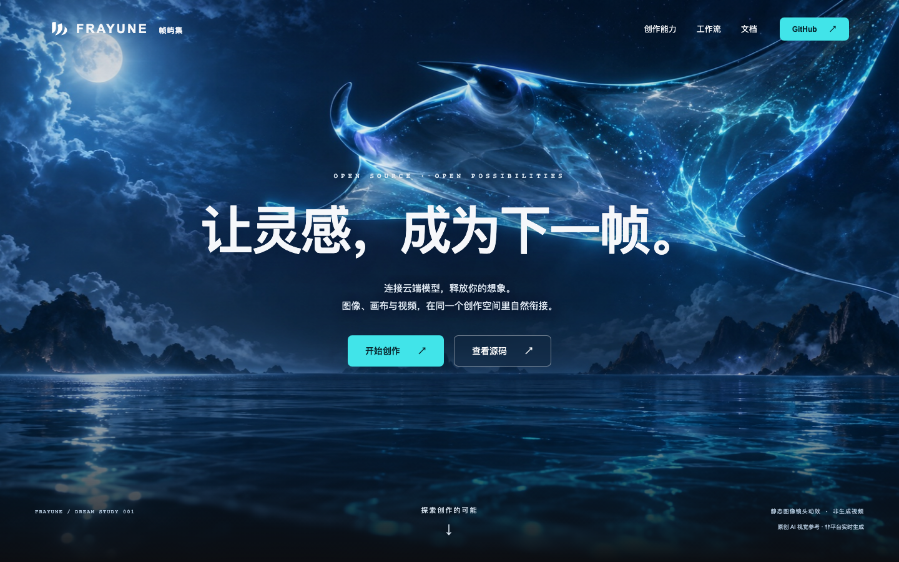

<div align="center">

<a href="https://weilengdezaoshang.github.io/aiVideo/">
  
</a>

# 帧屿集 FRAYUNE

让灵感，成为下一帧。

连接外部云模型的开源 AI 视觉创作平台。统一组织图像生成、画布编辑与视频创作，让灵感成为作品。

[浏览项目主页](https://weilengdezaoshang.github.io/aiVideo/) · [快速开始](#快速开始) · [功能概览](#功能概览) · [开发文档](AGENTS.md)

[](https://github.com/weilengdezaoshang/aiVideo/actions/workflows/ci.yml)
[](LICENSE)
[](https://nodejs.org/)
[](https://www.typescriptlang.org/)

云模型 API &nbsp; / &nbsp; 统一创作工作台 &nbsp; / &nbsp; React + TypeScript · Python + FastAPI

</div>

---

## 从一个想法，到一段作品

| 01 / 图像 | 02 / 画布 | 03 / 视频 |
| --- | --- | --- |
| **让文字，有了画面。** | **给灵感，展开的空间。** | **让下一帧，动起来。** |
| 文生图、参考图生图与局部重绘，逐步调整理想画面。 | 编排素材、检查抠图蒙版、保存创作文档。 | 参考图生成视频，单轨时间线整理片段，导出 MP4。 |

> 帧屿集通过外部云模型 API 提供生成能力，无需在本地部署图像或视频生成模型。平台负责工作台、任务与素材管理，支持自行部署。具体能力取决于接入的云模型；Mock 仅用于开发演示。项目主页和封面为展示内容，不是在线生成服务。

<details>
<summary>阅读导航 · 配置、接口与工程说明</summary>

- [快速开始](#快速开始) · [抠图与导出](#抠图与导出) · [源码开发](#源码开发)
- [云模型接入](docs/百炼生图接入.md) · [模型配置](#模型配置)
- [API 一览](#api-一览) · [项目结构](#项目结构) · [测试与校验](#测试与校验)
- [运行架构与兼容范围](#运行架构与兼容范围) · [时间线与 MP4 导出](#时间线与-mp4-导出)
- [品牌资源](docs/brand/frayune/README.md) · [项目主页维护](website/README.md)

</details>

## 代码与部署状态

新版平台源码已同步到本仓库：`apps/api` 为 Python/FastAPI 服务，`apps/web` 为 React/TypeScript 工作台与画布。云模型通过服务端 Provider 接入，API Key 不写入官网或浏览器静态资源。

[GitHub Pages 官网](https://weilengdezaoshang.github.io/aiVideo/) 仅提供产品介绍。运行创作平台请按下方步骤部署应用并配置云模型；发布源码不代表云 API 服务已经在线部署。

### 创作入口

所有启动方式共用 PostgreSQL / RabbitMQ / Redis / Celery 后端。百炼模型通过固定路由与 Worker 凭据接入，详见[配置步骤](docs/百炼生图接入.md)。后续多项目共用 Key 的规划：[统一模型网关方案](docs/统一模型网关方案.md)。

当前创作入口为 `/workspace` 与 `/canvas`，旧版独立生成面板已下线。

工作台 `/workspace` 与画布 `/canvas` 使用 React + TypeScript，画布渲染基于 Konva，公共组件位于 `apps/web/ui`。`npm run dev` 自动构建并监听前端；生产构建运行 `npm run build:web`。组件拆分、素材与验证说明见 [React 创作首页](apps/web/workspace/IMPLEMENTATION.md)。

<a id="功能概览"></a>

## 功能概览

- **云模型创作** —— 文生图、图生图、局部重绘与图生视频；实际可用模式由接入的服务和模型决定，不同模型的能力不完全相同。
- **生成参数** —— 选择模型、尺寸与批量数量；其余参数按所选服务能力提供，不要求云模型支持本地采样器、步数或 CFG。
- **任务执行** —— PostgreSQL 事务受理、RabbitMQ 投递、Celery 分阶段执行；SSE 进度、取消、原任务对账与故障恢复
- **结果管理** —— 画布预览、素材管理、下载与删除，生成历史保存在服务端数据库。
- **任务历史** —— 最近任务状态一览(状态点 + 重试入口)
- **持久化** —— PostgreSQL 保存文档、任务、历史与资产元数据，共享媒体卷保存图像/视频；产物收据支持故障后恢复
- **健壮性** —— 参数校验、统一 JSON 错误、队列上限保护、优雅停机、结构化日志
- **云模型接入** —— 通过 Provider 统一适配外部模型 API；保留 Mock 开发演示和可选 ComfyUI 适配。

<a id="快速开始"></a>

## 快速开始

应用只有一套数据库后端。需要 PostgreSQL、RabbitMQ、Redis、OIDC 身份服务与 HTTPS 入口；开发也使用同一套业务架构。Mock 是生成 Provider，不是免数据库的运行模式。

```bash
npm ci
cp -n .env.production.example .env
# 在自己的编辑器中填写 .env：身份、域名、数据库密码、固定路由与凭据文件路径。
# 无付费调用验证可使用 deploy/provider-routes.mock.json 与空的 mock credentials 文件。
docker compose config --quiet
npm run stack:up
```

打开配置的 `AIVERO_PUBLIC_ORIGIN`。登录用户需要通过管理员 CLI 授予工作区成员权限；不会自动创建公开工作区。
完整配置、授权和旧数据导入见[部署手册](docs/runbooks/production-cutover.md)。只创建 `.env` 或选择 Mock 不会自动配置真实 OIDC。

### 源码开发

```bash
python3.11 -m venv .venv
.venv/bin/python -m pip install -r requirements-dev.txt
npm run dev -- --env-file /absolute/path/to/dev.env
```

热重载只改变开发体验，仍使用数据库 API 和独立 Worker。宿主开发需提供可访问的独立数据库/Redis、OIDC、路由和共享媒体目录，详见部署手册；Compose 内部服务默认不向宿主公开端口。
`npm start` 使用相同入口但不热重载；`backend.production:create_app` 保留为同一工厂的兼容名称。旧 `AIVERO_API_MODE` 开关已移除，不读取根 `config.json` 选择运行方式。

### 抠图与导出

rembg 直接在 API 的单推理线程运行，无需 7100 服务；首次请求加载 `CUTOUT_MODEL` 对应模型，权重复用但识别结果不缓存。识别蒙版以临时 data URL 返回，确认后生成独立 PNG Asset。取消/超时需等待原生线程完成才释放槽位。
导出进入独立 `exports` Worker，由 FFmpeg 处理时间线快照并通过统一产物协议保存成片。当前新版画布的完整导出界面还未接通。

### 模型配置

云模型、Mock、ComfyUI 都在 `provider-routes.json` 固定 endpoint、实际模型和 `configVersion`；云端只保存 `credentialRef`，真实密钥挂载到生成 Worker。应用不再提供开发模式下的网页改密钥入口。
百炼配置见[云模型接入](docs/百炼生图接入.md)。ComfyUI 需自行部署并在路由指定 `provider=comfyui`、`comfyUrl` 及图片/视频模型；模型能力以当前适配器为准。

## API 一览

| 方法 | 路径 | 说明 |
| --- | --- | --- |
| GET | `/api/health` | 服务与后端状态 |
| GET | `/api/models` | 固定 Provider 路由对应的模型列表 |
| GET | `/api/samplers` | 兼容前端的采样器与调度器选项 |
| POST | `/api/generate` | 提交生成任务(202 + jobId);`initImage` 可选 data URL,`maskImage`(PNG,白 = 重绘)为局部重绘蒙版 |
| GET | `/api/jobs` | 进行中任务;`?all=1` 返回最近任务历史 |
| GET | `/api/jobs/:id` | 单个任务状态 |
| DELETE | `/api/jobs/:id` | 取消任务 |
| GET | `/api/history?limit=100` | 历史记录(新 → 旧) |
| PUT | `/api/images/:id/star` | 设置 / 取消收藏 |
| DELETE | `/api/images/:id` | 从历史索引隐藏图片，保留资产与任务记录 |
| GET | `/api/events` | SSE 实时事件(snapshot / job / image) |

生成请求由已登录的同源浏览器提交，需携带会话 Cookie、CSRF 请求头与稳定的 `requestId`；重试时复用同一个 ID。使用仓库 Mock 路由时，请求体示例：

```json
{
  "requestId": "8c833bb9-5821-4bd1-b10b-f9bd7d29adbc",
  "prompt": "一只宇航员猫，霓虹灯",
  "model": "mock-test",
  "batchCount": 2
}
```

## 项目结构

本项目使用 npm workspaces，前后端仍属于同一个独立 Git 仓库。统一在仓库根目录执行 `npm run dev`、`npm run verify`；也可使用 `npm run dev --workspace @frayune/api` 和 `npm run build --workspace @frayune/web`。迁移记录见 [monorepo 迁移说明](docs/monorepo-migration.md)。

```text
aiVideo/
├── apps/
│   ├── api/
│   │   ├── package.json         # @frayune/api：Python 服务命令入口
│   │   └── backend/             # FastAPI、队列、Provider、存储
│   └── web/                     # @frayune/web：React + TypeScript
│       ├── landing/             # 落地页
│       ├── workspace/           # 创作工作台
│       ├── canvas/              # 画布核心、状态与 React/Konva 渲染
│       ├── canvas-next/         # React 画布应用入口
│       ├── ui/                  # 前端共享组件
│       └── shared/              # 前端共享逻辑
├── scripts/                     # 开发启动、构建、评测 CLI
├── tests/                       # TypeScript 测试及 backend/ pytest
├── evals/                       # 中文评测用例与规则
├── docs/                        # 技术方案与实施提示词
├── package.json                 # npm workspaces 与统一命令
├── package-lock.json            # 全仓库共用 npm 锁文件
├── pyproject.toml               # Python 检查配置
├── requirements-dev.txt         # Python 开发依赖，使用根目录 .venv
├── .env.production.example      # 统一部署配置模板
├── compose.execution.yaml       # 数据库、消息、调度与 Worker
├── compose.production.yaml      # API、OIDC 与 HTTPS 网关
└── docker-compose.yml           # 合并为统一应用栈
```

**核心数据流**：

```text
浏览器 → FastAPI → PG 事务（Job + Outbox）→ Dispatcher → RabbitMQ → Bridge → Celery Worker
             ↑                                                        ↓
             └── SSE ← PG 状态投影 ← Notify / Redis 唤醒 ← 状态与产物登记 ← StagedProvider
```

生成通过 `providers/staged.py` 的 prepare/submit/poll/cancel 阶段执行；产物先写共享媒体卷与 receipt，再登记 Asset。图片、视频和导出使用独立队列。租约/epoch 防止失联 Worker 晚到覆盖状态，unknown 提交不盲目重试。
历史 FIFO HTTP 实现仅保留于 `evaluation/sandbox.py`，供隔离评测和兼容测试显式调用，不属于可部署应用入口。

## 测试与校验

```bash
npm run verify          # 前端 typecheck / eslint / node:test + 后端 ruff / pytest
PYTHONPATH=apps/api .venv/bin/python tests/integration/compose_smoke.py # 显式隔离部署冒烟
npm run format          # prettier 统一格式
```

CI 同时安装 Node 与 Python 3.11，运行前端类型检查、ESLint、node:test，以及后端 Ruff、pytest。

## Roadmap / TODO

- [x] 核心流程:提示词 → 队列 → 生成 → 画布结果 → 历史持久化
- [x] 采样器 / 调度器选择(选项来自后端能力探测)
- [x] 图生图(参考图上传 + 重绘幅度)
- [x] 局部重绘(Inpainting)—— 前端蒙版画板 + ComfyUI SetLatentNoiseMask / Mock 蒙版合成链路
- [x] 图生视频 Mock 链路(动画占位产物,前端播放支持)
- [x] ComfyUI 图生视频工作流 —— LTX-Video(单 checkpoint)与 Wan / Wan2.2 双 UNet 链路,SaveVideo 出 mp4
- [x] 收藏 / 过滤 / 批量下载 / 任务历史 / 失败重试
- [x] 工程化:verify 门禁、husky、CI、Docker、e2e 冒烟脚本
- [ ] **ComfyUI 真实环境校准** —— 在真实 GPU 上验证图像、视频与重绘工作流(超时与视频模型已可配置)
- [ ] 指令式图片编辑 —— 接入 Qwen-Image-Edit / FLUX.1 Kontext
- [ ] LoRA / ControlNet 支持
- [ ] 云端 GPU 部署指南(AutoDL / RunPod)
- [x] 历史搜索与参数过滤(关键字 / 模型 / 类型 / 收藏)
- [ ] 历史标签管理
- [ ] 多语言界面(i18n)

> 欢迎按下面的贡献流程认领任意条目。

## 参与贡献

1. Fork 并创建特性分支:`git checkout -b feat/your-feature`
2. 提交前运行 `npm run verify` 确保全绿(pre-commit 钩子会自动执行)
3. 提交信息遵循 [Conventional Commits 中文规范](AGENTS.md):`type(模块): 中文描述.`
4. 发起 Pull Request

详见 [AGENTS.md](AGENTS.md) 中的完整开发约定。

## License

[MIT](LICENSE) © 2026 chenGuoFeng


## 运行架构与兼容范围

`backend.app:create_app` 是唯一应用工厂，`python -m backend`、`npm run dev`、`npm start` 与默认 Compose 均指向它。应用状态使用 PostgreSQL；Node 仅用于构建和开发工具，运行镜像使用 Python 3.11、FFmpeg 和非 root 用户。

- `npm run build:web`：TypeScript / React → `.web-build/`，FastAPI 提供静态资源。
- `npm run stack:up` / `stack:down` / `stack:logs`：统一 Compose 应用栈。
- `npm run verify`：类型检查、构建、ESLint、前端测试、Ruff 和后端单测。
- `tests/integration/test_production_api.py`：独立数据库上的当前应用 HTTP/权限/文档/受理/导出契约；运行方式见[集成测试手册](docs/runbooks/integration-testing.md)。

旧 JSON 数据不会在启动时自动迁入数据库，必须停写后备份并执行受控导入。原 Agent、分镜编排、评测 HTTP 页面暂不在当前应用入口提供；离线评测 CLI 和历史契约沙箱仍保留。当前入口和存储统一不等于所有外围功能或生产故障验收完成，详见[实施状态](docs/architecture/durable-execution-status.md)。

画布新增独立的只读 Agent 对话面板，支持 DeepSeek / 百炼、真实图片元信息工具、持久调用记录、停止和刷新恢复。启用需迁移至 `0009` 并配置 Agent 模型路由与 Worker 凭据；默认未配置时不可用。接入及隔离测试步骤见[画布 Agent 手册](docs/runbooks/canvas-agent.md)。

### 时间线与 MP4 导出

时间线数据保存在 Document JSONB；`POST /api/exports` 提交 `{documentId, requestId, timeline}`，返回持久化导出任务。`GET /api/exports/{id}` 查询，`DELETE /api/exports/{id}` 请求取消，`GET /api/exports/{id}/download` 下载成片。FFmpeg 在独立 Worker 内运行，具备进程组回收和产物恢复；新版画布尚未装配完整的 TimelineExport flow。
