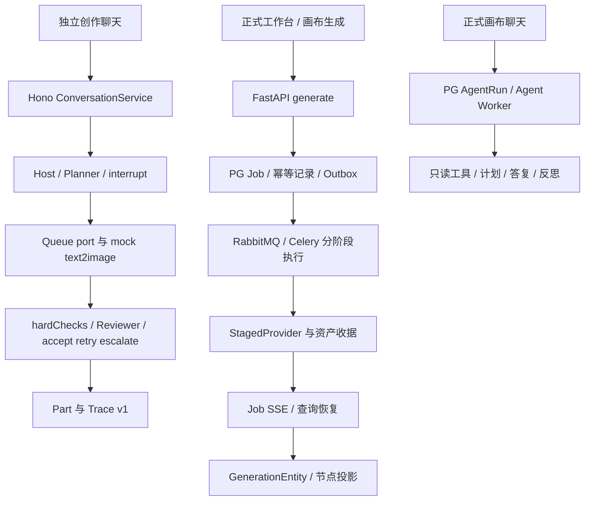

# Agent 与无限画布接入盘点及决策

审计日期：2026-10-10。基线提交：`970b7ff`，以当前工作区（含此前尚未提交的 Reflection、Reviewer、评测改动）为准。本轮只新增本文，不修改业务、不删除代码、不实现节点接入。

**决策：选择方案 1。下一阶段画布只提供节点上下文与结果落位，新增生成型 Agent 意图统一走 `apps/server` 的 Host/Planner；不调用旧简单 Agent，不再造第三套生成编排。** 这是一项接入方向决策，并非声称当前正式画布已经走 Host。正式产品目前通过 PostgreSQL/FastAPI 接受媒体任务；TypeScript Host 仍是独立联调服务，生产桥接有明确前置条件。

## A. 入口地图

### A1. 当前执行域

实际存在三个需要区分的执行域：独立 TypeScript 创作 Host、正式 Python 只读画布 Agent、正式媒体任务管线。另有前端本地演示和历史沙箱入口。它们不是同一条链路的不同页面。

| 用户触发 / 路由 | 源码入口与调用链 | 最终生成 / 写节点 | 判定 |
| --- | --- | --- | --- |
| 独立创作聊天发送；`POST /v1/conversation` | `creation-agent/src/Composer.tsx` → `store.ts:208` 的 `send` → `server-transport.ts` → `server/src/api/routes.ts` → `ConversationService.prepare/run` → `agent/host.ts` → Host 或 Planner → `tools/text2image.ts` → Queue port | 默认仅生成 `/mock/image.svg` 产物 Part；不写正式画布、PG Job 或 Asset | **创作 harness 主链路、下一阶段生成 Agent 唯一推荐入口**；当前是独立联调入口 |
| 创作确认积分 / 继续 | 同一 `/v1/conversation` 的 `resume_interrupt` → `prepareResume`；新消息“继续” → continuationDraft → Host | 恢复计划步骤；retry 仍先估算积分、必要时 interrupt，再 enqueue；accept 才完成步骤 | Host 主链路，不是另一个 agent |
| 创作停止 | `POST /v1/stop_stream` → service.stop；SSE abort → disconnect | 停止运行、保存可续跑信息；无节点写入 | Host 主链路控制 |
| 创作 P0/P1 演示按钮 / 选择“本地演示” | `creation-agent/src/App.tsx:66,72` → `store.send(..., 'mock')` → `mock.ts` | 浏览器生成模拟事件/卡片，不调用 Host 或媒体 Provider | **演示旁路**，不可作为节点接入目标 |
| 正式画布聊天发送 | `canvas/app.tsx:270,1875` → `AgentPanel` → `agent/store.ts:345 send`（先 ensureSaved、冻结选择）→ `agent/api.ts` → `POST /api/documents/{id}/agent/runs` → `backend/agent/api.py` → `AgentService.create_run` | 创建 PG AgentRun 和 Outbox → `workers/agent.py advance_agent` → kernel/harness_loop/orchestrator → 模型与只读工具 → reply/evidence/reflection；**不生图、不改节点** | **当前正式只读 Agent 主链路**，不能标为死代码或旧简单 agent |
| 选中图片的分析菜单 | `canvas/app.tsx:972` 附近设置 agent draft 并打开 chat；用户再点击发送才进入上一行 | 只分析；菜单本身不派发生成 | 正式只读 Agent 的 UI 入口 |
| 画布 Agent 停止 / 重连 | `POST /api/agent/runs/{id}/stop`；GET run/snapshot；`GET /api/documents/{id}/agent/events` | 停止当前 Run；SSE 仅重放提交过的事件，不启动新推理 | 正式只读 Agent 控制和恢复 |
| 工作台一句提示词开始创作 / 新建画布 | `workspace/app.tsx:145 create` → `workspace/api.ts CreationIntent.run` → 创建并保存 Document/Node → `POST /api/generate` → 跳转 `/canvas?doc=…` | 持久化媒体 Job；画布恢复事件写回结果；空白新建仅建文档 | **当前产品生成主链路**，不是 Host 或聊天 Agent |
| 画布底部发送（图 / 视频、草稿） | `canvas/app.tsx:1261` → `submitFromComposer:2121` → `flows/generate.ts submitGeneration` → `state/generation-coordinator.ts submit` → `/api/generate` | GenerationEntity + placeholder；Job / Asset 完成后 patchGeneration，经投影显示产物 | 正式媒体任务入口，无 Planner/Reflection |
| 画布完整质量再生成 | `canvas/app.tsx:1160` → `resubmitFullQuality:2172` → submitGeneration | 新 generation/operation，保留 lineage；相邻落位 | 同上，不是 Agent 自动 retry |
| 局部重绘提交 | `inpaint:region-committed` → 弹层提交 → `submitInpaint:2251` → submitGeneration（initImage、maskImage） | 新生成结果与源节点 lineage | 同上 |
| 四方向生成 / 查询未确认组 / 取消组 | `canvas/app.tsx:1380` → `flows/group-generate.ts submitGroupGeneration / confirmPendingGroup / cancelPendingGroup` → `/api/generate/group`、generation-requests、jobs | 组占位节点 + 子任务；`generation-events.ts` / group reducer 写回 | 正式既有批量能力；本次不改，也不纳入下一阶段节点并行 |
| 画布生成取消 / 恢复 / 重试 | coordinator.cancel/recover/retry；`generation-events.ts` → `/api/events`、`/api/jobs`、generation-requests | 按 operationId/jobId/version 归并结果；不确定请求先查原请求，不自动再次付费提交 | 媒体管线控制，不是 Host continue |
| 抠图识别 / 手动提交 | `canvas/app.tsx` 蒙版流程 → `/api/cutout/detect/{ident}`、`/api/cutout/apply/{ident}` → rembg / 合成资产 | 合成独立图像节点，不通过 Agent 推理或生图 Provider | 正式编辑操作；不要为统一 Agent 把它误迁到生成循环 |
| 旧简单抠图 Agent | `canvas/flows/agent.ts:36 createAgentFlow.send` → `/api/agent/sessions` → sandbox 的 `planning.plan_agent` → sessions/{id}/prepare → 用户手动 cutout → markCompleted | 历史 JSON session、doc.chat 的计划/结果卡；不是自动生图闭环 | **历史沙箱链路**；正式 React 入口没有 createAgentFlow 调用 |
| 旧聊天卡片组件 | `canvas/flows/chat.ts:60 createChat` | doc.chat UI 卡片及组状态展示，无模型/Host | 遗留 UI，目前检索到的实例化者在测试中 |
| 旧节点控制器 | `canvas/flows/node-generation.ts:9 createNodeGeneration` → `/api/generate` → `applyNodeJob` | NodeRun + 节点字段直接更新 | 测试/历史控制器；当前 app 不实例化，不能复制成新桥接 |
| 旧分镜面板规划与执行 | `flows/storyboard-panel.ts` → storyboard-planner/run → `/api/storyboards/jobs`、`/api/storyboards/runs` | 历史计划、串行分镜结果与时间线追加 | **沙箱 / 旧面板**。createStoryboardPanel 当前调用者为测试；正式 app 的分镜 tab 是本地 CRUD，并非该面板 |
| Agent 流程评测 / 故障注入 | eval 工作台或 `scripts/eval.py flow` → EvaluationRunner → `evaluation/agent_flow.py` → `server/src/eval/run-flow-case.ts` → Hono API → Host | 内存 ports + Trace v1 + offline report，不写正式节点 | 测试入口；F1～F4 仅评测注入，不是用户入口 |

服务器注册证据：`backend/app.py` 委托 `production.create_app`；`production.py:318,319` 接媒体生成，`:822` 安装正式 agent routes，`:825` 将 canvas-next 重定向到 canvas，`:830` 附近提供 landing/workspace/canvas。历史 `/api/agent/sessions` 与 storyboard 路由只在 `evaluation/sandbox.py` 注册，不能因为 URL 含 agent 就认为正式应用支持。

构建证据：`scripts/build-react.ts` 入口为 workspace、landing、evaluation、canvas；不包含 `creation-agent`。后者有自己的 Vite 包和 Host transport。生产页面默认不会向 localhost:8787 发送请求。

### A2. 两条生成调用链的边界



正式媒体执行参考 `services/acceptance.py`、`workers/durable.py`、`services/generation_runner.py`、`providers/staged.py` 和资产持久化设施。`workers/usecases.py` 的旧 stub 执行用例不能被误认作完整生产 Provider 管线。ComfyUI `providers/workflows.py` 是 Provider 数据图适配，不是第四套用户 Agent。

## B. 状态与数据模型

| 状态域 | 字段 / 存储 | 写入者 → 读取者 | 与其他状态的关系 |
| --- | --- | --- | --- |
| TS Conversation / Turn / Message / Part | `server/src/domain/model.ts`：conversationId、turnId/runId、messages/parts、plan、interrupt snapshot、continuationDraft、toolCalls；默认 MemorySessionStore | ConversationService / Host → SSE、创作 store、TraceWriter | 负责创作意图和编排；无 documentId/objectId 绑定，无 PG 文档事务 |
| TS 审核 / Trace v1 | tools evidence.checks/review、review history/attempt/outcome；文件 Trace，version="1" | finalizeGeneration → Host 完成/重试/升级、评测 grader | 分数型生成质量审核；不是 Python AgentReflection |
| 正式画布文档 | `CanvasDocData`：id、revision、objects、order、groups、generations、storyboard、timeline、chat；PG Document 与本地草稿/命令历史 | DocStore command + autosaver → CanvasView / API；baseRevision 防覆盖 | 持久化摆放和用户编辑，不能整体替换来写一个结果 |
| Node / Reference / Edge | CanvasObj.id/kind/位置/尺寸、nodeDraft、nodeRun、generationId、lineage；connections.ts 从 references 与 lineage **派生** sourceId/targetId | UI CRUD → 画布展示、请求快照 | 不是 DAG 调度器，没有独立 Edge 执行状态；连线不自动触发 Agent |
| 新 GenerationEntity / runtime | generationId、operationId、spec、status、version、result；coordinator 内存 runtime + 文档与本地草稿 | submit / acceptEvent / acceptJob → projectGeneration 显示 | 请求与落位分离；按 operation、job、版本过滤迟到事件；不能与旧 applyNodeJob 同时接管同一节点 |
| 旧 NodeRun | requestId、jobId/runId、status、draft snapshot | workspace 创建意图 / 旧 controller → legacy reducers、applyNodeJob | 正式工作台仍使用 NodeRun 初始节点，不能整体删字段或 reducer；与 GenerationEntity 存在过渡兼容 |
| 正式媒体 Job / Asset | PG Job、请求 hash/tombstone、Outbox、阶段/epoch、Provider snapshot/credentialRef、Asset/引用、收据 | 受理、Worker、恢复 daemon → `/api/events`、jobs 查询、canvas coordinator | 实际生成和文件的权威来源；Host mock artifact URL 尚不等同正式 Asset |
| 正式只读 AgentSession / Run | `backend/agent/orm.py`：Session(document/workspace,cursor)，Run(clientRequestId/hash、baseRevision 上下文、selectedObjectIds 的快照、route/history/evidence、stage、lease/epoch、status)；PG | AgentService / Kernel / Worker → API/SSE、canvas agent store | 按文档组织只读会话；不等同 TS conversation，不能直接共享 ID 或假定状态互通 |
| Python 计划/反思/调用账本 | AgentStep、AgentReflection(verdict/issues/round/hardChecks)、AgentModelCall、AgentToolCall、AgentEvent(seq) | Python orchestrator/kernel → history/context、AgentPanel | 反思针对只读答复证据，不是 evidence.review 的图像评分；不是 Trace v1 |
| Python Agent 前端 | agent/store.ts：runs/cursor/modelId/draft/pendingRequests；localStorage 记录待确认 clientRequestId 请求；先 ensureSaved 得到 baseRevision | send/start/SSE/recover → AgentPanel | 请求可查询恢复；不能复制一份到 doc.chat 再各自更新状态 |
| 旧简单 agent session | sandbox 的 agent-sessions.json；doc.chat plan/result/session/mask 字段 | planning/prepare 与旧 flows/agent → 旧聊天组件 | 历史状态；没有 TS interrupt snapshot、reviewAttempts 或可靠队列 |

重复字段主要是 prompt/message、plan/steps、status、request/run ID 和结果 URL，语义与持久化保障不同。不要仅按同名字段做结构强转。选中态属于 CanvasView 运行时：发送时冻结 selectedObjectIds；切换选择不应改写正在执行的 turn。

双写高风险：Host SSE 与 `/api/events` 分别写同一节点；old applyNodeJob 与 GenerationEntity 投影同时写 src；PG AgentRun.reply 与 doc.chat 分别维护同一对话；审核尚未通过的 attempt 被普通 job-completed 提前投影；旧 run 迟到事件覆盖用户新操作。接入必须定义唯一结果归并入口。

## C. 能力对照表

“部分”表示存在相近机制但契约不同，不能直接替代。画布列区分普通媒体生成与正式只读 Agent，避免漏算已上线能力。

| 能力 | 新 TS Host harness | 旧简单 Agent | 正式画布现有逻辑 |
| --- | --- | --- | --- |
| 路由 | 有：Host/Planner，默认 stub | 部分：规则/配置模型产生抠图计划 | 有：只读 Agent 按 model route；普通生成固定 Provider route，无意图路由 |
| 计划 | 有：TodoPlan、串行步骤 | 部分：抠图操作建议 | 有：Python AgentStep；媒体任务本身无 Planner |
| interrupt | 有：积分 quote + confirmId approve/cancel | 无：手动操作不是积分 interrupt | 部分：Agent 状态有 waiting_input/approval 预留；当前 effect 禁用，无 Host 积分确认 |
| 续跑 | 有：快照/continuationDraft、取消后继续 | 部分：加载 session/卡片，非执行续跑 | 部分：Agent durable lease/epoch 恢复；Job reconcile/不确定请求查询，非 TS continue |
| Reflection | 有：hardChecks + score/rubric + retry/escalate | 无 | 部分：只读 Agent 答复 reflection；没有 Host 生图质量闭环 |
| 工具调用 | 有：ports / queue / text2image | 部分：prepare/cutout 固定流程 | 有：只读 gateway；生成由独立媒体管线接受，不是 effect tool |
| Trace | 有：version 1、toolCalls、review evidence | 无：session JSON 不是 Trace | 部分：PG ModelCall/ToolCall/Event/evidence、Job 审计；无同一 Trace v1 |
| 画布读写 | 无：尚无节点上下文/落位接口 | 部分：读选中素材、写 doc.chat/抠图结果卡 | 有：UI CRUD/结果投影；Python Agent 只读快照，无节点写工具 |

冲突点：两套计划/反思不能同时决定同一生成是否成功；两种恢复不等价；Python 的 waiting_approval 枚举与 reserved ApprovalEvidence 不代表已经实现 Host 积分审批。`backend/agent/tools/__init__.py` 明确断言注册表不得包含 effect 工具，`contracts/reserved.py` 明确仅预留未来 generation evidence。

## D. 冗余与接错风险

1. 直接“画布调旧 `/api/agent/sessions`”：正式应用没有这个路由；即使重新注册也会引入 JSON/FIFO 沙箱状态，绕开 PG 文档隔离、Host 积分 interrupt、Reflection 和 L7，形成第二条生成旁路。
2. 把正式 Python Agent 当旧简单 Agent：会破坏仍在用的文档聊天、证据引用、模型账本、恢复和停止行为。它应保留为只读能力，不承担新增生成编排。
3. 直接在 AgentPanel 或节点 click 中 POST `/api/generate`：确实能生成，但绕过 Host Planner/retry/审批；不能宣称 L7 覆盖此链路。
4. 另写 canvas-agent/workflow 调度器：新增一份计划、状态机、幂等与取消语义，导致三方不一致；连线变更和 undo 也易意外再次生成。
5. 把浏览器直接指向 localhost:8787 视为生产接入：TS server 当前默认 memory drivers、mock 生图，Redis/BullMQ 合约尚未可用；不具备正式应用的 OIDC/workspace 授权、持久化任务与资产边界。
6. 直接消费 Host artifact URL：mock SVG 并非 PG Asset，缺少正式落位需要的资产和尺寸契约。不得伪造 assetId 或写裸路径绕过权限。

唯一推荐新增生成链路：**画布意图 → 现有 Host/Planner → 原有 ports / 工具 → 审核与审批 → 接受结果 → 统一画布结果适配**。生产执行需要包装现有媒体管线；它负责执行，不另做 Planner。Python 只读服务和手动编辑暂时维持原入口。

## E. 接入决策与可执行清单

### E1. 写死选择方案 1

选择理由：TS Host 已覆盖所需路由、积分、续跑、生成审核与 Trace，L0～L7 明确对其验收；画布已有稳定 CRUD 和结果归并，所缺是双向绑定。旧简单 Agent 没有正式路由且能力较少；保留它承担生成没有成本优势。**不选择方案 2**，不以正式 Python 只读 Agent 的存在为由制造新的生成编排。

“画布只做 UI 与 CRUD”约束新增生成接入：不删现有编辑功能、不撤销只读聊天，也不在本轮强制迁移工作台/四方向/视频等已有入口。下一阶段首个切片只接 image 单节点，完成后再单独规划其他入口迁移，不能声称所有产品生成已统一。

### E2. 文件 / 模块处理清单

| 动作 | 文件 / 模块 | 下一阶段具体处理 |
| --- | --- | --- |
| 保留并作为生成编排主干 | `apps/server/src/agent/host.ts`、`domain/conversation-service.ts`、`ports/index.ts`、`agent/reflection.ts`、`trace/schema.ts` | 沿用 Host/Planner、interrupt/continue、review attempts、S1 ports 和 Trace v1；不复制循环 |
| 包裹输入与事件 | `server/src/api/routes.ts`、`domain/model.ts`；`creation-agent/src/server-transport.ts` | 显式新增并校验 canvas turn context；目前 strict schema 不接受额外节点字段。复用 SSE 语义，避免新事件状态机 |
| 包裹画布边界 | `canvas/agent/` 或独立 canvas Host bridge；`canvas/state/generation-coordinator.ts`、`generation-events.ts`、projection/DocStore | 新增类型化上下文桥与 accepted 结果适配；统一结果归并，保留 operation/version 防护。不直接套用 Python AgentRequest |
| 保留 UI 和 CRUD | `canvas/app.tsx`、`state/commands.ts`、`node-model.ts`、`connections.ts`、autosaver、CanvasView | 选择、引用、占位、落位、undo、revision 归画布；连接不自动派发，不加图调度器 |
| 保留并包装执行层 | `backend/production.py`、`services/acceptance.py`、`generation_runner.py`、`providers/staged.py`、infrastructure/、workers/durable.py | 未来由 Host tool/Queue adapter 调用现有授权受理与收据查询；不直连付费 Provider、不重建队列 |
| 保留当前只读 Agent | `backend/agent/`、`workers/agent.py`、`canvas/agent/AgentPanel` 相关模块 | 本阶段不删/不改；明确只读入口。后续若复用读取能力，提供受权限保护的 adapter，不能借此再加 effect 编排 |
| 保留媒体兼容与恢复 | `workspace/api.ts` 的 CreationIntent、group-generate、legacy reducers、nodeRun 字段 | 仍有正式调用；迁移某一入口后再评估删减，不一次性清空兼容逻辑 |
| 标记废弃候选，不删除 | `canvas/flows/agent.ts`、`flows/chat.ts`、`flows/node-generation.ts`、旧 storyboard-panel/planner/run；`backend/planning.py` 的旧 plan_agent | 当前主入口无实例化证据或仅历史沙箱使用。禁止新代码引用；保留测试/离线历史兼容，删除需另行用户确认 |
| 保留隔离沙箱 | `evaluation/sandbox.py`、sandbox_jobs、历史 storyboard 后端 | 只供显式独立目录回归；不得作为 production 入口重新注册 |
| 保留评测并加绑定证据 | `evals/datasets/agent-flow-*.jsonl`、`evaluation/agent_flow.py`、server eval runner | 下一阶段新增节点上下文/accepted 落位验证；L0～L7 原题不可替换成另一个 Agent 的结果 |
| 标记演示，不当主链路 | `creation-agent/src/mock.ts` 和 P0/P1 按钮 | 保留联调；正式节点入口必须选择 server transport，不依赖演示事件 |

上表的“废弃候选”不是删除授权。本轮未删除任何文件。不要把 TypeScript import 中 `.js` 后缀误当作 JS 业务源文件，它们对应编译后的模块路径。

### E3. 下一阶段唯一实现边界

只做“节点上下文进 harness + 接受结果写回”，按以下顺序执行：

1. 冻结上下文：documentId、targetObjectId、baseRevision、selectedObjectIds、经过授权的参考 assetId、prompt/taskType、一次提交的 operationId。先 ensureSaved，再送 Host；选择变化不影响已发 turn。conversation 与文档的绑定须明确，不能强转 Python Session ID。
2. 在现有 turn/context 上扩展类型与严格校验，不改 S1 port 的既有职责。节点引用应显式进入 tool input/上下文适配；不能只把 ID 塞进 prompt 就宣称模型已读取图片。
3. 保留 Host 串行执行；积分 quote/approve/cancel、自动 retry 与 continue 使用原逻辑。一个可见节点对应一个创作意图，内部 attempt 使用现有 toolCallId:attempt 幂等；重试不会新增多个正式可见成果节点。
4. 在 Host **accepted** 后发布落位结果，包含可信 artifact/asset 引用、尺寸、turn/toolCall/attempt 和 binding。超限标记失败并显示 issues；停止、拒绝积分、未接受 attempt 不写成功产物。reviewEnabled=false 沿用既有完成决策，不能卡住落位。
5. 由一个 canvas adapter 合并到既有 generation/result 投影。校验目标仍存在、operation 未被替换、权限/版本有效；不能覆盖整张文档、用户移动/尺寸或后来生成。重复 SSE、重连、旧 attempt、删除节点后的迟到结果必须幂等或拒绝。
6. 测试单节点成功、低分 retry 后只落位一次、超限失败、审批拒绝、取消后继续、重连重复结果和目标删除。复跑原 Host L0～L7；新增接入测试独立证明节点路径确实经过 Host，现有 L7 单独全绿不等于画布闭环全绿。

不做节点并行、DAG 执行、连线自动调度、批量迁移、L6 画布评测体系、真实 Reviewer 接入、旧 Agent 删除或数据库大迁移。

**生产接入前置条件：** 当前 TS 默认 MemorySessionStore/Queue 和 mock image 尚不能直接承担正式产品生成。先在可隔离联调环境实现上述单节点绑定；上线前必须明确 Host 的授权/会话恢复边界，以及通过现有 ports 包装 PG 媒体受理、资产收据、取消和恢复的 adapter。无法满足时保持入口隔离，不将“mock 节点接通”作为生产完成。本文只记录这些缺口，不授权本轮实现它们或绕开 S1。

## F. 最小验证、评测绑定与文档一致性

### F1. 可复查的静态证据

本轮使用当前源码 `rg` 与注册点逐级追踪；未找到可用 GitNexus 工具/索引，不能宣称索引调用图已刷新。以下检索足以复查关键结论（需结合本节给出的注册点阅读，单独字符串匹配不证明运行可达）：

```sh
rg -n 'createAgentFlow|createChat|createNodeGeneration|createStoryboardPanel' apps/web tests --glob '*.ts' --glob '*.tsx'
rg -n '/api/agent/sessions|/api/storyboards/' apps/api/backend/production.py apps/api/backend/evaluation/sandbox.py apps/web/canvas/flows
rg -n 'submitFromComposer|submitInpaint|resubmitFullQuality|submitGroupGeneration' apps/web/canvas/app.tsx
rg -n 'prepareResume|streamSSE|stop_stream' apps/server/src/api/routes.ts
rg -n 'finalizeGeneration|enqueue|interrupt|reviewOutcome' apps/server/src/agent/host.ts
rg -n 'effect|GATEWAY' apps/api/backend/agent/tools/__init__.py
rg -n 'run-flow-case|agent_flow' apps/api/backend/evaluation/agent_flow.py apps/api/backend/evaluation/runner.py
```

对话调用到 Host、mock text2image、finalizeGeneration 的证据来自 routes → service → host → tools；正式画布生成来自 app → coordinator → production.generate → acceptance → durable worker → staged provider → events → projection。没有发现 Host 导入 CanvasDoc/DocStore 或正式 canvas 调用 `/v1/conversation` 的连通证据。

### F2. 评测绑定

- `agent_flow` 经 Python runner 调用 `apps/server/src/eval/run-flow-case.ts`，在真实 Hono 路由/Host 上使用内存 ports、stub LLM/reviewer 与隔离 Trace。层集为 L0、L1、L2、L3、L4、L5、L7；没有 L6。L7/F4 验证 TS 生成 Reflection，不验证正式 Python Canvas Agent 或画布落位。
- `evals/` 是当前流程题集和规范目录；本工作区未发现 `eval/` 下可供执行的另一个 agent 入口。`evaluation/runner.py` 的普通图像任务另走隔离 sandbox/Provider 评测；grader 的 VlmJudge 是评测审核，与创作 Reviewer port、只读 AgentReflection 三者分开。
- `scripts/evaluation_web.py` 明确是隔离本地工作台（8788），挂 evaluation router；生产 FastAPI 未因此变成评测入口。评测 Agent/runner 不应被产品节点调用。

### F3. 文档与代码一致性

| 文档 | 核对结论 / 后续文档债 |
| --- | --- |
| 根 README | 将正式生产入口说明为 PG/FastAPI、旧 Agent/分镜/评测 HTTP 不作为当前入口，与注册代码一致；这里的“旧 Agent”须与随后介绍的新只读 Canvas Agent 区分。只读 Agent 迁移说明提到 0009，而现有阶段式 harness 已有 0012，交接应补齐。Reflection 章节讲独立 apps/server，不应读成正式 canvas 已接通 |
| `apps/server/README.md` | 开头明确独立联调、不替换 FastAPI，与代码一致；历史阶段段落出现“未做审核”等旧描述，后文已写 Reflection，下一份 HANDOFF 应以当前实现为准；“无 LLM Key”只适用于默认 stub，可选 real reviewer 另有配置 |
| `docs/runbooks/canvas-agent.md` | 正式只读工具、持久化执行与 0012 stages 的说明符合当前 Python Agent；不等同 TS Host |
| `docs/jimeng-parity.md`、历史 PRD/技术方案 | 有旧分镜规划/Agent 能力说明，属于历史设计/实现记录；不能据此在 production 注册已隔离路由 |
| jimeng-harness 交接、`PORTS_AND_TRACE.md` | 未找到仓库内对应 HANDOFF/jimeng-harness 文件；server README 引用的是“用户提供”的外部 PORTS_AND_TRACE.md。本轮不能核对外部内容，也不补造文件。下一份 HANDOFF 可引用本文并补充外部文档位置 |

### F4. 本轮运行结果

| 校验 | 结果 / 限制 |
| --- | --- |
| `npm run verify` | **通过，退出 0**：typecheck、web build、eslint、397 个前端测试；后端检查及 532 passed、2 skipped。存在 Starlette/AnyIO 弃用 warning，无测试失败 |
| `npm run test --workspace @frayune/creation-server` | **通过，退出 0**：50 passed、1 skipped（无真实审核凭据的可选冒烟）；根 verify 不包含该包的独立测试，不能用根检查替代 |
| `.venv/bin/python scripts/eval.py flow --suite L0 --run-id audit-canvas-l0-20261010 --store /tmp/aivideo-audit-canvas-l0-20261010` | **4/4，通过门禁**；报告 `/tmp/aivideo-audit-canvas-l0-20261010/runs/audit-canvas-l0-20261010/reports/1/report.md`。显式独立目录，无生产数据/付费凭据 |
| 正式 PG/Redis durable 集成 | 本轮未另行运行：需显式独立 DB/Redis 与迁移；没有修改 HTTP/存储契约，不连接生产设施来完成文档盘点 |
| L1～L7 / F4 重跑 | 本轮要求的最小流程冒烟仅 L0；不把此前工作结果冒充本轮重跑。下一阶段行为变更后需完整复跑 |

verify 的编译产物在忽略目录；已有业务未提交改动保留。本轮修改范围仅本文；没有运行格式化全仓、删除或修复业务代码。

## 验收记录

- [x] 覆盖 Host、正式只读 Agent、媒体生成、旧 Agent、演示、分镜与评测入口，并区分当前/遗留。
- [x] 状态归属、重复字段与双写风险列清。
- [x] 八项能力对照完整。
- [x] 明确选择方案 1，给出保留/包裹/废弃候选清单。
- [x] 下一阶段限定单节点上下文与接受结果写回，不含并行。
- [x] 未改业务行为；根 verify 与 L0 冒烟通过。
