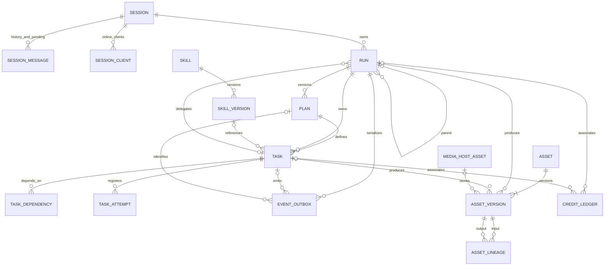
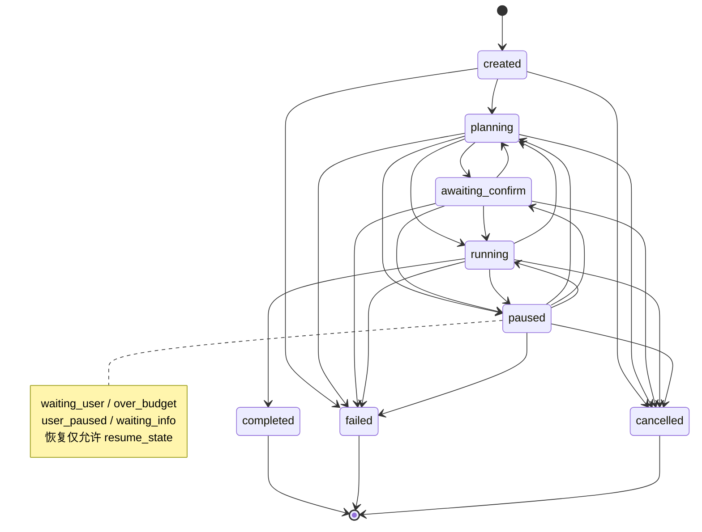
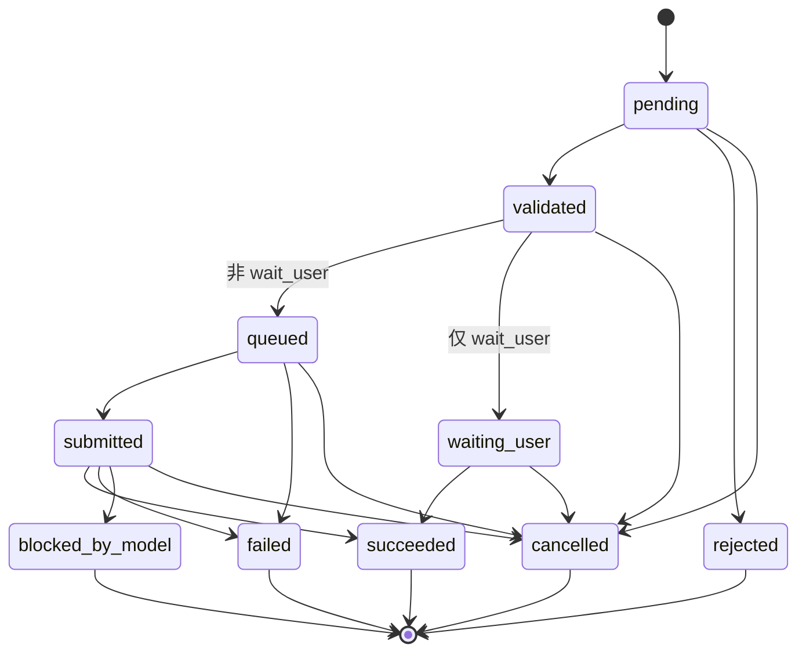

# Agent 核心契约与状态机（块 1）

本块提供数据库契约，不启动主管/助手、不做计划审核、调度、扣费、生成或画布写入。Tool / Capability 只留 ID 与版本引用，定义属于块 3。事件发布、消费属于块 2。

## 存储边界

七类持久化对象 Session、Run、Plan、Task、Asset、Skill、Event 加版本及关联，共 14 张 `core_*` 表。Tool 是第八个核心对象，本块不建定义表。

现有 `agent_runs`、`agent_steps`、`assets` 和生成服务继续独立运行；没有复制历史运行或双写同步。`CoreAssetVersion.stored_asset_id` 引用现有 MediaHost 文件记录，不搬运媒体。现有 `host_credit_ledger` 只添加 nullable `core_run_id/core_task_id` 及配套外键/索引，原积分服务与账户不变。旧 run_id 仍指向媒体执行记录，新 core_run_id 指向主管/助手任务契约。

新 outbox 是 `core_event_outbox`，既有发布器不会读取。不能把记录直接插入旧 outbox 当作已经接入块 2。

## 状态与原子性

唯一公开入口 `backend.core.store.transition(tx, entity_type, entity_id, expected_version, target_state, reason=..., causation_id=...)` 调用 PostgreSQL `core_transition`。数据库事件触发器校验边、执行 version CAS、推进 Run 事件游标和插入事件，在同一事务提交。普通 ORM/SQL 不得直接修改 Run/Task 的状态、版本或状态时间；数据库会拒绝。初始化固定为 created/pending、version=0，并自动写创建事件。

事件触发器是唯一状态写入机制；即使直接插入 outbox，也会执行相同校验，不能借此绕过。数据库管理员禁用触发器或直接改函数不属于应用写入权限。

冲突返回 `VersionConflict(code=version_conflict)`；非法边返回 `InvalidTransition(code=invalid_transition)`；记录不存在返回 `EntityNotFound`。SQLSTATE 分别是 P4001/P4002/P4004。不自动重试。失败的单次操作在 savepoint 内回滚，外层事务仍可继续；调用方最终 commit/rollback 决定状态与事件一起生效或一起撤销。savepoint 不是独立提交。

Run 事件和其 Task 事件共用严格递增的 `run_sequence`。同 Run 写入按 Run 行锁串行化，但状态修改仍检查调用方版本；两个同时以 version=0 修改同一 Run 的请求恰有一个成功，另一个冲突。

Run 暂停保存 pause_reason 与 resume_state，恢复只能回到暂停前状态。四种暂停原因全部预留。完成/失败/取消是终态；本块只验证转移合法性，是否满足业务完成条件由后续状态推进者负责。

Task 的 wait_user 走 validated → waiting_user，不进入 queued/submitted。ask_user 表示发出询问的动作，等待答复另用 wait_user。blocked_by_model/rejected/succeeded/failed/cancelled 为终态，不能直接重新排队。供应商请求的不确定性在 `core_task_attempts.submission_certainty` 表示，不把 unknown 假装成失败再提交。

## 不可变数据与范围

Plan、SkillVersion、AssetVersion 和资产血缘只追加，不允许 UPDATE/DELETE。Plan 的 stage/milestones 是该版本的阶段与里程碑定义；推进中的阶段另放 Run.current_stage、Task.stage_key/milestone_key，不改旧计划。

Asset 的业务内容（包括星标、识别结果、分层、状态及文件规格）在版本表。append_asset_version 完整追加快照并 CAS 前移 head；旧版本、来源 Run/Task/user、父版本和多输入血缘保留。裸 Asset 必须在同一事务建立初始版本，否则提交失败。Asset 头的 workspace/user/ownership 是稳定归属，不提供原地变更身份的接口。

复合外键阻止跨 Run / Plan 的 Task 引用、跨 Session 的父 Run、错误的父委派任务归属、错误的当前 Plan、跨工作区的资产来源和积分关联。scope 的授权判定、DAG 环检测、审核、预算分配和心跳续约均不在本块实施。

冻结 JSON 预留的键约定：

- scope：tools（ID/版本白名单）、readable_assets（asset_id/version_id）、writable_regions（代码分配的区域/节点标识）。
- version_lock：capabilities、skills、tools（含说明/Schema 哈希）、asset_cards 的固定版本引用。
- invariants：目标类型、禁止降级、合规边界及其他不可违反条件。
- Task.parameters/output_refs：保存原始参数与上游输出引用，后续解析值放提交尝试登记，不覆盖任务书。
- SkillVersion.tool_allowlist：工具及版本引用；phases/confirmation_points/boundaries/source 保存阶段流程、确认点、边界及来源。

## 预算与配置

整数积分：`0 <= allocated + spent <= reserved <= limit`。reserved 表示预扣总额，allocated 表示尚未结算的已分配额度，spent 表示已用。此处只约束数值，不操作账务。token 则以 outstanding reserved 与 used 计数，二者之和不超过 limit。

运行初始上限来自 `CoreSettings`，环境变量 `AIVERO_CORE_CREDITS_LIMIT`（默认 0）、`AIVERO_CORE_TOKENS_LIMIT`（65536）、`AIVERO_CORE_MAX_THOUGHT_ROUNDS`（20）、`AIVERO_CORE_MAX_TASK_RETRIES`（2）。没有计时器或写死的业务超时；heartbeat、租约、SLA/价格对应的版本引用留给后续块使用。

## ER 图



## Run 状态图



## Task 状态图



## 验证与迁移

迁移 0015 在已有 0014 上新增核心域；本块不导入旧运行。对独立数据库使用：

```sh
PYTHONPATH=apps/api AIVERO_DB_URL=... .venv/bin/alembic upgrade head
.venv/bin/python -m pytest tests/backend/test_core_states.py -q
AIVERO_CORE_TEST_DB=... .venv/bin/python -m pytest tests/integration/test_core_contracts.py -q
AIVERO_CORE_MIGRATION_TEST_DB=... .venv/bin/python -m pytest tests/integration/test_core_migrations.py -q
npm run verify
```

迁移测试要求专用空库（或只有空 alembic_version 表），执行 base→head→0014→head→base；遇到已有业务表会拒绝，不自动清空。普通事务测试要求预先迁移的独立 PostgreSQL，无 Redis/消息代理/模型凭据。回滚 0015 会删除本块新增数据，应只对可丢弃环境执行或按正常备份流程处理。

## 完整字段目录

以下目录按本块 ORM 生成；Tool/Capability 引用字段不表示这些能力已经实现。

### core_asset_lineage

| 字段 | 类型 | 可空 |
| --- | --- | --- |
| `input_version_id` | `CHAR(32)` | 否 |
| `output_version_id` | `CHAR(32)` | 否 |
| `relation` | `VARCHAR(32)` | 否 |
| `id` | `CHAR(32)` | 否 |
| `schema_version` | `INTEGER` | 否 |
| `created_at` | `DATETIME` | 否 |

### core_asset_versions

| 字段 | 类型 | 可空 |
| --- | --- | --- |
| `workspace_id` | `CHAR(32)` | 否 |
| `asset_id` | `CHAR(32)` | 否 |
| `version` | `INTEGER` | 否 |
| `previous_version_id` | `CHAR(32)` | 是 |
| `kind` | `VARCHAR(8)` | 否 |
| `category` | `VARCHAR(16)` | 否 |
| `card_kind` | `VARCHAR(16)` | 是 |
| `starred` | `BOOLEAN` | 否 |
| `recognition` | `JSONB` | 否 |
| `layers` | `JSONB` | 否 |
| `metadata_json` | `JSONB` | 否 |
| `storage` | `JSONB` | 否 |
| `stored_asset_id` | `CHAR(32)` | 是 |
| `content_hash` | `VARCHAR(64)` | 否 |
| `mime_type` | `VARCHAR(128)` | 是 |
| `size_bytes` | `BIGINT` | 是 |
| `width` | `INTEGER` | 是 |
| `height` | `INTEGER` | 是 |
| `duration_ms` | `BIGINT` | 是 |
| `status` | `VARCHAR(16)` | 否 |
| `run_id` | `CHAR(32)` | 是 |
| `task_id` | `CHAR(32)` | 是 |
| `user_id` | `VARCHAR(200)` | 否 |
| `id` | `CHAR(32)` | 否 |
| `schema_version` | `INTEGER` | 否 |
| `created_at` | `DATETIME` | 否 |

### core_assets

| 字段 | 类型 | 可空 |
| --- | --- | --- |
| `workspace_id` | `CHAR(32)` | 否 |
| `user_id` | `VARCHAR(200)` | 否 |
| `ownership` | `VARCHAR(8)` | 否 |
| `current_version_id` | `CHAR(32)` | 是 |
| `current_version_number` | `INTEGER` | 否 |
| `id` | `CHAR(32)` | 否 |
| `schema_version` | `INTEGER` | 否 |
| `created_at` | `DATETIME` | 否 |
| `version` | `INTEGER` | 否 |
| `updated_at` | `DATETIME` | 否 |

### core_event_outbox

| 字段 | 类型 | 可空 |
| --- | --- | --- |
| `aggregate_type` | `VARCHAR(8)` | 否 |
| `aggregate_id` | `CHAR(32)` | 否 |
| `aggregate_version` | `BIGINT` | 否 |
| `run_sequence` | `BIGINT` | 否 |
| `event_type` | `VARCHAR(64)` | 否 |
| `run_id` | `CHAR(32)` | 否 |
| `task_id` | `CHAR(32)` | 是 |
| `plan_id` | `CHAR(32)` | 是 |
| `plan_version` | `INTEGER` | 是 |
| `causation_id` | `CHAR(32)` | 是 |
| `correlation_id` | `CHAR(32)` | 否 |
| `from_state` | `VARCHAR(24)` | 是 |
| `to_state` | `VARCHAR(24)` | 否 |
| `reason` | `TEXT` | 是 |
| `payload` | `JSONB` | 否 |
| `delivery_status` | `VARCHAR(16)` | 否 |
| `attempts` | `INTEGER` | 否 |
| `claim_token` | `CHAR(32)` | 是 |
| `lease_until` | `DATETIME` | 是 |
| `next_attempt_at` | `DATETIME` | 是 |
| `published_at` | `DATETIME` | 是 |
| `id` | `CHAR(32)` | 否 |
| `schema_version` | `INTEGER` | 否 |
| `created_at` | `DATETIME` | 否 |

### core_plans

| 字段 | 类型 | 可空 |
| --- | --- | --- |
| `run_id` | `CHAR(32)` | 否 |
| `version` | `INTEGER` | 否 |
| `writer` | `VARCHAR(16)` | 否 |
| `writer_id` | `VARCHAR(200)` | 是 |
| `model_call_ref` | `VARCHAR(128)` | 是 |
| `raw_output` | `JSONB` | 是 |
| `proposal` | `JSONB` | 否 |
| `content_hash` | `VARCHAR(64)` | 否 |
| `rationale` | `JSONB` | 否 |
| `replan_reason` | `TEXT` | 是 |
| `link_constraints` | `JSONB` | 否 |
| `result_type` | `VARCHAR(16)` | 否 |
| `stage` | `VARCHAR(64)` | 否 |
| `milestones` | `JSONB` | 否 |
| `self_check` | `JSONB` | 否 |
| `expansion_rules` | `JSONB` | 否 |
| `version_lock` | `JSONB` | 否 |
| `id` | `CHAR(32)` | 否 |
| `schema_version` | `INTEGER` | 否 |
| `created_at` | `DATETIME` | 否 |

### core_runs

| 字段 | 类型 | 可空 |
| --- | --- | --- |
| `session_id` | `CHAR(32)` | 否 |
| `workspace_id` | `CHAR(32)` | 否 |
| `parent_run_id` | `CHAR(32)` | 是 |
| `parent_task_id` | `CHAR(32)` | 是 |
| `user_id` | `VARCHAR(200)` | 否 |
| `request_key` | `VARCHAR(128)` | 否 |
| `request_hash` | `VARCHAR(64)` | 否 |
| `snapshot` | `JSONB` | 否 |
| `mode` | `VARCHAR(8)` | 否 |
| `scope` | `JSONB` | 否 |
| `invariants` | `JSONB` | 否 |
| `version_lock` | `JSONB` | 否 |
| `status` | `VARCHAR(24)` | 否 |
| `pause_reason` | `VARCHAR(24)` | 是 |
| `resume_state` | `VARCHAR(24)` | 是 |
| `error` | `JSONB` | 是 |
| `cancel_reason` | `TEXT` | 是 |
| `credits_limit` | `BIGINT` | 否 |
| `credits_reserved` | `BIGINT` | 否 |
| `credits_allocated` | `BIGINT` | 否 |
| `credits_spent` | `BIGINT` | 否 |
| `tokens_limit` | `BIGINT` | 否 |
| `tokens_reserved` | `BIGINT` | 否 |
| `tokens_used` | `BIGINT` | 否 |
| `max_thought_rounds` | `INTEGER` | 否 |
| `thought_rounds_used` | `INTEGER` | 否 |
| `heartbeat_at` | `DATETIME` | 是 |
| `lease_owner` | `VARCHAR(128)` | 是 |
| `lease_until` | `DATETIME` | 是 |
| `execution_epoch` | `BIGINT` | 否 |
| `event_cursor` | `BIGINT` | 否 |
| `current_plan_id` | `CHAR(32)` | 是 |
| `current_stage` | `VARCHAR(64)` | 是 |
| `started_at` | `DATETIME` | 是 |
| `finished_at` | `DATETIME` | 是 |
| `id` | `CHAR(32)` | 否 |
| `schema_version` | `INTEGER` | 否 |
| `created_at` | `DATETIME` | 否 |
| `version` | `INTEGER` | 否 |
| `updated_at` | `DATETIME` | 否 |

### core_session_clients

| 字段 | 类型 | 可空 |
| --- | --- | --- |
| `session_id` | `CHAR(32)` | 否 |
| `client_id` | `VARCHAR(128)` | 否 |
| `user_id` | `VARCHAR(200)` | 否 |
| `last_event_id` | `CHAR(32)` | 是 |
| `heartbeat_at` | `DATETIME` | 否 |
| `lease_until` | `DATETIME` | 否 |
| `metadata_json` | `JSONB` | 否 |
| `id` | `CHAR(32)` | 否 |
| `schema_version` | `INTEGER` | 否 |
| `created_at` | `DATETIME` | 否 |
| `version` | `INTEGER` | 否 |
| `updated_at` | `DATETIME` | 否 |

### core_session_messages

| 字段 | 类型 | 可空 |
| --- | --- | --- |
| `session_id` | `CHAR(32)` | 否 |
| `sequence` | `BIGINT` | 否 |
| `request_key` | `VARCHAR(128)` | 否 |
| `role` | `VARCHAR(16)` | 否 |
| `content` | `JSONB` | 否 |
| `processing_status` | `VARCHAR(16)` | 否 |
| `run_id` | `CHAR(32)` | 是 |
| `processed_at` | `DATETIME` | 是 |
| `id` | `CHAR(32)` | 否 |
| `schema_version` | `INTEGER` | 否 |
| `created_at` | `DATETIME` | 否 |

### core_sessions

| 字段 | 类型 | 可空 |
| --- | --- | --- |
| `workspace_id` | `CHAR(32)` | 否 |
| `canvas_id` | `CHAR(32)` | 是 |
| `source_canvas_id` | `CHAR(32)` | 否 |
| `user_id` | `VARCHAR(200)` | 否 |
| `language` | `VARCHAR(35)` | 否 |
| `summary` | `TEXT` | 否 |
| `summary_cursor` | `BIGINT` | 否 |
| `message_cursor` | `BIGINT` | 否 |
| `recent_assets` | `JSONB` | 否 |
| `closed_at` | `DATETIME` | 是 |
| `id` | `CHAR(32)` | 否 |
| `schema_version` | `INTEGER` | 否 |
| `created_at` | `DATETIME` | 否 |
| `version` | `INTEGER` | 否 |
| `updated_at` | `DATETIME` | 否 |

### core_skill_versions

| 字段 | 类型 | 可空 |
| --- | --- | --- |
| `skill_id` | `CHAR(32)` | 否 |
| `version` | `INTEGER` | 否 |
| `scenario` | `TEXT` | 否 |
| `tool_allowlist` | `JSONB` | 否 |
| `phases` | `JSONB` | 否 |
| `confirmation_points` | `JSONB` | 否 |
| `boundaries` | `JSONB` | 否 |
| `source` | `VARCHAR(16)` | 否 |
| `source_ref` | `TEXT` | 是 |
| `content_hash` | `VARCHAR(64)` | 否 |
| `id` | `CHAR(32)` | 否 |
| `schema_version` | `INTEGER` | 否 |
| `created_at` | `DATETIME` | 否 |

### core_skills

| 字段 | 类型 | 可空 |
| --- | --- | --- |
| `workspace_id` | `CHAR(32)` | 是 |
| `user_id` | `VARCHAR(200)` | 是 |
| `name` | `VARCHAR(200)` | 否 |
| `current_version_id` | `CHAR(32)` | 是 |
| `id` | `CHAR(32)` | 否 |
| `schema_version` | `INTEGER` | 否 |
| `created_at` | `DATETIME` | 否 |
| `version` | `INTEGER` | 否 |
| `updated_at` | `DATETIME` | 否 |

### core_task_attempts

| 字段 | 类型 | 可空 |
| --- | --- | --- |
| `task_id` | `CHAR(32)` | 否 |
| `run_id` | `CHAR(32)` | 否 |
| `attempt` | `INTEGER` | 否 |
| `idempotency_key` | `VARCHAR(128)` | 否 |
| `provider_ref` | `VARCHAR(128)` | 是 |
| `provider_task_id` | `VARCHAR(256)` | 是 |
| `submission_status` | `VARCHAR(16)` | 否 |
| `submission_certainty` | `VARCHAR(16)` | 否 |
| `registration` | `JSONB` | 否 |
| `result` | `JSONB` | 是 |
| `error` | `JSONB` | 是 |
| `actual_credits` | `BIGINT` | 否 |
| `submitted_at` | `DATETIME` | 是 |
| `finished_at` | `DATETIME` | 是 |
| `id` | `CHAR(32)` | 否 |
| `schema_version` | `INTEGER` | 否 |
| `created_at` | `DATETIME` | 否 |

### core_task_dependencies

| 字段 | 类型 | 可空 |
| --- | --- | --- |
| `task_id` | `CHAR(32)` | 否 |
| `depends_on_id` | `CHAR(32)` | 否 |
| `run_id` | `CHAR(32)` | 否 |
| `plan_id` | `CHAR(32)` | 否 |

### core_tasks

| 字段 | 类型 | 可空 |
| --- | --- | --- |
| `run_id` | `CHAR(32)` | 否 |
| `plan_id` | `CHAR(32)` | 否 |
| `plan_version` | `INTEGER` | 否 |
| `task_key` | `VARCHAR(64)` | 否 |
| `kind` | `VARCHAR(24)` | 否 |
| `tool_ref` | `VARCHAR(128)` | 是 |
| `tool_version` | `VARCHAR(128)` | 是 |
| `capability_ref` | `VARCHAR(128)` | 是 |
| `capability_version` | `VARCHAR(128)` | 是 |
| `skill_version_id` | `CHAR(32)` | 是 |
| `parameters` | `JSONB` | 否 |
| `output_refs` | `JSONB` | 否 |
| `scope` | `JSONB` | 否 |
| `invariants` | `JSONB` | 否 |
| `status` | `VARCHAR(24)` | 否 |
| `review_ref` | `VARCHAR(128)` | 是 |
| `idempotency_key` | `VARCHAR(128)` | 否 |
| `retry_count` | `INTEGER` | 否 |
| `max_retries` | `INTEGER` | 否 |
| `tier` | `VARCHAR(8)` | 否 |
| `credits_reserved` | `BIGINT` | 否 |
| `actual_credits` | `BIGINT` | 否 |
| `tokens_limit` | `BIGINT` | 否 |
| `tokens_used` | `BIGINT` | 否 |
| `output` | `JSONB` | 是 |
| `error` | `JSONB` | 是 |
| `waiting` | `JSONB` | 是 |
| `job_id` | `CHAR(32)` | 是 |
| `stage_key` | `VARCHAR(64)` | 是 |
| `milestone_key` | `VARCHAR(64)` | 是 |
| `heartbeat_at` | `DATETIME` | 是 |
| `lease_owner` | `VARCHAR(128)` | 是 |
| `lease_until` | `DATETIME` | 是 |
| `execution_epoch` | `BIGINT` | 否 |
| `started_at` | `DATETIME` | 是 |
| `finished_at` | `DATETIME` | 是 |
| `id` | `CHAR(32)` | 否 |
| `schema_version` | `INTEGER` | 否 |
| `created_at` | `DATETIME` | 否 |
| `version` | `INTEGER` | 否 |
| `updated_at` | `DATETIME` | 否 |
