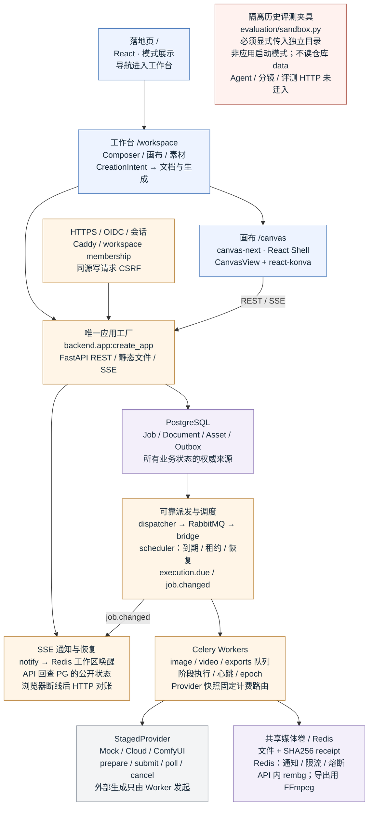
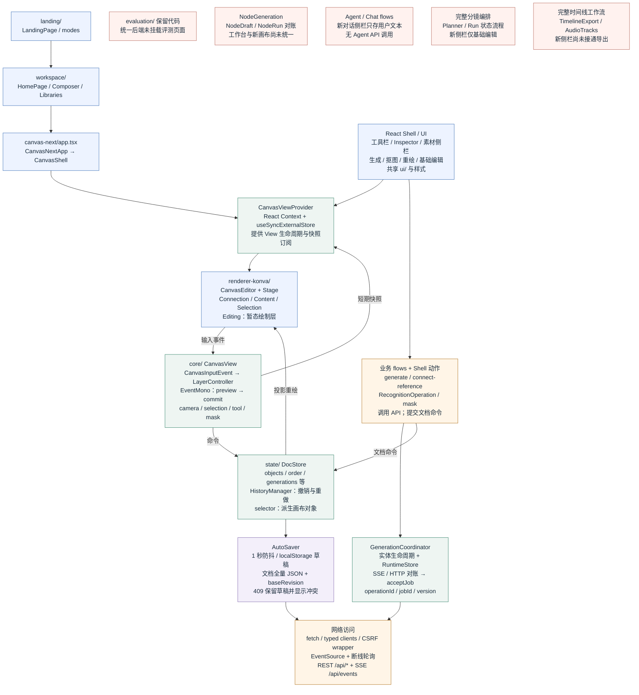
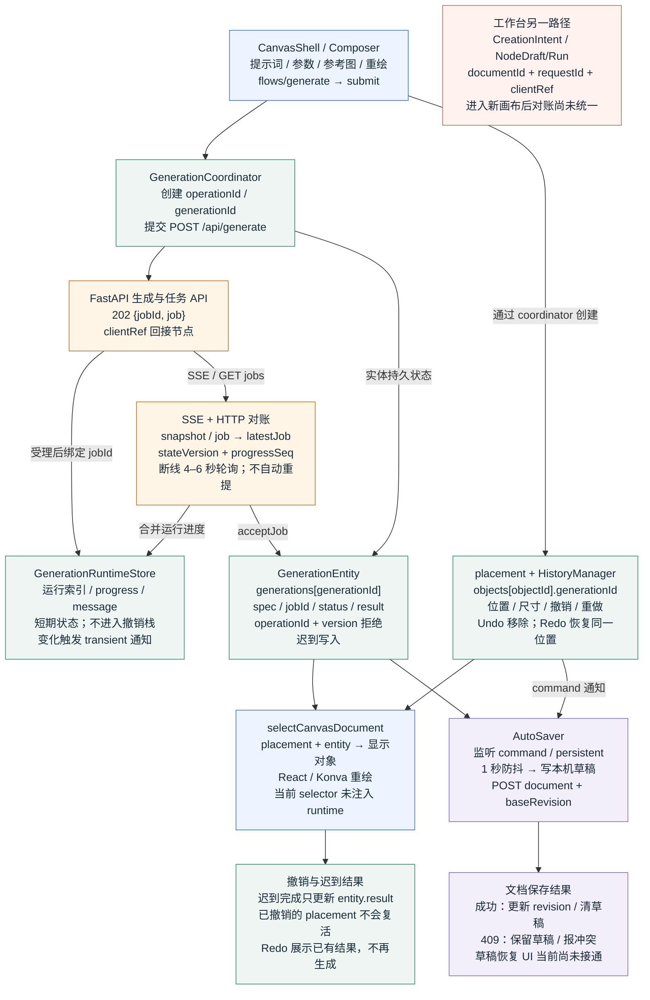
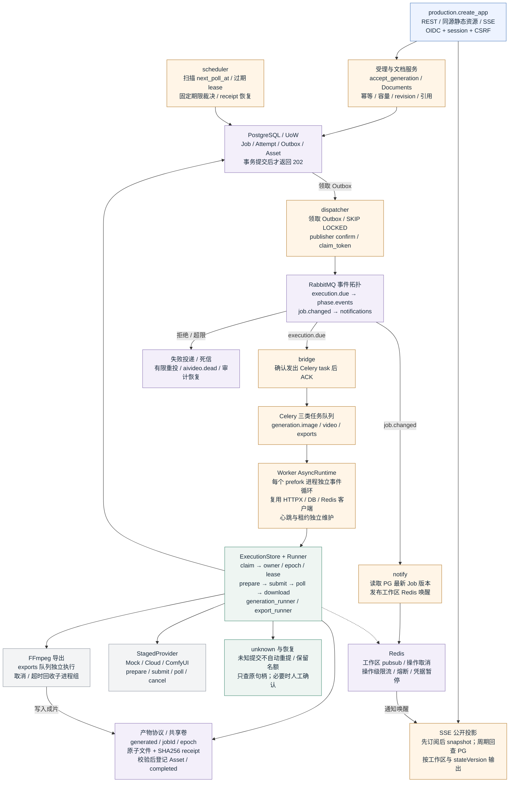
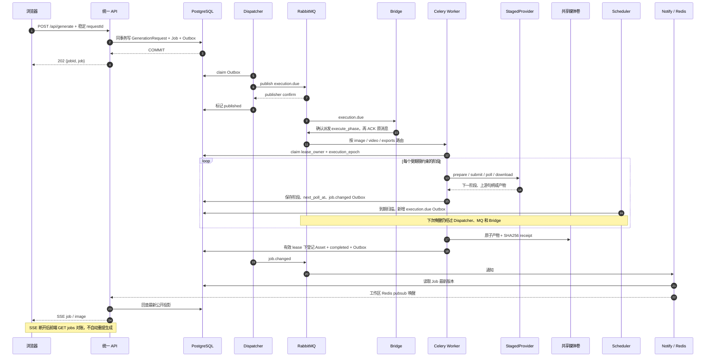
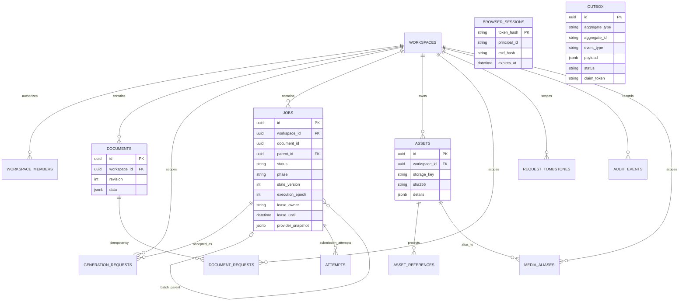
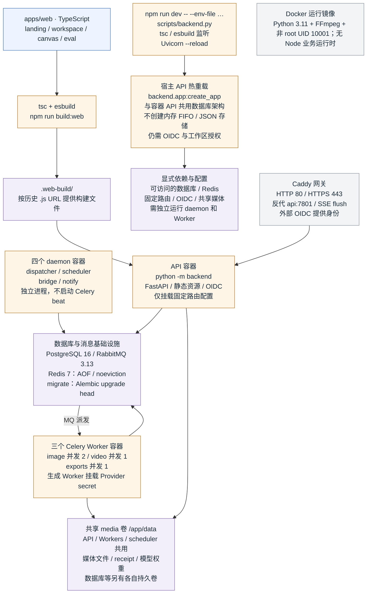

# aiVideo 前后端架构图

当前项目已统一到 PostgreSQL / RabbitMQ / Redis / Celery 后端。图解覆盖前端编辑状态、数据库受理、阶段执行、产物恢复和部署关系。

应用已统一到数据库执行架构。旧实现仅保留为显式隔离评测和历史契约沙箱，不属于运行模式。外围 HTTP 功能与新版画布仍存在未迁移/未接通部分。

> 基线：2026-10-05，Git HEAD `9868f59` 加当前未提交工作区。此报告描述源码连线，不代表线上部署或本次运行验收。

## 01 系统全景：前后端统一使用持久化执行架构

所有应用入口共用 PostgreSQL / RabbitMQ / Redis / Celery。开发热重载与容器部署只改变进程启动方式，不切换队列或存储实现。

- **单一业务运行架构**：backend.app 与 backend.production 导入同一工厂。npm dev/start、python -m backend 和默认 Compose 均使用数据库 API，AIVERO_API_MODE 已退役。

- **开发依旧可以热重载**：--reload 只影响源码监听；仍需要数据库、Redis、独立 Worker、共享媒体、OIDC 与 HTTPS 配置。缺配置会失败，不回退 JSON 或 Mock 应用。

- **历史代码的保留范围**：旧 HTTP/FIFO 仅被隔离评测、性能夹具与兼容测试显式导入，无法用默认无参数工厂启动，禁止操作仓库 data。已有数据需离线导入。

- **当前功能边界**：Agent、完整分镜编排、评测 HTTP 页面尚未迁入统一入口；新画布中的部分工作流也未接通。统一入口不代表这些外围能力已经迁移完成。

源码依据：`apps/api/backend/app.py:1`；`apps/api/backend/__main__.py:13`；`apps/api/backend/production.py:89`；`apps/api/backend/evaluation/sandbox.py:112`；`docker-compose.yml:1`。

## 02 前端模块分层：入口、交互核心、文档与网络

当前画布以 canvas-next/app.tsx 为组合入口。React 管工具和面板，CanvasView 管交互与短期快照，DocStore 管持久文档，React-Konva 只承接渲染和输入适配。

- **交互与绘制分离**：Konva 输入先变成显式 CanvasInputEvent。交互层产生预览或命令；拖动中更新短期快照，提交时才进入文档历史，避免每次鼠标移动都成为撤销项。

- **三类状态**：DocStore 保存文档；CanvasViewSnapshot 保存相机、选中、工具和笔画；GenerationRuntimeStore 保存请求与进度。它们的生命周期和保存策略不同。

- **网络栈现状**：普通页面用 fetch 与类型化封装，landing/workspace/canvas-next 安装同源写请求 CSRF 包装。TanStack Query 主要用于独立评测页；不是全站统一 Query 或 Axios 层。评测源码仍保留，但应用入口不提供 /evals 或评测 API。

- **当前接线缺口**：NodeGeneration、Agent、完整分镜及时间线导出模块保留在 canvas/flows，但当前入口没有装配；不能将其全部视为新版界面已实现能力。

源码依据：`apps/web/canvas-next/app.tsx:37`；`apps/web/canvas/react/canvas-view-context.tsx:25`；`apps/web/canvas/core/canvas-view.ts:87`；`apps/web/canvas/core/layers.ts:291`；`apps/web/canvas/renderer-konva/canvas-editor.tsx:37`；`apps/web/shared/session-fetch.ts:2`。

## 03 前端状态流：生成实体、画布位置与保存分离

生成实体保留任务身份和结果，placement 决定它是否出现在画布上。SSE 或轮询只合并状态；自动保存只响应需要持久化的文档变更。

- **为什么撤销不会重复计费**：用户历史记录 placement 命令，生成结果更新不进入撤销栈。撤销不自动取消上游任务；只有显式 cancel 才调用删除任务 API。

- **两种版本不能混用**：实体 operationId/version 用于前端操作归属与补丁次序；Job 的 stateVersion/progressSeq 用于 HTTP、SSE 和快照的状态合并。

- **幂等接线的现状**：CanvasCoordinator 当前只带 clientRef，不带稳定 requestId/documentId。后端可受理，但 clientRef 本身不是幂等键。工作台 CreationIntent 才沿用稳定请求 ID。

- **保存恢复的范围**：AutoSaver 已有草稿与冲突保护；resolveDraftOnOpen 和重复标签页保护模块尚未被新入口装配。进度 RuntimeStore 也尚未作为参数传入当前 selector。

源码依据：`apps/web/canvas/state/generation-coordinator.ts:91`；`apps/web/canvas/state/generation-entity.ts:153`；`apps/web/canvas/state/generation-events.ts:48`；`apps/web/canvas/state/autosave.ts:37`；`apps/web/canvas-next/app.tsx:122`；`apps/web/workspace/api.ts:136`。

## 04 统一后端：事务受理、阶段执行与通知闭环

PostgreSQL 保存任务和执行所有权；RabbitMQ 传递至少一次消息；Celery 每次执行一个阶段；Redis 协調通知、限流和熔断。API 受理不直接调用付费生成。

- **四个 daemon 各司其职**：dispatcher 保证数据库事件送达 MQ；bridge 转成 Celery 执行任务；scheduler 扫描到期任务并恢复租约；notify 将状态变更转成 Redis 唤醒。Compose 不运行 Celery beat。

- **消息可重复，提交不可盲重试**：至少一次消息由数据库 claim、lease_owner、execution_epoch 和期限检查吸收重复。Attempt 记录提交尝试；不能确定上游是否收单时转 unknown，不自动重新付费生成。

- **模型并发与 Worker 并发分开**：PG 模型槽位代表实际上游任务并发；轮询等待不占 Celery 执行槽。Redis 负责速率和熔断；PostgreSQL 才是任务状态依据，Celery 未使用结果后端。

- **资源恢复与事件恢复**：文件先原子落盘并写 receipt，再登记资产；崩溃后可恢复已有产物。SSE 依赖 PG 快照和周期对账，Redis 是唤醒信号，不是事件历史或 Last-Event-ID 重放日志。

- **抠图仍在 API**：当前 API 的 rembg 识别仍是 API 进程内单推理线程，Redis 传递跨实例取消标记；只有时间线导出进入 exports Worker。识别结果不持久化为蒙版资产。

源码依据：`apps/api/backend/production.py:307`；`apps/api/backend/services/acceptance.py:18`；`apps/api/backend/services/execution.py:45`；`apps/api/backend/workers/daemon.py:36`；`apps/api/backend/workers/daemon.py:63`；`apps/api/backend/workers/daemon.py:150`；`apps/api/backend/infrastructure/outbox_dispatcher.py:23`；`apps/api/backend/services/generation_runner.py:31`。

## 05 一次生成请求的跨层时序

以下展示统一后端的主路径。任务状态与派发事件同事务落库，执行分成可恢复的阶段，最终经通知唤醒与数据库投影回到浏览器。

- **202 的含义**：请求已被可靠受理，尚未生成完成。结果通过 Job.images、历史与 SSE 异步返回；不能把 202 当成媒体已生成。

- **图中的合并泳道**：SVG 将 Dispatcher/MQ、Bridge/Worker 和 Provider/媒体卷合并以便阅读；Mermaid 源码保留更细的独立参与者，模块边界见上一图。

- **同步与异步 Provider**：有些图像调用同步返回产物；云视频与 ComfyUI 常经历上游句柄轮询。图中阶段是协议概览，不代表所有适配器都经过完全相同的分支。

- **失败和取消**：有句柄就对账原任务；缺句柄且提交不确定时保留 unknown。取消标记不代表上游确认停止；已有完整 receipt 可恢复登记，避免重新生成。

源码依据：`apps/api/backend/production.py:296`；`apps/api/backend/services/acceptance.py:36`；`apps/api/backend/services/generation_runner.py:31`；`apps/api/backend/services/execution.py:154`；`apps/api/backend/infrastructure/artifacts.py:16`；`apps/api/backend/production.py:754`。

## 06 数据实体与存储：关系表、画布 JSONB、媒体文件

本图描述当前应用数据库。实线表示主要外键关联，虚线表示逻辑或多态引用。画布内容在 Document.data JSONB 中，图像和视频字节放在共享文件卷。

- **外键与逻辑关系**：没有独立 User 表；Session 与 Member 通过 principal_id 逻辑关联。Job.document_id 不是外键；Outbox.aggregate_id 与 AssetReference.owner_* 也是逻辑关系。Mermaid ER 图只画真实外键。

- **批次与尝试**：Job.parent_id 支持父子批次聚合；Attempt 专门记录上游提交尝试，不是每次轮询都新建。GenerationRequest 负责受理幂等，DocumentRequest 负责文档创建幂等。

- **旧数据导入**：旧 documents/*.json、assets/*、jobs.json、history.json 属历史数据格式，只用于离线导入和隔离兼容回归。应用启动不会自动读取它们或恢复旧 FIFO。

- **一致性边界**：revision 防止覆盖他人的文档；资产引用随文档事务更新。文件与数据库不是单一事务，因此需要不可变产物和 receipt 补偿恢复。当前迁移链到 0008。

源码依据：`apps/api/backend/infrastructure/orm.py:30`；`apps/api/backend/infrastructure/orm.py:87`；`apps/api/backend/infrastructure/orm.py:125`；`apps/api/backend/infrastructure/orm.py:192`；`apps/api/backend/infrastructure/orm.py:226`；`apps/api/backend/services/documents.py:86`；`apps/api/backend/infrastructure/artifacts.py:16`。

## 07 构建与部署：同一后端的热重载与容器启动方式

Node 构建前端、Python 运行 API。默认 Compose 与 compose.dev.yaml 解析为同一套 13 服务；宿主热重载也使用同一数据库应用工厂。

- **生产镜像与开发环境**：Docker 第一阶段用 Node 构建前端，第二阶段只有 Python 与运行依赖。npm run dev 只是开发启动桥，同时启动前端编译监听与 Uvicorn 热重载。

- **配置和凭据分工**：API 从部署路由固定 endpoint、模型与 credentialRef；真实 Provider 密钥只挂到生成 Worker。该图不包含真实配置值，未读取或复制用户凭据。

- **扩展边界**：当前 Compose 是单机配置：单节点 PG、单节点 RabbitMQ、Redis 和共享文件卷。独立进程不等于多节点高可用，也未使用 S3 或跨主机对象存储。

- **统一启动**：默认 docker-compose.yml 合并执行栈与 API/HTTPS 配置；compose.dev.yaml 仅保留为同一配置的兼容文件名。旧 bailian 单进程启动脚本已移除。

源码依据：`scripts/build-react.ts:6`；`scripts/backend.py:14`；`tsconfig.web.json:1`；`Dockerfile:1`；`compose.execution.yaml:1`；`compose.production.yaml:1`；`deploy/Caddyfile:1`；`docs/runbooks/production-cutover.md:1`；`compose.dev.yaml:1`；`apps/api/backend/__main__.py:13`。

## 08 当前接口与迁移边界

应用只有数据库执行架构。下表明确当前已提供的 API，以及历史功能和请求兼容边界。

| 能力 / 路径 | 统一后端 | 迁移与调用说明 |
| --- | --- | --- |
| 生成 /api/generate；/api/generate/group | Job + GenerationRequest + Outbox 事务；requestId → Idempotency-Key → 服务端 UUID 回退。缺稳定 ID 时仅 clientRef 不幂等。 | CanvasCoordinator 当前仅带 clientRef；工作台 CreationIntent 带稳定 requestId。clientRef 本身不提供重放幂等。 |
| 受理响应 | 单次生成同样返回 202 {jobId, job}；批量/组图可拆父子 Job。 | 202 表示持久受理，结果异步返回。 |
| 任务 /api/jobs；/{id}；/{id}/reconcile | 按 workspace 查询 PG；阶段租约、epoch、固定期限、unknown 对账；不借对账重新提交。 | 撤销画布 placement 不等于取消生成。 |
| 请求 /api/generation-requests/{requestId} | 空间作用域 GenerationRequest + RequestTombstone；处理取消先于受理。 | 取消先于受理通过 tombstone 处理。 |
| 事件 /api/events | Redis 工作区唤醒 + PG 公开投影 + 周期回查；不依赖 Redis 恢复历史。 | 无 Redis 历史事件重放；通过数据库快照与轮询恢复。 |
| 文档 /api/documents；/{id}；/{id}/rename | Document JSONB + revision CAS；与素材引用事务更新。 | 旧 JSON 文档需离线导入。 |
| 素材 /api/assets；/{id}；metadata；poster | Asset 表 + 共享文件；授权 /api/assets/{id}/content；旧媒体别名兼容。 | 生成媒体与上传素材由权限和引用关系保护。 |
| 历史 /api/history；/api/images/{id}；star | PG Asset 查询与 hidden/star 状态；删除历史不直接抹除可能被引用的字节。 | 不再从根 data/history.json 提供应用历史。 |
| 抠图 /api/cutout/detect/{id}；operations/{id}；apply/{id} | 同样单线程 rembg；detect 返回临时 data URL；Redis 取消标记；apply 创建 Asset。 | 旧沙箱 detect 的蒙版 Asset 行为仅用于历史契约回归。 |
| 导出 /api/exports；/{id}；/{id}/download | durable export Job → exports Worker → FFmpeg → 同一产物登记协议。新版画布入口尚未装配导出 flow。 | 新版画布尚未装配完整导出 flow。 |
| Agent /api/agent/sessions；prepare | 未迁入当前入口；新版对话侧栏当前也没有调用此 API。 | 仅在隔离历史沙箱保留旧协议，不是应用部署选项。 |
| 分镜 /api/storyboards/jobs；runs；plan | 缺少这些路由；Document 可以保存 storyboard 字段，不等于已有编排服务。 | 文档保留 storyboard 字段，不代表完整编排已接入。 |
| 评测 /api/evals/v1/* | 未挂载评测 router，也没有 /evals 页面入口。此评测任务不使用生产 Celery 生成队列。 | 离线评测 CLI 保留；评测页面和 HTTP API 尚未迁移。 |
| 配置 /api/runtime；models；generation-capabilities；config | 固定部署路由，settingsEnabled=false；config GET/POST/test 返回 403。 | 旧 config.json / SWARMUI_PROVIDER 应用设置入口退役。 |
| 身份 /auth/*；会话与工作区 | OIDC + PKCE / 服务端 session / WorkspaceMember / 同源 CSRF；未自动给登录用户工作区权限。 | 开发与部署采用相同身份边界。 |
| 观测 /api/metrics；/internal/metrics | Token 保护的 /internal/metrics，PG 聚合指标；Compose 提供告警规则，未声称已配完整追踪平台。 | 完整故障矩阵与监控接收方仍需部署验收。 |

## 09 源码索引与范围

基于统一入口后的当前工作区。沙箱测试与应用集成测试分开表述，不以旧契约测试替代 PostgreSQL API 验证。

| 边界 | 主要源码入口 | 阅读重点 |
| --- | --- | --- |
| 唯一启动入口 | apps/api/backend/app.py:1；apps/api/backend/__main__.py:13 | 热重载与常规启动使用相同数据库 API，无模式分支。 |
| 前端组合根 | apps/web/canvas-next/app.tsx:37；:96；:132 | 打开文档、React Shell、自动保存和 SSE 装配。 |
| 交互与渲染 | apps/web/canvas/core/canvas-view.ts:87；canvas/core/layers.ts:291；canvas/renderer-konva/canvas-editor.tsx:37 | 输入归一化 → 层控制器 → preview/command → React-Konva。 |
| 文档与历史 | apps/web/canvas/state/doc-store.ts:105；history-manager.ts:27；autosave.ts:37 | 文档所有权、命令栈、persistent/transient 通知、revision。 |
| 生成实体与对账 | apps/web/canvas/state/generation-coordinator.ts:91；generation-entity.ts:153；generation-events.ts:48 | entity/placement 分离、运行态与版本过滤。 |
| 工作台与会话 | apps/web/workspace/api.ts:136；apps/web/shared/session-fetch.ts:2 | CreationIntent 的稳定幂等键、同源 CSRF 包装。 |
| 生成适配器 | apps/api/backend/providers/base.py:10；cloud.py:125；comfyui.py:45；staged.py:35 | 一体化 generate 与生产 prepare/submit/poll/cancel 分阶段接口。 |
| 统一 API / 授权 | apps/api/backend/production.py:89；services/identity.py:42 | OIDC、session、空间授权、生产路由和响应投影。 |
| 统一事务与状态机 | apps/api/backend/services/acceptance.py:18；services/execution.py:45；services/generation_runner.py:31 | 幂等、容量、lease/epoch、unknown、恢复与模型并发槽位。 |
| 消息与执行进程 | apps/api/backend/workers/daemon.py:36；:63；:150；workers/durable.py:31；infrastructure/outbox_dispatcher.py:23 | scheduler、bridge、notify、阶段执行、发布确认。 |
| 统一模型与媒体 | apps/api/backend/infrastructure/orm.py:30；artifacts.py:16；services/documents.py:86 | 真实 FK/逻辑边、JSONB、receipt、资产引用。 |
| 评测边界 | apps/api/backend/evaluation/api.py:66；scheduler.py:32；runner.py:225 | 独立离线评测模块；HTTP 页面/路由未挂载到当前应用。 |
| 构建与部署 | scripts/build-react.ts:6；Dockerfile:1；compose.execution.yaml:1；compose.production.yaml:1 | Node 构建产物、Python 运行镜像、共享卷与进程拓扑。 |
| 状态证据 | docs/architecture/durable-execution-status.md:1；docs/runbooks/production-cutover.md:1 | 实施中与剩余验收边界；较早 target-architecture/gap-matrix 不作为最新实现依据。 |
| 历史兼容沙箱 | apps/api/backend/evaluation/sandbox.py:112；sandbox_jobs.py:1 | 只有显式隔离评测和历史测试调用，不属于应用入口。 |
