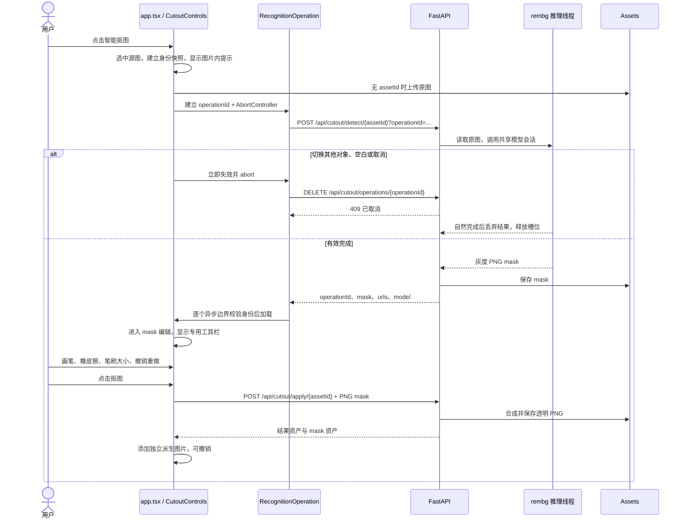

# 抠图流程与实现

前端业务模块使用 TypeScript，后端使用 FastAPI，直接在进程内调用 rembg。无需另起识别服务，不缓存 mask 或跨会话笔画草稿。

## 右侧 Agent 入口

- 在右侧发送“帮这张图抠图”“提取主体”“移除背景”，Host 将其解析为当前图片的画布编辑，返回持久化的 `canvasAction`，状态为 `waiting_approval`。这条路径不创建 Provider 作业或扣积分。
- 新请求受理后，前端仅在选区与源资产仍匹配时自动进入现有识别/蒙版编辑流程；迟到响应不能抢走新选区。历史记录、SSE 重放、刷新和幂等重试不自动识别，用户可点击“进入抠图模式”显式恢复；退出后不复用旧蒙版。
- 确认抠图后生成独立图片，先保存画布，再向 `/api/host/runs/{id}/canvas-result` 回写结果对象 ID 与版本。服务端核对拥有者、已保存对象、源图谱系和结果资产后才将聊天任务标记完成，右侧可定位结果。
- 同步回执失败时保留图片与结果 ID 收据，提供“同步抠图结果”；只重发回执，不重复识别或合成。收据不包含图片蒙版或笔画。
- 退出编辑、切换选区或右侧取消会结束尚未提交的 Agent 抠图。合成一旦提交则独立完成，不因选区变化丢失结果。

## 数据流

## 模块

| 模块 | 职责 |
| --- | --- |
| `core/layers.ts` / `core/monos.ts` | 抠图输入归属、画笔手势与源图选择 |
| `core/canvas-view.ts` | 会话内笔刷配置、笔画历史、独立撤销重做 |
| `cutout-controls.tsx` | 图片附近的单行深色工具条，状态、修正、确认与退出 |
| `cutout-mask-preview.tsx` | 紫色保留区域，实时呈现画笔与橡皮擦 |
| `flows/cutout-mask.ts` | 预览及提交共用灰度蒙版绘制；支持缩放笔宽、旋转图片、单击圆点 |
| `flows/cutout-placement.ts` | 图片附近定位，底部空间不足时上移，左右避让 |
| `flows/recognition-operation.ts` | 操作 ID、取消通知、响应归属与异步结果检查 |
| `flows/asset-util.ts` | 原图上传与资源访问，识别前上传支持 AbortSignal |
| `backend/cutout.py` | rembg 模型懒加载、单推理线程、忙状态、取消标记、超时 |

`app.tsx` 负责识别、编辑及显式提交的接线。笔画与蒙版仅存在于当前抠图会话，不写入文档或 localStorage。

## 交互与异常

- 识别中点击当前图片不会移动、resize 或重复识别。点击其他对象或空白立即退出识别，同次按下转交普通选择；右键其他对象退出并打开其菜单。
- 空格/中键平移、滚轮缩放继续识别；工具条跟随图片并避让视口边界。识别过程不锁定整张画布。
- Esc/退出清除当前选区与笔画历史，保留源图选中；笔刷大小弹层打开时，第一次 Esc 仅关闭弹层。切换对象则退出编辑。重新识别会明确重置当前修正，失败后可重试或手动涂抹。
- 文档实例、源对象 ID、资产 ID/URL/扩展名或原图谱系发生变化，或选中集合改变，会话失效。删除、换图、导航离开、迟到响应都不能覆盖新会话。
- 每个请求具有独立操作 ID；在上传、请求、JSON 解析、图片加载之后重新检查。旧 catch/finally 不会关闭新提示或恢复旧模式。
- 取消先于 POST 到达时，后端的短期取消标记阻止启动推理。标记保留 5 分钟、上限 2048，不包含图片结果。
- 推理占用单线程且不排无界队列；忙时返回 429，超时 120 秒返回 504，识别失败返回 502，取消返回 409。API 健康检查与画布操作继续响应。
- 取消或超时不能安全杀死 ONNX 原生线程，线程结束前仍占用槽位。已取消结果不落盘；落盘期间发生取消时完成写入后删除该资产。
- 模型会话每进程加载一次。默认 `birefnet-portrait`，首次使用可能下载约 928 MB 权重；`CUTOUT_MODEL=isnet-general-use` 可切换通用模型。重启清空操作状态。
- 工具栏采用图片附近的单行深色布局：画笔、橡皮擦、笔刷大小、重新识别、笔画撤销重做、原图对照、抠图与退出。笔刷大小浮层优先放在工具条下方以避让主体，空间不足时放到上方。当前合成不扣积分，不显示虚构的扣费；不放置尚未接通的快速选择。
- 不新增识别结果缓存或跨次复用 mask；退出蒙版时丢弃选区与笔画历史；再次点击抠图必须请求新的识别结果，不读写旧 localStorage 草稿。Agent 显式传入的预备蒙版按既有流程加载。
- 点击抠图后，合成任务独立运行。切换选择不会取消合成，旧任务完成不关闭新会话；失败保留当前蒙版与笔画供再次确认。

## 启动与验证

安装 `requirements-dev.txt` 后运行 `npm run dev`。不要同时启动多个进程使用同一数据目录。

`npm run verify` 包含 TS 校验、编译、lint、前端交互/异步竞态测试与 Python API/真实 HTTP/SSE 测试。模型测试另行执行，普通单元测试注入推理函数，避免依赖模型下载与机器性能。
