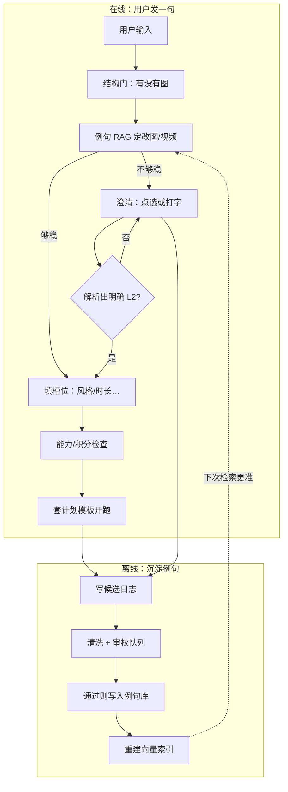

# 意图识别完整闭环：在线识别 + 离线沉淀

> 配套：`TECH_LAYERED_INTENT.md`（v1.2）、`TECH_INTENT_RAG_IMPL.md`  
> 目标读者：产品 / 实现 Agent；讲清「一整圈怎么转」，以及大厂常见对照。

---

## 1. 一句话

**在线**：拿不准就问用户，定死后开跑。  
**离线**：把「用户定死过 / 任务成功过」的句子洗干净，变成例句，下次更准。

---

## 2. 总览（两圈）

---

## 3. 在线流程（逐步）

| 步 | 做什么 | 不做什么 |
|----|--------|----------|
| 1 结构门 | 没选中图 → 不能「改图」；有图才能进改图/有图做视频 | 不在这里猜意图 |
| 2 例句检索 | 只在「当前可能」的 L2 里找 topK 例句，算相似度 | 不用正则当主分类器 |
| 3 置信度 | strong → 直接定 L2；weak/冲突 → 进澄清；none → 澄清或拒识 | 不偷偷默认成出图/出视频 |
| 4 硬门闩 | 「不要视频」等否定、入口冲突 | 门闩不能被槽位改掉 |
| 5 澄清 | 点选项 **或** 打字；选项绑定当时快照 | 没定死不往下跑 |
| 6 槽位 | 风格、时长、首帧等；**不得改 L2** | 槽位不是二次意图识别 |
| 7 能力门 | 视频未配置 → fail-closed | 禁止静默降级成只出图 |
| 8 执行 | `plan_from_decision` 套模板 → 队列 | — |

---

## 4. 离线沉淀（逐步）

### 4.1 什么能进「候选」

| 来源 | 记什么 | 默认可信度 |
|------|--------|------------|
| 澄清点选 | 原文 + 点的 L2 | 高（仍要过筛） |
| 澄清打字 | 原文 + 解析出的 L2 | 中（解析失败不进候选） |
| 任务成功且未立刻撤销/重做 | 原文 + 实际执行的 L2 | 中（事后反馈） |
| 人工标注 / 评测集 | 原文 + 标的 L2 | 最高 |

**不进候选**：纯模型猜、澄清未定死、用户放弃会话、误点后马上改主意且无最终成功任务。

### 4.2 清洗（必须）

1. **去噪**：空话、乱码、纯表情、与画布无关闲聊  
2. **去歧义**：一句双意图、标签互相矛盾 → 待人工或丢弃  
3. **去重/合并**：近义句只留代表，避免检索被刷屏  
4. **对标签**：以「最终确认 / 成功执行 / 人工标」为准  
5. **脱敏**：隐私、内部 URL、过长附件名  

### 4.3 入库与生效

候选 → 审校通过 → 写入 exemplar 表/文件 → **重建 embedding 索引** → 线上检索立刻带上新句。  
可选：先 **shadow**（只记「若有此句会怎么判」）再全量；用固定评测集（改图水彩 / 动起来要问 / 动画风格不当视频 / 否定不进视频）做回归门。

---

## 5. 和大厂常见做法的对照（公开资料归纳）

大厂对话 / 搜索 / 助手类产品，公开工程实践里常见的是同一套骨架，名字不同：

| 环节 | 常见叫法 / 做法 | 我们对应 |
|------|-----------------|----------|
| 在线分类 | Embedding / few-shot / 例句检索 + **置信度阈值**；不够稳就 clarify | 例句 RAG + strong/weak/none |
| 用户纠正 | 澄清选择、纠错、成功完成当 **候选标签**，进 HITL；人工 Approve 后再进库 | 候选日志 + 审校 |
| 数据质量 | Active learning：优先标「最不确定 / 模型分歧」；清洗、去重、硬负例 | 澄清样本优先审 |
| 上线控制 | 按批重建索引（不做每句在线改权重）；shadow → canary → 全量 | 评测集 + 可回滚例句版本 |
| 明确不做 | **不把每一次点击无审校自动写进训练集/例句库** | 候选 ≠ 已入库 |

公开对照（均有文档/论文，**非**即梦/可灵内部）：

| 来源 | 做法要点 |
|------|----------|
| [Dialogflow Training](https://docs.cloud.google.com/dialogflow/es/docs/training) | 日志里的 User Says → 人工 Approve 才进 intent / fallback 负例 → 再 train |
| [Copilot Studio NLU](https://learn.microsoft.com/en-us/microsoft-copilot-studio/guidance/language-understanding) | 多 topic 命中或置信低 → disambiguation / fallback |
| [AWS RAG AskHuman](https://aws.amazon.com/blogs/machine-learning/improve-llm-responses-in-rag-use-cases-by-interacting-with-the-user/) | 上下文不够就问人，不硬猜 |
| [Amazon REIC](https://arxiv.org/html/2506.00210v1) | `(query, intent)` 索引检索定意图；新意图靠 **更新索引**，不必整模重训 |
| [Weber et al. 2021](https://aclanthology.org/2021.dash-1.2/) | 优先 **核实** 模型假设，错了才全量标注 |
| [Pascual et al. 2023](https://aclanthology.org/2023.law-1.6/) | 生产分类器与 LLM 分歧 → 聚类优先标注 |
| [Meta BlenderBot](https://ai.meta.com/blog/blenderbot-3-a-175b-parameter-publicly-available-chatbot-that-improves-its-skills-and-safety-over-time/) | 在线收集反馈 → **批量**持续学习；过滤 troll |
| [Rasa Conversation Review](https://rasa.com/docs/studio/analyze/conversation-review/) | 按预测意图筛会话 → 审阅 → 沉淀 pattern |
| [AWS HITL ML Lens](https://docs.aws.amazon.com/wellarchitected/latest/machine-learning-lens/mlperf06-bp01.html) | 低置信/高风险/随机抽样进人工，再回流训练 |
| [OpenAI accuracy](https://developers.openai.com/api/docs/guides/optimizing-llm-accuracy) | 意图不清先澄清；日志要剪枝成高质量集（质 ≫ 量） |

> 即梦、可灵等内部流水线无公开细节，**不要臆造**；上表是跨产品的共性模式。调研全文见 `RESEARCH_INTENT_FEEDBACK_LOOP.md`。

---

## 6. 小团队落地建议（画布 Agent：改图 vs 视频）

**P0（先做）**

1. 在线：RAG + 阈值 + 澄清（点选/打字）+ fail-closed  
2. 日志：每次澄清与每次成功任务写结构化候选  
3. 人工/半自动清洗周更；例句库带版本号  
4. 固定 20～50 条回归例，入库前必跑  

**P1**

5. 成功任务弱标签 + 近重复合并  
6. Shadow：新例句先只观察命中分布  
7. 硬负例（「动画风格」≠ 视频）单独维护  

**不做**

- 澄清一点选就自动全量进库  
- 用正则重新当主识别  
- embedding 挂了赌视频  

---

## 7. 和现有 PR 的关系

- 在线主路径：见 `TECH_INTENT_RAG_IMPL.md` PR1–8  
- 本文件补的是 **PR 之外的数据闭环**：候选 → 清洗 → 入库 → 重索引 → 回归  
- 实现时可新增轻量模块：`intent/feedback_log.py`、`scripts/wash_exemplars.py`、`exemplars/VERSION`

---

## 8. 验收一句话

用户说「把这张改成水彩」稳走改图；说「动起来」会问；问完/跑成功的句子能进审校队列；洗完入库后同款话少再问；坏数据能回滚。
