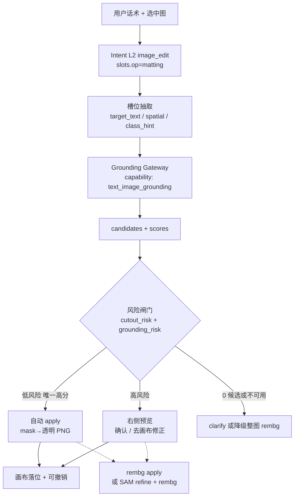

# 技术方案：文字对齐图内元素（Text–Image Grounding）→ 抠图

> 日期：2026-10-17  
> 仓库：aiVideo · Host Agent / 画布  
> 对齐：`HANDOFF_CUTOUT_AGENT.md`（默认自动 · 高风险才确认）、`TECH_LAYERED_INTENT.md`（L2 `image_edit` + `slots.op=matting`）、能力目录分层（Planner 不写供应商模型名）  
> 场景清单：`SCENES_TEXT_IMAGE_GROUNDING.md`

---

## 1. 背景与目标 / 非目标

### 1.1 背景

用户会说「抠出里面的人」「只要左边那个杯子」「去掉背景里的字」。现有抠图链路是 **rembg detect → mask → apply**，擅长「整图主前景」，**不会**把自然语言指到图内某个实例。

交互已修订为：**低风险自动 apply，高风险才确认**。多主体 / 指代不清本身就是高风险闸门信号——要真正「少点」，就必须先把 **文字 → 区域** 做对，再喂给 cutout。

### 1.2 目标

1. 在选中画布图上，把自然语言短语解析为 **候选区域**（box + 可选 mask）。  
2. 与 Intent 槽位、风险闸门、rembg/SAM 抠图串联，**复用**现有 cutout，不另起 Provider 假抠图。  
3. 按能力目录分层：Agent 只认 `capabilityId`；开源/云模型进 Adapter + Binding。  
4. fail-closed：判不清不自动抠；禁止静默走百炼 `image_edit` 冒充抠图。

### 1.3 非目标（本方案不做）

| 非目标 | 说明 |
|--------|------|
| 对话内画笔涂蒙版 | 空间编辑仍在画布；本方案只解决「指到哪」 |
| P0 完整多轮指代消解 | 「那个」「刚才那个」依赖会话状态，放 P1+ |
| 视频帧级 grounding | 仅静态图；视频另案 |
| 用 CLIP 单独做像素级定位 | CLIP 可粗排，不能当唯一精确定位 |
| Planner 写死 Grounding DINO / 某云 API 模型名 | 只输出 capability + 槽位 |

---

## 2. 问题定义：text referring → region

### 2.1 输入

| 字段 | 含义 |
|------|------|
| `assetId` / 选中图 | 画布当前有效 image 节点 |
| `query` | 用户指代表达，如「左边那个杯子」 |
| `locale` | 默认 `zh-CN` |
| 可选 `class_hint` | Intent 已抽出的粗类：`person` / `product` / `text` / `null` |
| 可选 `spatial` | `left` / `right` / `center` / `top` / `bottom` / `null` |
| 可选 `target_index` | 「第二个」「第 2 个」 |

### 2.2 输出

```ts
interface GroundingCandidate {
  id: string;                 // 稳定 id，幂等用
  box: [x1, y1, x2, y2];      // 归一化 0–1 或像素（协议写死一种：像素相对原图）
  score: number;              // 0–1
  label?: string;             // 检测器返回的开放词
  maskUrl?: string;           // 可选；无则后续 SAM/rembg 补
  source: "ovd" | "florence" | "vlm" | "heuristic";
}

interface GroundingResult {
  assetId: string;
  query: string;
  candidates: GroundingCandidate[];
  latencyMs: number;
  bindingVersion: string;
  degraded?: "none" | "no_grounding" | "timeout" | "provider_failed";
}
```

### 2.3 成功标准（产品语义）

- **命中正确实例**：用户说的那个对象在候选里且 top1 正确，或唯一高分候选正确。  
- **可喂抠图**：有 box，最好有 mask；最终透明图主体与指代一致。  
- **失败可解释**：0 候选 / 多候选同分 → 进入高风险确认或 clarify，不瞎抠。

---

## 3. 生产架构总览



**原则**：Grounding 只负责「指到哪」；Cutout 仍走现有 rembg detect/apply（或对 box 裁剪/SAM 细化后再 apply）。**禁止**把 grounding 结果当成 Provider 生图。

---

## 4. 分层 L0–L5（对齐能力目录）

| 层 | 职责 | 本能力要点 |
|----|------|------------|
| **L0 UI / 预览** | 过程条、候选框叠加、确认卡 | 低风险不弹工具条；高风险预览轮廓/多框点选 |
| **L1 Intent / Planner** | 只出 `image_edit` + `op=matting` + grounding 槽位 | **不写**模型名；可写 `needs_grounding=true` |
| **L2 Tool Gateway** | 查目录 → 校验 → 报价（若计费）→ 幂等 → 调用 | `text_image_grounding`；失败码稳定 |
| **L3 队列** | 可选：重模型异步；轻量可同步 | P0 建议同步 + 硬超时；超时降级 |
| **L4 Adapter** | 开源侧车 / 云 API | Grounding DINO+SAM、Florence-2、云开放词汇检测等 |
| **L5 Config Binding** | `adapter` + `modelId` + `credentialRef` + 阈值 | 换模型改 binding，不改 Planner |

### 4.1 能力目录条目（建议）

```yaml
capabilityId: text_image_grounding
enabled: true   # 未绑定时 false，fail-closed
input:
  maxRefImages: 1
  query: required
output:
  type: grounding_candidates
failClosed: true
tiers:
  preview: { maxCandidates: 5, timeoutSec: 8 }
  final:   { maxCandidates: 5, timeoutSec: 12 }  # 与 cutout 同请求时可合并
pricing:
  formulaRef: grounding_static_or_free   # P0 可与抠图同免积分，但流水仍记
```

抠图能力保持独立（现有 rembg 路径），可记为 `image_matting`（或沿用 canvasAction，不进 Provider catalog）。Gateway 顺序：

```
Intent → (可选) text_image_grounding → image_matting(detect/apply)
```

---

## 5. 推荐技术栈（生产）

### 5.1 P0（推荐主路径）

**开放词汇检测（OVD）→ 框 → SAM/SAM2 出 mask → 交 cutout**

| 组件 | 选型方向 | 作用 |
|------|----------|------|
| 检测 | Grounding DINO / OWL-ViT 类，或 **Florence-2** grounding | 文本 query → boxes + scores |
| 分割 | SAM / SAM2（box prompt） | box → 精细 mask |
| 抠图合成 | **现有 rembg apply**（或 mask 直接 alpha 合成，与现网一致） | 透明 PNG 落画布 |
| 中文 | query 侧做轻量同义扩展（人→person/people/人像）；或选对中文友好的多语检测 | 避免纯英模型漏「杯子」 |

**为何不单用 rembg**：rembg 是显著前景，无法区分「左边杯子 vs 右边杯子」。  
**为何不单用 CLIP**：相似度热图粗、边界糊，误抠率高，只作 P1 召回辅助。

### 5.2 P1

| 路径 | 适用 |
|------|------|
| 指代表达理解（REC）模型 | 「穿红衣服的人右边的包」等长句 |
| 多模态 VLM 出 box/JSON | 复杂指代、关系；再 SAM；注意延迟与幻觉，需 schema 校验 |
| 多主体点选 UI | grounding 返回 >1 时预览点选 |

### 5.3 可选 / 不推荐单用

| 方案 | 定位 |
|------|------|
| CLIP / SigLIP 图文粗排 | 仅召回或 class_hint 校验，**不**单独定像素 |
| 纯启发式（最大人脸框） | 仅 `class_hint=person` 且无人脸检测失败时的弱降级 |
| 云商「一句话抠图」黑盒 | 可作 Adapter，但须进 catalog；禁止绕过风险闸门 |

### 5.4 对比表

| 方案 | 延迟 | 精度（实例） | 成本 | 多主体 | 中文短语 | 生产建议 |
|------|------|--------------|------|--------|----------|----------|
| Grounding DINO/OWL + SAM | 中（0.5–3s 级，视 GPU） | 高 | 中（自建 GPU） | 优 | 需 query 规范化 | **P0 首选** |
| Florence-2 grounding | 中 | 高（一体） | 中 | 良 | 看权重语种 | P0 备选一体模型 |
| VLM → box → SAM | 高 | 参差、有幻觉 | 高 | 良 | 优 | P1 复杂句 |
| CLIP 热图 | 低 | 低 | 低 | 差 | 中 | 仅粗排 |
| 仅 rembg | 低 | 主前景尚可 | 低 | 差 | N/A | 无 grounding 时降级 |
| 云开放词汇 API | 中-高 | 视供应商 | 按次 | 视供应商 | 视供应商 | Binding 可切换 |

**P0 落地形态**：侧车 HTTP 服务（GPU）或托管推理；Host Worker 调 Adapter；密钥在 L5。

---

## 6. 槽位设计

在现有 `image_edit` + `op=matting` 上扩展（L3 抽取，不推翻 L2）：

```ts
interface MattingSlots {
  op: "matting";
  target_text?: string;       // 「杯子」「人」「红色书包」
  target_index?: number;      // 1-based：「第二个」
  spatial?: "left" | "right" | "center" | "top" | "bottom";
  class_hint?: "person" | "product" | "text" | "animal" | "other";
  needs_point?: boolean;      // true → 强制高风险点选
  fine_edge?: boolean;        // 「发丝」「精细」→ 高风险，去画布
  needs_grounding?: boolean;  // 有指代/空间/索引时 true；纯「抠图/去背景」可 false
}
```

### 6.1 抽取规则（P0 可规则 + exemplar）

| 用户说法 | 槽位 |
|----------|------|
| 帮我抠图 / 去背景 | `needs_grounding=false`，整图 rembg |
| 抠出里面的人 | `target_text=人`, `class_hint=person`, `needs_grounding=true` |
| 只要左边那个杯子 | `target_text=杯子`, `spatial=left`, `class_hint=product` |
| 抠第二个 | `target_index=2`, `needs_grounding=true` |
| 精细抠发丝 | `fine_edge=true` → 高风险 |
| 先抠再做成视频 | 顺位 → P0 clarify（对齐 cutout handoff） |

`target_ref` 可作对外统一字段：序列化上述槽位，便于 Trace 与 exemplar。

---

## 7. 风险闸门：与「默认自动 · 高风险才确认」衔接

在 `cutout_risk` 上叠加 `grounding_risk`（纯函数，判不清 → 高）：

| 信号 | 风险 | 行为 |
|------|------|------|
| 无选中图 | 高 | clarify，不调用 grounding/detect |
| `needs_grounding=false` 且单前景意图 | 低* | 走现网 rembg；*仍受 mask 质量约束 |
| candidates.length === 1 且 score ≥ T_auto | **低** | **自动** mask→apply（可撤销） |
| candidates.length === 0 | 高 | clarify 或降级「整图去背景？」二次确认 |
| candidates.length > 1 且 top1−top2 < T_margin | 高 | 预览多框点选 / 确认 |
| score 全 < T_min | 高 | 不自动；预览或 clarify |
| `fine_edge` / 用户要手改 | 高 | 预览或直接去画布修正 |
| `needs_point` | 高 | 必须点选 |
| grounding 超时/失败 | 高 | 见 §9 降级，不静默假成功 |
| 历史 SSE 重放 | — | 不自动 apply |

**阈值**（`grounding.toml`，禁止写死魔法数进业务代码）：`T_auto`、`T_min`、`T_margin`；上线前用评测集标定；`rule_version` 进 Trace。

**与 HANDOFF_CUTOUT_AGENT 一致**：低风险零点击；高风险右侧「确认抠图 / 去画布修正」；画布工具条仅兜底。

---

## 8. API 草图

### 8.1 检测

```http
POST /api/grounding/detect
Content-Type: application/json

{
  "assetId": "ast_xxx",
  "query": "左边的杯子",
  "locale": "zh-CN",
  "classHint": "product",
  "spatial": "left",
  "maxCandidates": 5,
  "idempotencyKey": "session:run:grounding:hash",
  "tier": "preview"
}
```

**响应 200**

```json
{
  "assetId": "ast_xxx",
  "query": "左边的杯子",
  "candidates": [
    {
      "id": "c0",
      "box": [120, 80, 340, 410],
      "score": 0.87,
      "label": "cup",
      "maskUrl": "https://.../mask.png",
      "source": "ovd"
    }
  ],
  "latencyMs": 920,
  "bindingVersion": "gnd-2026-10-17.1",
  "degraded": "none"
}
```

**错误码**（稳定）：`asset_forbidden` / `asset_expired` / `capability_unavailable` / `provider_timeout` / `provider_failed` / `idempotent_replay` / `query_empty`。

### 8.2 与 Cutout 编排（Host 侧，非新公开 API）

```
1. Intent → slots
2. if needs_grounding: POST grounding/detect
3. risk = f(slots, candidates, mask_stats)
4. if auto: apply(mask) → canvas
5. if confirm: UI preview → user → apply
6. Trace: grounding.*, risk, mode, auto_applied
```

Agent/Planner **只**发 capability + 槽位；由 Gateway 解 binding。

---

## 9. 数据流与缓存、幂等、超时、降级

### 9.1 数据流

```
选中节点 assetId
  → 鉴权读原图（与 cutout 同源，禁止匿名 URL 外泄）
  → Adapter(query 规范化 → OVD → 可选 SAM)
  → candidates 写短缓存
  → 风险闸门
  → rembg/SAM mask → apply → 派生 asset → 画布 CAS 写回
```

### 9.2 缓存

| 键 | TTL | 内容 |
|----|-----|------|
| `gnd:{assetContentHash}:{queryNorm}:{bindingVersion}` | 短（如 10–30 min） | candidates JSON |
| mask 对象存储 | 与临时 cutout 一致 | 按现网清理策略 |

同一 `assetId` 若内容变更（新 revision），hash 变，缓存自然失效。

### 9.3 幂等

`idempotencyKey = sessionId + assetId + queryNorm + bindingVersion (+ runId)`  
重复提交返回同一 `GroundingResult`，不双计费（若未来计费）。

### 9.4 超时

- Gateway 硬超时：`tiers.*.timeoutSec`（建议 preview ≤ 8s）。  
- 超时 → `provider_timeout`，进入降级，**不**空等后当成功。

### 9.5 降级矩阵

| 情况 | 行为 |
|------|------|
| 能力未开通 / 无 binding | `capability_unavailable`；clarify「暂不支持按物体抠图，可整图去背景」；**禁止** Provider 假抠 |
| grounding 超时/失败 | 高风险：可选「整图 rembg」二次确认，或重试；默认不自动 |
| 0 候选 | clarify 改述 / 点选；或确认整图去背景 |
| SAM 失败但有 box | 用 box 膨胀 + rembg 局部 / 或仅 box 裁剪蒙版；质量差则转确认 |
| 纯「去背景」且 grounding 不必需 | 跳过 grounding，直接 rembg（现网） |

---

## 10. 评测

### 10.1 例句集（每条含图标注）

至少覆盖：

- 单人像：「抠出里面的人」  
- 空间：「左边的杯子」「右边的人」  
- 类别：「只要书包」「去掉文字」  
- 索引：「第二个」  
- 负例：「动画风格海报」不得进 matting  
- 多主体歧义：「抠人」但图中 3 人  
- 中英混写：「cut out the dog」

标注：`gt_box` / `gt_mask` / `expected_risk` / `expected_ux`（auto|confirm|clarify）。

### 10.2 指标

| 指标 | 定义 | 门禁建议（标定后写入） |
|------|------|------------------------|
| 指代准确率 | top1 与 gt 实例一致（IoU≥0.5 或同实例 id） | P0 ≥ 标定阈值 |
| Box IoU / Mask IoU | 与 gt | 报 P50/P95 |
| 误抠率 | 自动路径下主体错误仍 apply 的比例 | **越低越好**，自动路径严控 |
| 自动率 | 低风险且 auto 的占比 | 观察，防刷高 |
| 澄清率 / 确认率 | clarify、confirm 占比 | 与产品预期对比 |
| 延迟 | grounding P95 | ≤ 配置预算 |
| 降级率 | degraded ≠ none | 告警 |

### 10.3 Trace 字段

`query`, `query_norm`, `candidate_count`, `top_score`, `margin`, `risk`, `mode`, `auto_applied`, `bindingVersion`, `latency_ms`, `degraded`。

---

## 11. 分期

### P0

- 槽位：`target_text` / `spatial` / `class_hint` / `needs_grounding` / `fine_edge`  
- 能力：`text_image_grounding` + Adapter（OVD+SAM 或 Florence-2）  
- 风险闸门与 cutout auto/confirm 打通  
- 0/1/>1 候选行为；超时降级；评测集 v0（≥50 条）  
- **不做**：VLM 主路径、多轮指代、视频

### P1

- 多主体预览点选；`target_index`  
- REC / VLM 补复杂句（schema 约束 + 校验）  
- CLIP 粗排可选  
- 中文 query 同义库运营化

### P2

- 会话指代（「那个」）；批量多图；质量模型预估误抠概率  
- 与「先抠再视频」顺位计划打通（仍须明确确认策略）

---

## 12. 验收门

| ID | 验收项 |
|----|--------|
| G01 | 「抠出里面的人」+ 单人像 → grounding 1 高分候选 → **自动**透明图；无工具条 |
| G02 | 「只要左边那个杯子」+ 双杯图 → top1 为左杯；低分差则确认而非盲自动 |
| G03 | 三人图 +「抠人」→ 不自动；预览或 clarify |
| G04 | 无 grounding binding → 明确不可用或降级确认整图；**无** Provider image_edit 作业 |
| G05 | 超时 → 高风险路径，不空结果当成功 |
| G06 | 改 binding 模型 ID，Planner 代码无需改 |
| G07 | 与 K-A1/K-H*（HANDOFF_CUTOUT_AGENT）回归：`fine_edge` 仍不自动；无图 clarify |
| G08 | 幂等键重复不双跑计费/双写冲突 |
| G09 | Trace 含 risk/mode/auto_applied/grounding 字段 |
| G10 | 「先抠再视频」P0 仍 clarify |

---

## 13. 附录：与即梦「画布抠图 + 点选」的差异

| 维度 | 即梦（公开能力印象） | 本方案 |
|------|----------------------|--------|
| 对话 vs 画布 | Agent 编排生成；抠图精修在画布 | 同：对话唤起；空间修正在画布 |
| 指到物体 | 偏画布点选 / 智能主体 | **文字 grounding** 优先，点选为高风险兜底 |
| 确认 | 画布「抠图」确认感强 | **默认自动**，高风险才确认（对齐修订 handoff） |
| 多主体 | 分别抠 / 点选 | P0 clarify 或预览；P1 点选 |
| 能力治理 | 产品闭源 | 能力目录 + Binding，可换 OVD/云 |

对齐的是「对话不负责画笔」；差异是我们用 **生产级 text grounding** 减少点选，并把自动/确认纳入统一风险闸门。

---

## 14. 实现落点建议（供排期，非强制目录名）

- `capability-catalog`：新增 `text_image_grounding`  
- Host：matting 计划步插入 grounding；`cutout_risk` 扩展  
- 前端：候选框叠加（confirm 态）；auto 态过程条进度  
- Worker/侧车：OVD+SAM Adapter  
- 配置：`grounding.toml` 阈值 + binding  
- 文档：本文件 + `SCENES_TEXT_IMAGE_GROUNDING.md` + 更新 `HANDOFF_CUTOUT_AGENT` 交叉链接

---

**文档状态**：可直接据此排期与实现；阈值数值须评测标定后写入配置，不在业务代码写死。
