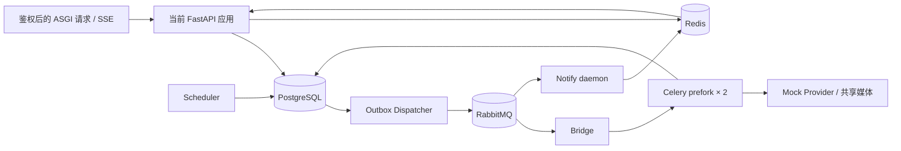

# 当前数据库后端性能基线 · 2026-10-05

> 协议：`durable-backend-baseline-v1`。基于当前工作区源码与 `backend.app:create_app` 实测。旧 sandbox / JSON / FIFO 的报告保留，不能与本报告计算优化收益。



## 读接口

每个场景 50 次正式请求，单并发另预热 1 次、10 并发另预热 10 次。下表延迟仅统计成功请求；失败单独保留。单位 ms，格式 P50 / P95。

### 10,000 个其他工作区背景任务

| 接口 | 单并发 | 10 并发 | 每请求 SQL（成功） | 响应体字节 |
|---|---:|---:|---:|---:|
| `/api/session` | 2.60 / 3.14 | 12.60 / 16.09 | 2 | 69 |
| `/api/jobs` | 94.64 / 205.43 | 331.64 / 555.53 | 104 | 245,590 |
| `/api/jobs/0103e903-6773-5789-b1cf-d7bc8c8ab89d` | 5.57 / 6.17 | 36.21 / 84.88 | 4 | 2,461 |
| `/api/generation-requests/baseline-request-0` | 7.33 / 8.86 | 40.98 / 55.99 | 5 | 2,461 |
| `/api/documents` | 275.53 / 530.10 | 1,554.72 / 2,559.65 | 3 | 62,015 |
| `/api/documents/5e018e8d-818c-5a71-97d6-0eef9c0c582f` | 7.33 / 11.68 | 39.38 / 69.55 | 3 | 100,205 |
| `/internal/metrics` | 11.44 / 31.56 | 44.35 / 67.17 | 7 | 502 |

### 100,000 个其他工作区背景任务

| 接口 | 单并发 | 10 并发 | 每请求 SQL（成功） | 响应体字节 |
|---|---:|---:|---:|---:|
| `/api/session` | 2.47 / 3.30 | 13.36 / 17.01 | 2 | 69 |
| `/api/jobs` | 92.95 / 186.09 | 357.92 / 594.88 | 104 | 245,590 |
| `/api/jobs/0103e903-6773-5789-b1cf-d7bc8c8ab89d` | 5.93 / 6.95 | 25.96 / 30.99 | 4 | 2,461 |
| `/api/generation-requests/baseline-request-0` | 8.12 / 11.11 | 36.33 / 44.07 | 5 | 2,461 |
| `/api/documents` | 257.50 / 383.18 | 1,464.43 / 2,332.51 | 3 | 62,015 |
| `/api/documents/5e018e8d-818c-5a71-97d6-0eef9c0c582f` | 5.86 / 7.44 | 27.69 / 33.78 | 3 | 100,205 |
| `/internal/metrics` | 47.18 / 55.65 | 164.75 / 335.97 | 7 | 504 |

共 **1,400 次正式请求 + 154 次预热，28,409 条 SQL**。原始记录与汇总已独立复算核对，SQL 全部归属到具体请求。HTTP 200 响应均通过内容校验。

| 失败场景 | 正式请求 | 预热 |
|---|---:|---:|
| 1 万背景任务，文档列表，10 并发 | 2 / 50（4%） | 1 / 10 |
| 10 万背景任务，文档列表，10 并发 | 0 / 50 | 4 / 10 |
| 其余组 | 0 | 0 |

7 次均为 HTTP 503，耗时 2,021–2,157 ms，只完成 2 条鉴权 SQL、1 次连接 checkout。表现与 2 秒连接池等待超时吻合，但没有采集到服务端异常类别，不能写成已确认的 `TimeoutError`。原始记录中的 `ValueError` 来自采集器对非 200 响应的校验。

## SSE

每组首屏结束后测量约 12 秒无变化窗口，每条连接实际经历 2 次定时刷新。变更延迟为直接写入隔离 PG 并发布 Redis 事件后，数据库提交返回到 ASGI 发送目标终态的耗时；该段明确不经过 Outbox / RabbitMQ / Worker。

| 任务夹具 | 连接数 | 首屏 P95 ms | 无变化 SQL/s | 变更通知 P95 ms | 终态收到 |
|---|---:|---:|---:|---:|---:|
| 30 个普通任务 | 1 | 31.50 | 0.667 | 34.48 | 1/1 |
| 30 个普通任务 | 10 | 79.67 | 6.666 | 65.85 | 10/10 |
| 30 个普通任务 | 30 | 154.10 | 19.999 | 140.72 | 30/30 |
| 100 个批次 × 4 子任务 | 1 | 126.69 | 17.331 | 97.46 | 1/1 |
| 100 个批次 × 4 子任务 | 10 | 869.74 | 173.312 | 628.30 | 10/10 |
| 100 个批次 × 4 子任务 | 30 | 1,798.15 | 519.952 | 1,683.29 | 30/30 |

**82 / 82 条连接收到目标终态。** 每轮刷新，普通任务场景是 4 条 SQL，批次场景是 104 条 SQL，查询量相差 26 倍。约 520 SQL/s 是本次 12 秒窗口的实测值，不是长期稳态上限。

测量阶段没有 SQL/SSE 错误。停止连接时有 1 条被主动取消的查询；批次 30 连接的变更窗口有 1 条查询在汇总截止后完成，raw 中保留，不能将最终 raw 的 3,187 条直接等同于截止时汇总的 3,186 条。采样后清理了本轮两个工作区的 524 个剩余活动夹具，清理不计入测量。

## 完整任务链路

最终有效补测保存在 `chain-measured/`：新建空库迁移后，正常受理 10 个 64×64、seed=1 的 Mock 图片任务，单 Worker、真实 prefork concurrency=2，Dispatcher / Scheduler / Bridge / Notify 各独立进程。正常额度未放宽。此段使用空库，不能当作 10 万背景任务的执行压测。

| 指标 | P50 ms | 最大 ms |
|---|---:|---:|
| HTTP 受理 | 164.38 | 174.83 |
| 受理返回 → 首次 Worker 尝试 | 2,695.28 | 2,723.94 |
| 请求开始 → DB finished_at | 7,230.87 | 7,827.12 |
| DB finished_at → SSE 终态 | 717.91 | 2,009.32 |
| DB finished_at → 首次 Redis 终态通知 | 13,416.68 | 35,415.21 |
| Mock Provider 调用累计 | 256.73 | 269.13 |
| 产物写入累计 | 0.98 | 1.87 |

**10 / 10 任务完成；Redis 和 SSE 均收到 10 / 10 任务终态；两个 prefork 子进程均实际执行阶段。** 仅 10 个任务，表内使用 P50 和最大值；原始 JSON 的 P95 仅为小样本描述。

RabbitMQ 通知队列观测峰值 **48 条**；从首次请求开始到首次观测队列清空约 **111.41 秒**，共观察到 **50 条 Redis 通知**。管理接口每 0.5 秒采样，但数值受 RabbitMQ 统计刷新周期影响，因此这不是精确的入队/出队时间。219 个队列样本中，前 12 个 null 是统计热身，之后 207 个有效；unacked 观测峰值为 0 不表示从无处理中消息。Redis 通知间隔中位数约 2.049 秒。

**SSE 可能先于对应 Redis 终态通知出现。** API 会定期从 PG 刷新，也会在其他任务通知唤醒后批量刷新；本轮完成到 SSE 的 P50 为 0.72 秒，而完成到首次 Redis 终态通知的 P50 为 13.42 秒、最大 35.42 秒。不能用 SSE 显示完成来推断通知队列已排空。通知积压应成为独立的后续优化实验。

`finished_at` 是应用写入的时间，不是数据库 COMMIT 的精确时刻；另保存每 0.2 秒轮询首次看到完成的时刻。共 30 次 Worker 尝试，其中 20 次为有效阶段，10 次为完成后的重复唤醒并跳过（每任务一次）。原字段 `worker_phase_total_ms` / `between_worker_phases_ms` 包含这些完成后的尝试，应读作“所有 Worker 尝试总耗时 / 尝试间空隙”，不能当作完成关键路径相加。剔除 `outcome.skipped` 后，有效阶段累计耗时 P50 296.95 ms、最大 416.71 ms；prepare→submit 等待 P50 4,083.18 ms、最大 4,646.99 ms。

补测环境问题与全部失败证据保留：首轮及 `chain-retry/` 未通过 AMQP 检查；`chain-retry-2/` 捕获容器退出日志，错误为 Erlang cookie `eacces`，`OOMKilled=false`。采集器改为启动前配置 management 插件并验证 AMQP 认证。随后 `chain-final/` 跑通任务，但镜像默认禁用 management 指标，因此停止该轮、保留原始记录；启用指标后 `chain-measured/` 完整成功。上述改动仅属于测试基础设施和采集器，不是业务后端优化。

## 实测支持的下一步

1. **文档列表减少完整 JSON 读取。** 列表查询读取 500 份完整画布，夹具文本量合计约 50 MB，HTTP 摘要只有 62,015 字节；约 50 MB 是根据夹具推导，不是网络抓包值。10 万场景该 SQL 平均服务端耗时 393.67 ms。优先测摘要投影，之后再考虑列表缓存。
2. **批量读取子任务。** jobs 列表的 104 条 SQL = 2 条鉴权 + 2 条父任务列表 + 100 条子任务查询。代表性子任务查询已有索引，单次 EXPLAIN 0.064 ms；应先消除查询放大，再测共享快照缓存与增量 SSE。
3. **指标聚合改为低频刷新候选。** metrics 单并发 P50 随背景任务从 1 万到 10 万由 11.44 ms 增至 47.18 ms。状态聚合扫描约 10 万行；可以下一轮验证短期缓存/预聚合，但本轮未实施。

这些是由基线支持的实验优先级，不是已实现的性能收益。

## 环境、夹具与边界

- Apple M2，8 CPU，16 GiB，macOS-26.4.1-arm64-arm-64bit，Python 3.11.15；PostgreSQL 16、Redis 7、RabbitMQ 3.13，镜像摘要和具体版本见环境文件。Docker VM 为 2 CPU、约 3.81 GiB；宿主机与容器资源边界分开记录。
- Git HEAD `9868f59a21d53480c0e489e86cd8f8e78e5d6e3a`，工作区包含未提交更改，以后端逐文件 SHA256 为准；本轮后端源码测量期间没有变化。
- 只使用新建隔离 Docker 基础设施、随机 loopback 端口、合成身份和 Mock。未读取应用 `.env` / 业务数据 / 付费凭据，采样完成清理本轮容器。
- 读接口夹具：当前工作区 100 个已完成批次、400 子任务、100 个 request 映射，1,000 份各含 100,000 字节文本的文档；另有 1 万 / 10 万背景任务和 1 万已发布 outbox。固定种子 1，夹具时间 2026-01-01。
- SSE 的活动任务为直接播种的读压力夹具，绕过任务受理额度；不能据此宣称系统可同时受理 400 个执行任务。
- API 数据库池为 pool_size=2、max_overflow=1、pool_timeout=2 秒。读接口是 ASGI 进程内 HTTP，SSE 截止 ASGI send，不含 TLS、网关、真实 OIDC 登录、网络和浏览器渲染。
- 本机当时另有 17 个运行中的容器，未停止它们；暖缓存、单次环境采样、SQL hooks 有额外开销。不能外推为生产 SLA、容量上限或精确微小差异。
- `sql_rows` 是 cursor 返回行数之和，`response_bytes` 是未压缩 HTTP 响应体字节，都不代表数据库传输字节。
- `EXPLAIN ANALYZE` 不向客户端传输完整查询结果，不能覆盖完整 JSON 输出与 ORM 成本。文档列表 EXPLAIN 0.695 ms 与接口秒级耗时并不矛盾。
- 本轮是基线诊断，未增加缓存、改业务代码、模拟故障或采 CPU 火焰图。后续 A/B 应固定夹具、配置、采集器与机器条件，交替重复采样并同时比较错误率。

## 原始证据与复现

读接口、SSE、最终链路的后端逐文件 SHA256 完全相同。不同阶段独立解释，不将不同数据库规模下的结果拼成单条性能样本。`report-manifest.json` 记录整份交付的文件校验和。

- `reads/read-summary.json`：28 组汇总；`reads/*-c*.json`：每请求原始数据；同目录含 SQL catalog、pg_stat_statements、EXPLAIN。
- `sse/durable-sse.json`：6 组汇总；同目录 JSONL / Chrome Trace 可追到每条查询。
- `environment.json`：首轮环境、源码指纹、阶段状态、清理记录和采样结束时产物哈希。其 failed 状态保留表示首轮链路失败，不能改写成全部成功。
- `collectors/`、`collector-snapshot.json`：实际执行采集器快照。SSE 的夹具清理在执行 SSE 前修订，实际执行 hash 以 snapshot 为准；environment 中原启动 hash 保留作为审计记录。
- `python-packages.json`：本机实际安装的 Python 包版本；`chain-measured/environment.json` 保存最终链路的源码/采集器指纹和清理记录，测量期间均无变化。
- `verification.log`：`npm run verify` 通过，前端 254 项、后端 310 项，另 2 项跳过；校验在性能采样前完成。它不等于全部数据库集成测试已执行。

从仓库根目录执行，要求 Docker 已启动、项目 `.venv` 依赖已安装，并允许访问本机 Docker 与 loopback：

```sh
.venv/bin/python scripts/perf/collect_durable_baseline.py \
  --output /tmp/aivideo-durable-baseline-new-run --repeats 50
```

输出目录必须为空。默认依次测 reads / SSE / chain；可用 `--stages chain` 单独补测完整任务链路（新建空数据库、先迁移）。失败响应不会被丢弃；读请求测量失败退出码 2 会记录并继续后续阶段。
