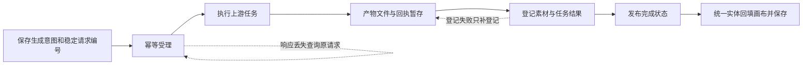

# 生成、作品与画布流程审查

审查日期：2026-10-05。基于当前工作树，包括尚未提交的画布入口迁移与生产后端代码；这不是已部署版本的故障统计。未修改业务代码，未调用真实生成服务。

本次确认的问题集中在跨模块衔接：提交意图与任务身份没有贯通、页面退出与草稿恢复没有贯通、生成结果与作品登记没有贯通。存储方面还存在临时文件永久化、历史筛选截断及预览直接读取原图。

## 范围与优先级

- 默认后端：`backend.app`，单进程 JSON/文件持久化。
- 生产后端：`backend.production`，PostgreSQL + Celery/RabbitMQ + Redis，必须显式启用。
- 两种后端当前都把 `/canvas` 指向 `canvas-next`。前端问题会影响使用该入口的部署；生产执行链问题只影响生产模式。
- P1：优先修复，会阻断主要流程、丢失可恢复编辑、引发重复生成或扩大故障。P2：随后修复，涉及取消语义、素材生命周期、查询完整性和成本。

| 顺序 | 问题 | 适用范围 | 证据 |
| --- | --- | --- | --- |
| 1 / P1 | 工作台提交成功，当前画布不接收结果 | 两种后端的新画布入口 | 真实前端模块 + Mock 事件复现 |
| 2 / P1 | 丢失提交响应后再点生成，会创建另一任务 | 新画布；生产受理契约已核对 | 真实提交模块 Mock + 后端代码 |
| 3 / P1 | 失败草稿未恢复，生产退出保存又被拒绝 | 草稿问题影响两种模式；退出鉴权问题影响生产 | 前端 Mock + 实际鉴权函数复现 |
| 4 / P1 | 图片链接 403 导致整个生成凭据暂停 | 生产执行链 | 实际 runner + MockTransport 复现 |
| 5 / P1 | 图片已生成，历史写失败后缺少补存路径 | 默认 JSON 后端 | 注入单点写失败复现 |
| 6 / P2 | 视频执行期间取消漏发上游取消请求 | 生产 cloud video | 实际状态机 + 内存事务替身复现 |
| 7 / P2 | 识别会话蒙版变成永久素材 | 默认 JSON 后端，当前抠图入口可达 | 隔离 ASGI API 复现 |
| 8 / P2 | 请求拒绝或并发去重后残留正式输入资产 | 生产生成入口 | 静态跨模块核实 |
| 9 / P2 | 历史先截取 500 条再筛选，旧收藏查不到 | 生产历史接口 | 实际路由体 + SQLite 合成数据复现 |
| 10 / P2 | 小预览读取原图，生产媒体禁止缓存 | 生产媒体接口 + 当前素材列表 | 前后端调用链静态核实 |

## 1. 工作台生成完成后，结果无法落入当前画布

用户在工作台输入提示词、点击生成，任务已提交并跳到画布。工作台创建的是带 `nodeDraft/nodeRun` 的 image/video 节点，新画布主要消费 `generations` 实体；兼容前一种节点的控制器没有挂到当前入口。

完成事件到达时，新控制器不认这个节点，回退处理器又只接受 placeholder。结果文件可以已经存在，但画布节点仍为空、仍处于提交状态，刷新也不能完成回填。

证据：[工作台节点与提交协议](/Users/weilengdezaoshang/Documents/项目/aiVideo/apps/web/workspace/api.ts:148)、[新画布事件接线](/Users/weilengdezaoshang/Documents/项目/aiVideo/apps/web/canvas-next/app.tsx:131)、[迁移跳过 nodeRun](/Users/weilengdezaoshang/Documents/项目/aiVideo/apps/web/canvas/state/generation-entity.ts:53)、[回退处理只接收 placeholder](/Users/weilengdezaoshang/Documents/项目/aiVideo/apps/web/canvas/state/generation-reducer.ts:57)。

验证：真实 CreationIntent → DocStore → Coordinator → GenerationEvents，依次注入完成 snapshot、job 事件、对账返回。节点 `src` 仍为空，`nodeRun.status` 仍为 submitting。

修法：统一工作台与画布的生成实体；迁移期间接回旧 nodeRun 的完成处理。验收必须覆盖“工作台生成 → 跳画布 → 完成 → 刷新”，并保留旧文档兼容性。

## 2. 提交结果未知被当成失败，重试失去原任务身份

画布提交后，如果服务端已接受任务但 HTTP 响应丢失，前端直接把操作标成 failed。提示词仍保留，生成按钮重新可用；再点会产生新的 clientRef，且两次请求都没有稳定的 requestId。

生产接口在缺少 requestId 时每次生成新 UUID，受理层仅按工作区 + requestId 去重。因此两次提交会被视作两次生成，存在重复调用和重复费用风险。不能把“收不到响应”当作“服务端没有执行”。

证据：[请求体缺少身份字段](/Users/weilengdezaoshang/Documents/项目/aiVideo/apps/web/canvas/state/generation-coordinator.ts:148)、[网络异常直接失败](/Users/weilengdezaoshang/Documents/项目/aiVideo/apps/web/canvas/state/generation-coordinator.ts:206)、[页面允许再次提交](/Users/weilengdezaoshang/Documents/项目/aiVideo/apps/web/canvas-next/app.tsx:435)、[生产入口生成新请求 ID](/Users/weilengdezaoshang/Documents/项目/aiVideo/apps/api/backend/production.py:312)、[受理去重](/Users/weilengdezaoshang/Documents/项目/aiVideo/apps/api/backend/services/acceptance.py:41)。documentId 也未传；后端允许其为空，不能误报为必填校验失败。

验证：Mock 模拟“服务端接受但响应丢失”，连续两次 submit 捕获两份不同 clientRef、无 requestId/documentId 的请求。没有调用真实付费服务。

修法：先持久化一次生成意图的 requestId、documentId 和参数快照；未知状态先查询原请求，重试沿用同一编号；用户明确开始新一次创作才创建新编号。

## 3. 自动保存、退出保存和草稿恢复没有形成闭环

这里有两个相互放大的问题。

第一，保存失败时确实留下了本地草稿，但新入口打开文档只读取服务器，没有接入现成的草稿恢复判断。刷新看到旧内容后，再次成功保存会覆盖并清除本地草稿，未保存修改的唯一副本可能消失。

第二，生产模式关闭/刷新页面时，保存走 sendBeacon，没有鉴权要求的 X-CSRF-Token 请求头。浏览器成功排队不代表服务器接受；beacon 返回 true 后不会走带 CSRF 的 fetch 兜底，因此最后一次修改可能被 403 拒绝。

证据：[新入口直接读服务器](/Users/weilengdezaoshang/Documents/项目/aiVideo/apps/web/canvas-next/app.tsx:41)、[保存前写草稿、成功清除](/Users/weilengdezaoshang/Documents/项目/aiVideo/apps/web/canvas/state/autosave.ts:79)、[退出 beacon](/Users/weilengdezaoshang/Documents/项目/aiVideo/apps/web/canvas/state/autosave.ts:180)、[生产 CSRF 校验](/Users/weilengdezaoshang/Documents/项目/aiVideo/apps/api/backend/services/identity.py:50)。

验证：写入较新的本地草稿后，真实 openDocument 返回旧服务器版本；下一次成功 flush 清空草稿。beacon 排队成功时 fetch 调用为 0；实际 authenticated 函数在有效会话、正确 Origin、缺 CSRF 头时返回 403。

修法：打开文档先比较草稿，提供恢复、另存和放弃；站内离开先完成保存；退出使用携带鉴权头的 keepalive fetch，同时保留可恢复草稿。不能靠关闭 CSRF 修复。草稿比较也应纳入 generations，避免生成结果变化被忽略。

## 4. 作品链接失效，被升级为整个生成账号故障

生成结果下载到 CDN 时，403 可能只表示该作品链接失效。当前错误分类把所有阶段的 401/403 都当成生成 API 鉴权失败，runner 随后把 credentialRef 对应的凭据设为永久暂停。

于是原本只有一张图下载失败，变成同一凭据的后续任务都被延迟；已有产物的下载也先检查这项暂停。必须运维解除或更换凭据引用才恢复，即使生成 API 密钥始终有效。

证据：[通用 403 分类](/Users/weilengdezaoshang/Documents/项目/aiVideo/apps/api/backend/providers/policy.py:138)、[无阶段区分地暂停凭据](/Users/weilengdezaoshang/Documents/项目/aiVideo/apps/api/backend/services/generation_runner.py:194)、[暂停无自动过期](/Users/weilengdezaoshang/Documents/项目/aiVideo/apps/api/backend/infrastructure/resilience.py:132)。

验证：实际 runner 使用 MockTransport，只向 CDN 发一次不含 Authorization 的 GET，返回 403 后得到 UPSTREAM_AUTH；下一 prepare 返回 `deferred: credential`。

修法：按操作阶段和请求目标区分错误。下载鉴权失败走刷新原任务产物链接/恢复下载，不能暂停生成 API 凭据；真实生成 API 的鉴权失败仍保留暂停保护。

## 5. 已生成图片缺少“只补保存”的恢复路径

默认后端先写原图、修改内存历史，再落历史 JSON。历史落盘失败会进入任务的通用失败分支，而任务还没绑定新图片。重启后历史没有该图，磁盘留下没有索引的文件；现有 resume 不能恢复这类失败。

证据：[图片和历史写入顺序](/Users/weilengdezaoshang/Documents/项目/aiVideo/apps/api/backend/storage.py:323)、[保存后才关联任务图片](/Users/weilengdezaoshang/Documents/项目/aiVideo/apps/api/backend/jobs.py:245)、[通用失败分支](/Users/weilengdezaoshang/Documents/项目/aiVideo/apps/api/backend/jobs.py:268)。

验证：Mock 生成一次有效 PNG，只注入 History.persist 的 OSError。结果：任务 failed、任务图片数 0、重启历史数 0、磁盘原图数 1、resume 不支持。

修法：拿到产物后先可靠暂存文件和回执，登记失败只补登记，恢复后再发布完成事件。生产路径已有 ArtifactSpool 回执保护，不把这个旧版问题泛化到生产版。

## 6. 视频取消流程随 Worker 执行时机改变

生产 cloud video 在两次轮询之间取消，会进入上游 cancel；如果正在轮询时取消，只记录标志并停止本地操作。租约恢复后转入 reconcile，继续查原任务，漏掉向上游发取消这一步。

证据：[活动租约提前返回](/Users/weilengdezaoshang/Documents/项目/aiVideo/apps/api/backend/services/execution.py:302)、[恢复后取消标志转对账](/Users/weilengdezaoshang/Documents/项目/aiVideo/apps/api/backend/services/execution.py:93)、[只有 CANCEL 调用上游取消](/Users/weilengdezaoshang/Documents/项目/aiVideo/apps/api/backend/services/generation_runner.py:120)。

验证：实际 request_cancel、heartbeat、recover_expired、claim 使用内存事务替身。同一个已提交视频状态，无活动 Worker 的下一阶段为 cancel；有活动 Worker 并经历恢复的下一阶段为 reconcile。

修法：持久保留“需要发送取消”的意图，安全交接或恢复后统一处理，之后查询上游直到确认终态。发送取消不保证供应商一定停止或退款，仍不能提前释放名额。

## 7. 每次抠图识别都留下永久蒙版素材

默认后端 detect 成功会把尚未提交的会话蒙版保存为普通素材。用户退出识别、重新选择图片，只清理前端状态或取消 operation，没有释放已完成的蒙版资产。

证据：[detect 永久保存蒙版](/Users/weilengdezaoshang/Documents/项目/aiVideo/apps/api/backend/app.py:292)、[取消仅改操作状态](/Users/weilengdezaoshang/Documents/项目/aiVideo/apps/api/backend/app.py:783)、[当前画布识别入口](/Users/weilengdezaoshang/Documents/项目/aiVideo/apps/web/canvas-next/app.tsx:260)、[退出清理](/Users/weilengdezaoshang/Documents/项目/aiVideo/apps/web/canvas-next/app.tsx:614)。

验证：显式 Mock 配置、注入识别函数，上传原图 → detect 成功 → 取消 operation。素材列表仍有原图和蒙版，普通删除资产接口返回 405。

修法：识别蒙版只作为当前会话响应，不登记为永久资产；提交后的独立合成图才长期保存。生产 detect 已直接返回内存中的 data URL，未发现相同落盘问题。这也符合仓库“不缓存 mask 或持久化笔画草稿”的约定。

## 8. 生成请求被拒绝，输入图片却已成为正式资产

生产接口先保存 initImage/maskImage，再检查“蒙版需要原图”等语义条件和执行受理事务。相同 requestId 并发重试也可能都通过入口预查，各自保存输入图，然后才在受理层去重。

save_media 每次创建新的 UUID、文件和独立 Asset 记录；没有临时归属。媒体审计又把所有已登记 Asset 的目录都保护起来，这类未被使用的图片不会进入孤儿文件候选。

证据：[先保存后做后续校验](/Users/weilengdezaoshang/Documents/项目/aiVideo/apps/api/backend/production.py:357)、[独立保存事务](/Users/weilengdezaoshang/Documents/项目/aiVideo/apps/api/backend/services/media.py:54)、[审计保护所有已登记资产](/Users/weilengdezaoshang/Documents/项目/aiVideo/apps/api/backend/tools/media_audit.py:20)。本项为代码路径核实，未做真实 PostgreSQL 并发复现。

修法：先完成无需落盘的校验；用稳定请求身份认领输入文件，或引入临时资产、到期时间和认领动作。临时资产回收前重新检查活动任务和文档引用；用户主动上传到素材库的作品不能一并按“无引用”删除。

## 9. 历史先截断再筛选，旧收藏和搜索结果不可见

生产历史接口先读取最新 500 条，再在 Python 中筛选 hidden、关键词、模型、类型和收藏。旧收藏超出这 500 条就查不到；最近记录中有隐藏项时，也不会用更早的有效记录补齐。当前没有游标参数读取下一页。

证据：[history 查询与筛选](/Users/weilengdezaoshang/Documents/项目/aiVideo/apps/api/backend/production.py:642)。

验证：提取实际路由函数体，用 SQLAlchemy ORM + SQLite 内存库放入 501 条历史，最旧一条为唯一收藏/唯一关键词匹配，最新 20 条 hidden。无条件返回 480 条；收藏和关键词查询均返回 0。这个测试验证查询截断语义，不代表 PostgreSQL 性能基线。

修法：把筛选放在数据库分页之前，按 createdAt + id 稳定游标翻页。明确区分每页显示数量和作品保留数量。

## 10. 列表小预览仍下载原图

生产 asset_view 固定 hasThumbs=false，两个缩略图 URL 都为空；工作台因此回退 original。当前画布素材列表也直接使用历史记录的原图 URL。生产 content 响应为 private, no-store，重新加载列表时浏览器不能长期复用这些文件。

证据：[生产素材响应](/Users/weilengdezaoshang/Documents/项目/aiVideo/apps/api/backend/production.py:502)、[媒体缓存策略](/Users/weilengdezaoshang/Documents/项目/aiVideo/apps/api/backend/production.py:635)、[工作台预览回退](/Users/weilengdezaoshang/Documents/项目/aiVideo/apps/web/workspace/AssetLibrary.tsx:188)、[画布素材预览](/Users/weilengdezaoshang/Documents/项目/aiVideo/apps/web/canvas-next/app.tsx:1103)。

修法：生成或上传完成后产出小预览；列表使用缩略图，查看大图或下载才取原图。私有素材的缓存需结合权限撤销策略设计，可使用受控的浏览器私有缓存/重新验证；不能直接把鉴权文件改成公开缓存。本次未测浏览器实际流量，不声称已量化节省比例。

## 建议的流程契约

修改画布 → 本机草稿 → 带鉴权的服务器保存 → 确认成功后清理对应草稿；重新打开时必须先处理未确认草稿。临时识别蒙版、任务输入、正式作品应有明确的不同生命周期，历史列表只负责查询与展示。

## 验证与边界

主审逐项回看了上述关键调用点，并重新运行三个隔离脚本，全部复现预期缺陷：

- `/tmp/aivideo-frontend-repro.mts`：4 个前端跨模块场景，全部使用 Mock fetch / SSE。
- `/tmp/aivideo-flow-execution-repro.py`：取消路由、下载 403 两个执行场景，使用内存替身和 MockTransport。
- `/tmp/aivideo-flow-storage-repro.py`：历史保存失败、识别蒙版残留，以及旧导出 API 的排队源图丢失场景；使用临时目录和显式 Mock 配置。
- 主审另验证历史筛选截断，以及有效登录会话下缺 CSRF 头的保存请求返回 403。

没有运行真实模型、读取真实付费配置或操作运行时 data；没有声称完成真实浏览器、真实供应商、PG/Rabbit/Redis 全链路验收。未修改业务代码，因此未运行全量 npm verify。

已排除：两后端均保留 generations 字段；生产文档引用扫描覆盖生成结果 assetId；生产 unknown 保留名额有人工对账入口，不能当成无恢复死锁；生产产物已有文件回执恢复。

附录候选：旧导出 API 受理时只验证源文件，排队等槽位后才复制；期间删除未被文档引用的历史图会使导出失败，隔离复现成立。但当前 canvas-next 没有可达的导出按钮，因此不作为当前主界面故障。参考 [导出输入快照](/Users/weilengdezaoshang/Documents/项目/aiVideo/apps/api/backend/exports.py:153)。
