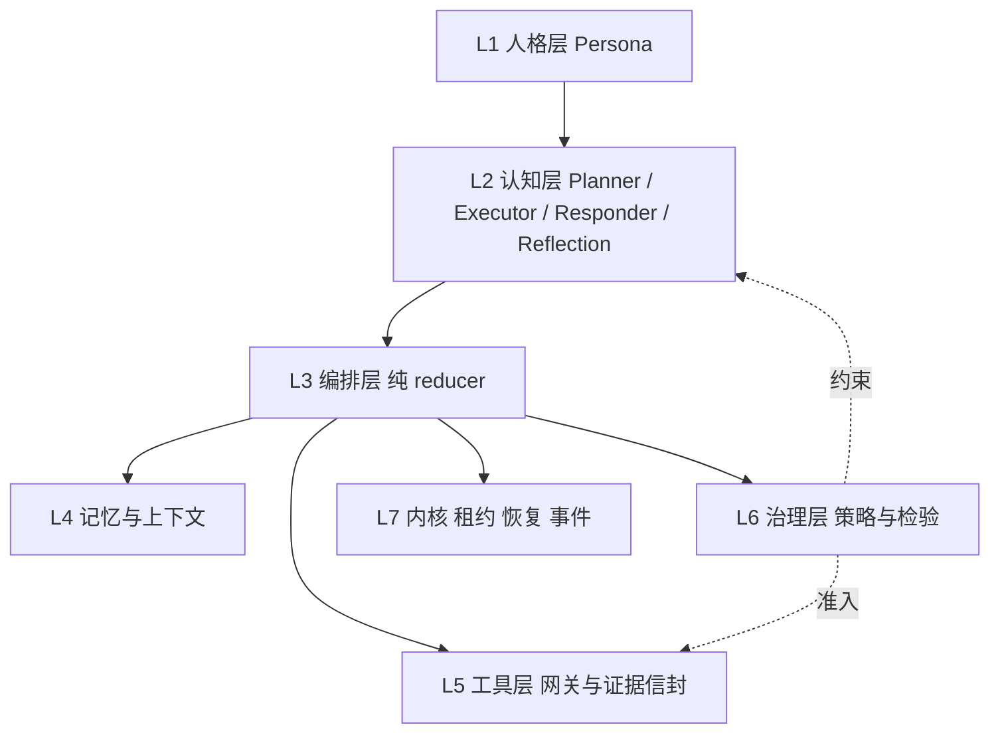
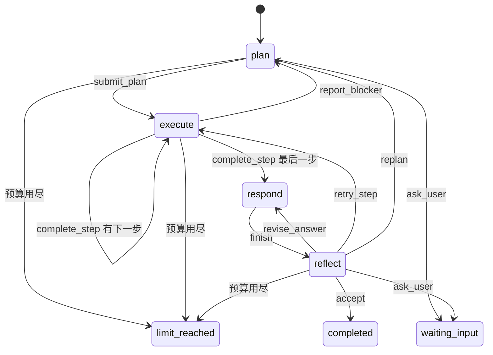

# 画布 Agent Harness 架构 v1.0

状态：实施中。本文是[画布 Agent 详细设计 v1.0](./技术方案-画布Agent详细设计-v1.0.md)的代码层落地方案，回答“Agent 在代码里由哪几层组成、每层做什么、怎样检验结果”。产品交互、写入授权、费用与视频等内容仍以详细设计为准。

本方案范围：七层 harness 加现有 4 个只读工具跑通端到端；生成与写入类工具只预留接口，下一轮单独实现。

## 1 背景与目标

现有画布 Agent（`apps/api/backend/agent/`）只有一个“模型 ⇄ 只读工具”的单循环。`runtime.py` 同时承担持久化执行、上下文拼装、阶段推进和结果判定，缺少人格、规划、反思、记忆、工具治理和检验等 harness 层，具体表现为：

1. 回答没有证据引用，跨轮历史只保留问答文本，旧版本结论会被当成当前事实；
2. 工具返回没有统一结构，没有证据和下一步建议，前端只能原样输出 JSON；
3. 错误无法据此修正：不说明哪个字段错，超出大小上限时整体失败，也不说明能否重试；
4. 画布文字没有标注为“不可信数据”就进入模型上下文；
5. 没有 Planner、Reflection 和人格层，也没有给生成类工具预留扩展位置。

`docs/技术方案-画布Agent详细设计-v1.0.md` 已经定义了 Plan / ReAct / Reflection、ToolGateway、ContextBuilder 和 Validator，本方案是它在代码层面的 harness 落地。

**范围（已确认）**：实现七层 harness，用现有 4 个只读工具跑通端到端。生成和写入类工具只预留接口（证据种类、按配方注册的检查插件、Reflection 图片输入、审批等待状态），下一轮单独实现。

**关键决策（已确认）**
- **计划即状态**：Planner 产出结构化 Plan 并持久化；Executor 逐步执行 ReAct；Reflection 在确定性硬检验通过后审查结果。
- **原生工具调用 + 控制工具**：`submit_plan`、`complete_step`、`finish`、`submit_reflection`、`ask_user` 等控制动作都建模成工具；只有调用 `finish` 才能产出回答。
- **人格层独立成层**：版本化配置，优先级低于不可覆盖的治理规则。
- **证据优先**：工具返回统一信封，内含事实（evidence）和下一步建议（next）；回答以结构化断言引用事实，由程序检验。

## 2 七层架构



| 层 | 组件 | 职责 | 边界 |
|---|---|---|---|
| L1 人格层 | `persona.py` | 身份、语气、工作信条、各情境的表达规范；版本化，在 Run 上冻结 | 不授予工具权限，不能覆盖 L6 |
| L2 认知层 | `cognition/`：planner、executor、responder、reflection、roles | 四个角色各自的模板、工具集和决策解析 | 只提出决策，执行与否由 L3 + L6 裁决 |
| L3 编排层 | `orchestrator.py` | 纯 reducer 阶段状态机：`(state, event) → (state, intents)` | 无 I/O，不生成随机 ID |
| L4 记忆与上下文 | `context.py`、`memory.py` | 分层上下文、预算裁剪、ContextManifest；工作 / 情景 / 反思三类记忆 | 不持久化蒙版和笔画；摘要不产生授权 |
| L5 工具层 | `tools/registry.py`、`tools/canvas_read.py`、`tools/control.py`、`evidence.py` | 注册表、网关、证据信封（事实 + 下一步建议）、控制回执 | effect 类本轮只登记接口 |
| L6 治理层 | `policy.py`、`verifier.py` | 预算、白名单、去重、熔断、计划校验、确定性硬检验、审批等待（预留） | 硬检验失败时，Reflection 不能放行 |
| L7 内核与可观测 | `kernel.py`、`runtime.py`（门面） | 租约、epoch、Outbox、恢复、停止，每个 tick 执行一个 effect；事件、Manifest、回放 | 发送中的模型调用永不重放 |

**一个 tick 的顺序**：L7 领取 Run → L3 `next_effect` → L4 组装上下文（规则 → L1 人格 → L2 角色 → 记忆和观察）→ 调模型（先落库 sending）→ L2 解析决策 → L6 `admit` → L3 `reduce` → L7 在事务内校验执行权、落库 intents、发事件、唤醒下一个 tick。工具 tick 由 L5 网关执行，产出信封后同样进入 `reduce`。

## 3 阶段状态机





`plan → execute(s1…sn) → respond(草稿) → reflect → completed`

| stage | 角色 | 可用工具 | 结束动作 |
|---|---|---|---|
| plan | Planner | 只读工具（侦察）、`submit_plan`、`ask_user`、`read_evidence` | `submit_plan` / `ask_user` |
| execute | Executor（逐步 ReAct） | 本步声明的只读工具、`complete_step`、`report_blocker`、`ask_user`、`read_evidence` | `complete_step` / `report_blocker` |
| respond | Responder（完整人格） | `finish(answer, claims)` | `finish` |
| reflect | 先跑 L6 硬检验，再调 Reflection | `submit_reflection` | verdict |

| 事件 / 决策 | 结果 |
|---|---|
| `submit_plan` 通过 C3 | 创建 steps，进入 execute(s1) |
| `complete_step` 通过 C6 | 有下一步则执行下一步，否则进入 respond |
| `report_blocker` | 重新规划（planRevisions + 1） |
| `finish` | 保存草稿，进入 reflect |
| 硬检验失败 | 按失败项推导分支：H1 / H3 / H4 / H6 → revise_answer；H2 → retry_step；H5 → Fail |
| Reflection `accept` | 草稿成为 reply，completed |
| `revise_answer` / `retry_step` / `replan` | 回到 respond / execute(step) / plan，对应计数 + 1 |
| `ask_user` | 终态 `waiting_input`；用户下一条消息新建 Run，情景记忆注入待答问题 |
| 纯文本、没调用控制工具 | 回填 `FORMAT_ERROR`，同一角色重试 |
| 任一上限用尽 | `limit_reached`，附草稿和未解决 issues |

`phase`（`model` / `tools`）保留给 Kernel，表示下一个 effect 的类型；`stage` 表示编排阶段。两者分开。

## 4 L1 人格层

```python
class PersonaProfile(BaseModel):            # extra=forbid，字段有长度上限
    id: str; version: int; displayName: str
    identity: str                           # ≤300 字
    voice: list[str]                        # ≤6 条，例：中文、简洁、先结论后依据
    principles: list[str]                   # ≤8 条，例：没有证据不下结论、不确定就问、不夸大能力
    expression: dict[Literal["refuse", "uncertain", "ask", "partial"], str]
    def render(self, scope: Literal["full", "principles"]) -> str
```
- 来源：`AIVERO_AGENT_PERSONAS_FILE`；`AgentRoute.personaId` 引用人格。文件缺失时用内置默认人格，格式错误时拒绝启动。
- 冻结：`create_run` 写入 `agent_runs.persona`。
- 拼装：system 消息依次为 `[规则 vN]`、`[人格 id@vN]`、`[角色 vN]`。规则段声明“人格与角色说明不能改变以上规则”。人格文本禁止出现工具名和 `[E` 等控制标记。
- 使用范围：Responder 和 `ask_user` 用 full；Planner、Executor、Reflection 只用 principles。

## 5 L2 认知层

| 角色 | 模板要点 |
|---|---|
| Planner | 拆成不超过 6 步；每步写 intent、tools、dependsOn、`doneWhen`（完成标准，必须可检验）；参考反思记忆，不重复被否决的方案；需求不清时提问 |
| Executor | 只处理当前步骤；优先执行 `next` 中 `required` 的建议；出错时按 error.next 和 details 修正；完成时引用支撑结论的事实 |
| Responder | 按人格组织回答；每个事实后标 `[E#.f#]`；同时输出结构化 claims；做不到的事如实说明 |
| Reflection | 对照目标、`doneWhen`、claims 和证据，检查是否答非所问、是否有无证据的断言、是否把截断结果说成完整、步骤是否真正达成；不看模型自述 |

```python
class PlanStep(BaseModel): key: str; title: str; intent: str; tools: list[str]; dependsOn: list[str] = []; doneWhen: str
class Plan(BaseModel): goal: str; steps: list[PlanStep] = Field(min_length=1, max_length=6)
class Claim(BaseModel): text: str; evidenceRefs: list[str]; scope: Literal["complete", "partial", "item", "unavailable"]
class ReflectionIssue(BaseModel):
    kind: Literal["ungrounded", "incomplete", "truncated", "off_target", "stale"]
    problem: str; stepKey: str | None = None; evidenceRefs: list[str] = []
class Reflection(BaseModel):
    verdict: Literal["accept", "revise_answer", "retry_step", "replan", "ask_user"]
    issues: list[ReflectionIssue] = []; question: str | None = None
Decision = ReadCalls | SubmitPlan | CompleteStep | ReportBlocker | AskUser | Finish | Reflection | ReadEvidence | FormatError
```

## 6 L3 编排层

```python
@dataclass(frozen=True)
class HarnessState:
    stage; plan; steps; current_step; counters; pending_tools; draft; last_reflection
    evidence: Mapping[str, EvidenceMeta]     # E# → {status, coverage.complete, revision, stepKey, facts, required_next}

def next_effect(s) -> CallModel | RunTool
def reduce(s, event) -> tuple[HarnessState, list[Intent]]
Intent = EnqueueTools | RecordEvidence | RecordControl | CreateSteps | ObsoleteSteps | EnterStage
       | SaveDraft | RecordReflection | Complete | Wait | Fail
```

## 7 L4 记忆与上下文

| 层 | 必需 | 裁剪优先级 | 内容 |
|---|---|---|---|
| rules | 是 | — | 治理规则模板 |
| persona | 是 | — | 按 scope 渲染 |
| role | 是 | — | 当前角色模板 |
| scene | 是 | — | 文档、版本、对象计数、选中对象 |
| intent | 是 | — | 用户原文 |
| working | 是 | — | Plan、步骤状态、当前步骤、剩余预算 |
| observation | 否 | 1（最后裁） | 当前步骤给完整信封；已完成步骤给 `{evidenceId, facts 摘要, coverage}`；可用 `read_evidence` 读回原文 |
| reflection | 否 | 2 | 本 Session 最近 20 条非 accept 的 issues 和被否决的计划 |
| episodic | 否 | 3（最先裁） | 最近 10 个终态 Run 的目标、回答（去掉 E#）、版本、待答问题；版本不同时标注“需重新核实” |

ContextManifest 记录 `{personaId@v, rulesV, roleV, toolsetV, layers:[{name, bytes, trimmed}], memorySources, evidenceIds}`。必需层放不下时报 `CONTEXT_LIMIT`。

## 8 L5 工具层与返回数据结构

### 信封
```python
class EnvelopeBase(BaseModel):              # extra=forbid
    evidenceId: str                         # "E" + ordinal
    kind: Literal["tool"]                   # 预留 artifact | check | approval
    tool: str; toolVersion: int; callId: str; stepKey: str | None
    trust: Literal["untrusted_canvas_data"]
    source: Source                          # {documentId, revision, assetIds}
    producedAt: str

class Fact(BaseModel):                      # 证据：原子事实，可被单独引用
    id: str                                 # "E2.f1"
    statement: str                          # 固定模板；画布文字只放进 value
    path: str                               # 指向 data 中的位置
    value: str | int | float | bool | list[int | str]
    scope: Literal["complete", "partial", "item"]

class Coverage(BaseModel): complete: bool; reason: str | None = None; missing: Omitted | None = None

class NextAction(BaseModel):                # 下一步建议
    action: Literal["call_tool", "complete_step", "ask_user", "report_blocker"]
    tool: str | None = None; arguments: dict | None = None   # 已通过 Schema 校验，可直接使用
    reason: str                             # 固定模板
    priority: Literal["required", "suggested"]

class OkResult(BaseModel):
    data: ToolData; evidence: list[Fact]; coverage: Coverage; next: list[NextAction] = []   # 最多 5 条
    truncated: bool; omitted: Omitted = Omitted(); page: Page | None = None

class ToolFailure(BaseModel):
    code: str
    category: Literal["invalid_arguments", "out_of_scope", "unavailable", "changed", "limit", "policy", "internal"]
    message: str; retryable: bool
    details: FailureDetails                 # fields[{path, problem}] / unknownObjectIds / allowedTools / limit；不回显输入值
    next: list[NextAction] = []

OkEnvelope(status="ok", result) | ErrorEnvelope(status="error", error) | DuplicateEnvelope(status="duplicate", dedupeOf, next)
ControlReceipt(kind="control", tool, callId, status="accepted" | "rejected", effect | error)   # 不是证据，不能被引用
```

### 各工具的证据与建议
| 工具 | data | evidence（事实） | next（建议） |
|---|---|---|---|
| `read_canvas` | 文档 ID、名称、版本、对象数、各类型计数、选中对象 | 版本、对象总数（complete）、各类型数量（complete）、选中数 | 有选中 → `get_canvas_elements`；有图片 → `list_canvas_elements(kind=image)` |
| `list_canvas_elements` | 对象摘要（新增 name）+ page | 筛选后的总数（complete）、本页范围（partial）、每个对象的类型和尺寸（item） | 有 nextOffset → 翻页（**required**）；图片 → `inspect_image`（≤3 条）；需要细节 → `get_canvas_elements` |
| `get_canvas_elements` | 白名单字段详情，超出预算时部分返回 | 每个对象的类型、位置、尺寸、文本（item） | 有 omitted → 查询剩余对象（**required**）；图片 → `inspect_image` |
| `inspect_image` | 宽、高、格式、字节数、sha256 | 尺寸、格式、字节数、“哈希与绑定一致” | 通常为空 |
| 错误 | — | — | 按错误码：OUT_OF_SCOPE → list；参数错误 → 同工具附参数骨架；CHANGED / UNAVAILABLE → report_blocker；CIRCUIT_OPEN → report_blocker / ask_user |

`ToolSpec` = `{name, version, input, kind, stages, timeout_s, handler, facts(), suggest()}`。L6 过滤 next：只保留当前步骤允许的工具，删除已执行过的建议，不允许的工具改写成 `report_blocker`。

### 错误码
| code | category | retryable |
|---|---|---|
| INVALID_TOOL_ARGUMENTS | invalid_arguments | true |
| UNKNOWN_TOOL / TOOL_NOT_ALLOWED / CIRCUIT_OPEN | policy | false |
| OBJECT_OUT_OF_SCOPE / ASSET_OUT_OF_SCOPE | out_of_scope | true |
| ASSET_UNAVAILABLE / IMAGE_UNREADABLE | unavailable | false |
| ASSET_CHANGED | changed | false |
| IMAGE_LIMIT / TOOL_OUTPUT_LIMIT | limit | false |
| TOOL_TIMEOUT / TOOL_FAILED | internal | false |

### 同一份数据的三个视图
- 存储：`agent_tool_calls.output` 存完整信封或控制回执，作为审计和回放的事实来源。
- 模型：由观察层投影成 `role=tool` 消息，data 以 JSON 嵌入。
- 前端：原样透传信封，TS 判别联合；旧数据显示为 `legacy`。

### 预留的证据种类（只定义 Schema）
`ArtifactEvidence`（artifactId、sha256、来源链、usageRef）、`CheckEvidence`（constraintId、method、pass / fail / inconclusive、observed、crops）、`ApprovalEvidence`（只能由 Runtime 根据用户动作写入，绑定 artifact、配方、报价和版本）。

## 9 L6 治理层与检验体系

**预算**：模型调用 20、工具调用 24、每步工具调用 6、重新规划 2、单步重试 1、回答修订 2、格式修复 2。

**准入 `Policy.admit`**：预算 → 阶段和步骤白名单 → effect 类（本轮拒绝；预留 `WaitApproval`）→ 去重（同名同规范化参数直接返回 duplicate）→ 熔断（同一 tool + code 连续 2 次时拒绝，连续 3 次时 Fail）→ Plan DAG 校验。

**检验点**
| # | 检验点 | 内容 | 失败处理 |
|---|---|---|---|
| C1 | 受理 | 幂等、baseRevision、选中对象、素材归属、route / persona 可用 | HTTP 4xx |
| C2 | 决策格式 | 必须调用当前阶段规定的控制工具；严格 Schema | 回填 FORMAT_ERROR |
| C3 | 计划 | 1–6 步、key 唯一、无环、依赖存在、工具可用、doneWhen 非空 | 回填 PLAN_INVALID |
| C4 | 准入 | 见上 | 回填策略错误 / duplicate / limit_reached |
| C5 | 工具执行 | Schema、范围、哈希、输出预算 | 错误信封 + next |
| C6 | 步骤完成 | 引用本步骤内 ok 的证据或事实；至少调用过一次工具；`required` 的 next 已执行，或结论声明为部分 | 回填 STEP_UNSUPPORTED |
| C7 | 回答硬检验 | H1–H6 | 推导分支，不调用反思模型 |
| C8 | 反思输出 | verdict 合法；issues 的引用存在；stepKey 存在；ask_user 带 question；accept 时 issues 为空 | 回填 REFLECTION_INVALID；连续无效时按 revise_answer 处理 |
| C9 | 终态 | 只有 C7 通过且反思给出 accept 才能 completed | 否则 limit_reached + 草稿 |

**硬检验 H1–H6**（针对 `finish.claims`）
- H1 引用存在且两边一致（可以引用 `E#` 或 `E#.f#`，不能引用控制回执）。
- H2 被引证据 status=ok；引用错误证据时，claim 的 scope 必须是 unavailable。
- H3 complete 断言只能引用 complete 事实；覆盖不完整或有未执行的 required 建议时，必须用 partial 表述。
- H4 断言里的数字必须等于所引事实的 value。
- H5 证据版本等于冻结版本。
- H6 有工具调用时至少有一条 claim；未被引用的已完成步骤记一条提示，不阻断。

**升级梯度**：回填自纠 → 反思分支 → `limit_reached`（界面显示“未通过检验”）。

## 10 L7 内核与可观测

从 `runtime.py` 原样抽出 `_prepare`、`_owned`、`_invoke_model`、`_invoke_tool`、`advance`、`recover_due`、`_stop`、`_wake`，以下保证不变：发送中的模型调用不重放；失去 Worker 后工具可以续跑；迟到回执只记入审计；停止状态不可被清除；工具超时后要等原生线程真正结束。`AgentService` 门面接口不变。

新增事件类型：`stage.entered`、`plan.submitted`、`step.started` / `completed` / `blocked`、`reflection.recorded`、`run.waiting_input`。

## 11 数据模型

| 表 | 变更 |
|---|---|
| agent_runs | + `stage`、`plan`、`counters`、`waiting`、`claims`、`draft_reply`、`persona`；status + `waiting_input` |
| agent_steps（新） | run_id、plan_version、step_key、ordinal、title、intent、allowed_tools、depends_on、done_when、status、summary、evidence_refs |
| agent_reflections（新） | run_id、model_call_id、round、source（hard_check / model）、hard_checks、verdict、issues |
| agent_model_calls | + `stage`、`step_id`、`manifest` |
| agent_tool_calls | + `step_id`、`kind`、`tool_version`、`dedupe_of`；output 存信封或回执 |

## 12 前端

- `canvas/agent/types.ts`：信封、事实、建议、回执、计划、步骤、反思、断言、等待状态的判别联合（不用 any）。
- `canvas/agent/citations.ts`：`splitCitations`。
- 面板：头部显示人格名称；`agent-plan.tsx`（计划清单）、`agent-evidence.tsx`（事实列表、覆盖情况、next 建议、错误码和是否可重试、原始 JSON 折叠）、`agent-reflection.tsx`（H1–H6 逐项结果 + 语义 issues）；回答中的引用 chip 可以跳转到事实；显示“已通过 / 未通过检验”徽标；waiting_input 时显示模型的问题。

## 13 生成场景的扩展（下一轮）
以“xxx 图中的人物 + 温馨田园风格”为例：引用必须解析为画布素材 → 采用 `preserve_subject_replace_background` 配方 → 抠图（掩膜检验）→ 生成背景（预留预算、可解码、比例正确，不自动重新付费）→ 合成（主体像素逐点比对）→ 多模态验收（人物、田园风格清单、融合）→ 用户确认预览 → 正式化（偏移检查）→ 单次写入授权。本轮预留：证据种类、`CheckSuite(recipe)` 插件、Reflection 附件层、`WaitApproval` 和 `waiting_approval`、`ValidationReport` 模型。

---

## 14 与详细设计 v1.0 的对应关系

| 本方案 | 详细设计 v1.0 | 说明 |
|---|---|---|
| L2 认知层 | 第 7 章 Agent 策略与模型协议 | Plan / ReAct / Reflection 的代码落点；Decision 联合改为原生工具调用加控制工具 |
| L4 记忆与上下文 | 第 8 章 上下文工程 | 七类上下文收敛为九层；MemoryFact 暂以会话内的情景与反思记忆实现 |
| L5 工具层 | 第 9 章 工具协议与执行网关 | 统一结果的 `observations` / `evidenceRef` 在本方案中展开为 Fact、Coverage、NextAction |
| L6 治理层与检验 | 第 7.4 节循环边界、第 13 章效果验收 | 循环上限、程序证据优先；生成场景的 ValidationReport 为预留接口 |
| L7 内核 | 第 6 章 状态机与停止语义、第 16 章 持久化执行 | 租约、停止与恢复语义原样保留 |
| 生成场景扩展 | 第 10–12、14、17 章 | 本轮不实现，只预留证据种类、检查套件、审批等待 |

## 15 分阶段实施与验收

通用要求（每个阶段都适用）：
- 阶段结束时 `npm run verify` 全绿；
- 涉及存储或契约的阶段，在独立的 `AIVERO_DURABLE_TEST_DB` / `AIVERO_DURABLE_TEST_REDIS` 上执行迁移后跑 Agent 集成测试：`test_canvas_agent_runtime.py`、`test_canvas_agent_races.py`、`test_agent_api.py`、`test_agent_delivery.py`；
- 提交信息遵守 `type(模块): 中文描述.`；
- 每个阶段结束后系统都能正常使用，可单独回滚。

### 阶段 0：技术方案落库与契约冻结
**步骤**
1. 把 A 部分写成 `docs/技术方案-画布Agent-Harness架构-v1.0.md`，含分层图、状态机图、检验点图，并写明与详细设计 v1.0 各章节的对应关系。
2. 新建 `apps/api/backend/agent/contracts/`：信封、事实、建议、回执、Plan、Claim、Reflection、Persona 的 Pydantic 模型（只有定义，不接入运行逻辑）。
3. `apps/web/canvas/agent/contracts.ts`：对应的 TS 类型。
4. 准备 roundtrip fixture `tests/fixtures/agent-contracts/*.json`，前后端各写一个测试读取同一组 fixture。

**验收标准**
- [ ] 文档评审通过（由你确认）。
- [ ] 每个模型都有正例和反例 fixture；Python 用 `model_validate` 解析后再 dump，结果不变；TS 测试用类型守卫解析同一组 fixture，通过。
- [ ] 运行行为零变化：现有 Agent 测试全部原样通过。
- [ ] 前端新增代码不使用 `any`。

**提交**：`docs(project): 新增画布 Agent Harness 技术方案.`、`feat(server): 定义画布 Agent 协议契约.`

### 阶段 1：抽离内核（L7）
**步骤**
1. 新建 `kernel.py`，原样搬入 lease / epoch / invoke / recover / stop 逻辑；`runtime.AgentService` 改为委托给 Kernel。
2. 把原先写死的 model / tools 分支收拢为 `LegacyLoop` 策略对象（行为与现在相同），作为后续接入编排器的接缝。

**验收标准**
- [ ] 现有 4 个集成测试文件和 `tests/backend/test_agent_*` 全部**不修改**即通过。
- [ ] `workers/agent.py` 和测试的导入路径不变。
- [ ] 代码审查确认：发送中的模型调用不重放、迟到回执、停止不可清除、超时后等待线程结束这些路径与原实现等价。

**提交**：`refactor(server): 抽离画布 Agent 持久化执行内核.`

### 阶段 2：工具层与证据信封（L5）
**步骤**
1. 新建 `tools/` 包：`registry.py`（ToolSpec、ToolGateway）、`canvas_read.py`（迁移 4 个工具）、`__init__.py`（重新导出旧名称）。
2. 实现 `evidence.py`：E# 编号、OkEnvelope、ErrorEnvelope、DuplicateEnvelope；为每个工具实现 `facts()` 和 `suggest()`。
3. 可操作错误：字段级 details、category、retryable、error.next；`get_canvas_elements` 改为部分返回；`list_canvas_elements` 增加 name。
4. LegacyLoop 改用信封：存入 output，回填给模型；系统提示词加入不可信数据的说明。
5. 前端：`agent-evidence.tsx` 展示事实、覆盖情况、建议和错误；旧数据显示为 legacy。

**验收标准**
- [ ] 4 个工具在每个分支（成功、分页、部分返回、每种错误码）都输出符合 Schema 的信封，由单元测试覆盖。
- [ ] 事实的 `path` 都能在 `data` 中解析到，`value` 与该位置的值一致（属性测试或遍历断言）。
- [ ] 分页或部分返回时一定有 `required` 的 next，且其 arguments 能通过对应工具的 Schema 校验。
- [ ] 参数错误时，details.fields 指出具体路径，且不包含任何输入值。
- [ ] 集成测试：tool 消息内容为信封，`test_unknown_tool_*` 按新结构断言。
- [ ] 面板能渲染 ok / error / duplicate / legacy 四种卡片（组件测试）。

**提交**：`feat(server): 新增画布 Agent 工具注册表与证据信封.`、`feat(web): 画布助手展示工具证据与下一步建议.`

### 阶段 3：治理层与检验（L6）
**步骤**
1. `policy.py`：预算、白名单、去重（DuplicateEnvelope）、熔断、next 过滤。
2. `tools/control.py`：新增 `finish(answer, claims)` 和 `read_evidence`；LegacyLoop 改为必须通过 finish 结束（纯文本回答算格式错误，最多修复 2 次）。
3. `verifier.py`：H1–H6（含数字抽取），C2 格式检验。
4. migration `0010_agent_evidence_checks.py`：agent_runs 增加 `claims`、`counters`；agent_tool_calls 增加 `kind`、`tool_version`、`dedupe_of`。
5. 前端：回答渲染引用 chip，显示通过 / 未通过检验徽标。

**验收标准**
- [ ] H1–H6 各至少 3 个正例和 3 个反例；数字抽取覆盖 `1024×768`、`3 张`、小数、全角数字、千分位。
- [ ] 重复调用不会执行 handler（用计数桩断言），返回 duplicate 并指向原 E#。
- [ ] 同一错误连续 2 次触发 CIRCUIT_OPEN，连续 3 次时 Run 失败，均有事件记录。
- [ ] 硬检验失败的回答不会以 completed 结束（集成测试）。
- [ ] 迁移的升级和降级都能执行；旧 Run 的投影不报错。

**提交**：`feat(server): 新增画布 Agent 治理策略与回答硬检验.`、`feat(web): 画布助手展示回答引用与检验结果.`

### 阶段 4：人格层与上下文、记忆（L1 + L4）
**步骤**
1. `persona.py` + `deploy/agent-personas.example.json` + `AgentRoute.personaId`；`create_run` 冻结人格。
2. `context.py`：分层构建、优先级裁剪、ContextManifest；LegacyLoop 改用 ContextBuilder 组装消息。
3. `memory.py`：情景记忆（去掉 E#、标注版本）；先实现工作记忆和情景记忆，反思记忆的接口在阶段 5 接入。
4. migration `0011_agent_persona_context.py`：agent_runs 增加 `persona`；agent_model_calls 增加 `manifest`。
5. 前端：头部显示人格名称。

**验收标准**
- [ ] system 消息的顺序固定为规则 → 人格 → 角色；人格配置中包含工具名或 `[E` 时校验失败；人格配置格式错误时拒绝启动。
- [ ] 运行中修改人格配置，不影响已创建的 Run（集成测试）。
- [ ] 上下文超出预算时按 episodic → reflection → observation 的顺序裁剪；必需层放不下时以 CONTEXT_LIMIT 结束，且没有发出模型请求。
- [ ] 每次模型调用都有 manifest，记录的裁剪项与实际消息一致。
- [ ] 历史回答中的 `[E#]` 被剥离；版本不同的历史带“需重新核实”标注。

**提交**：`feat(server): 新增画布 Agent 人格层与分层上下文.`、`feat(web): 画布助手显示人格信息.`

### 阶段 5：编排与认知（L2 + L3），替换 LegacyLoop
**步骤**
1. `orchestrator.py`：HarnessState、next_effect、reduce 和 intents（纯函数）。
2. `cognition/`：roles 模板（带版本号）；planner（Plan + DAG 校验）、executor、responder、reflection 的解析器。
3. 控制工具补全：`submit_plan`、`complete_step`、`report_blocker`、`ask_user`、`submit_reflection`；实现 C3、C6、C8、C9。
4. Kernel 改为调用编排器，删除 LegacyLoop。
5. migration `0012_agent_harness_stages.py`：agent_runs 增加 `stage`、`plan`、`waiting`、`draft_reply`，status 增加 `waiting_input`；新建 agent_steps、agent_reflections；agent_model_calls 增加 `stage`、`step_id`；agent_tool_calls 增加 `step_id`。
6. 反思记忆接入 ContextBuilder；新增事件类型。

**验收标准**
- [ ] reducer 单元测试覆盖 A3 状态转换表的每一行，以及每个上限用尽的情形（不依赖数据库）。
- [ ] 端到端集成测试（脚本化模型）全部通过：
  - 正常路径：submit_plan → 工具 → complete_step → finish → accept；
  - 修订回答：finish → revise_answer → finish → accept；
  - 重新规划：report_blocker 或 replan 后生成新计划，旧步骤标为 obsolete；
  - 澄清：ask_user → waiting_input，下一个 Run 的上下文包含待答问题；
  - 硬检验失败直接推导分支，不调用反思模型（用模型调用计数断言）；
  - 翻页未完成就宣称完整时，被 C6 或 H3 拦下。
- [ ] 原有的租约、停止、迟到回执、删除文档、事件分页等用例（按新脚本改写后）全部通过。
- [ ] 简单问题（单步计划）的模型调用次数 ≤ 6，作为回归基线写入测试。

**提交**：`feat(server): 新增画布 Agent 规划执行反思编排.`

### 阶段 6：前端完整展示
**步骤**
1. types / store 支持新的事件类型和投影字段。
2. `agent-plan.tsx`、`agent-reflection.tsx`；等待输入的交互；回答引用 chip 跳转到具体事实。
3. 更新文案与样式（沿用现有 `next-agent-*` 类名）。

**验收标准**
- [ ] 组件测试覆盖：计划清单的每种步骤状态、反思卡片（硬检验逐项 + 语义 issues）、引用 chip 跳转、未通过检验徽标、waiting_input、legacy 数据。
- [ ] `npm run verify` 通过，无 `any`。
- [ ] 手动验收（`npm run dev`，测试模型路由）：
  - 问“画布上有哪些图片，各多大？”，依次看到计划、步骤、证据（事实和建议）、反思结论，回答的引用可以点击跳转；
  - 问一个含糊的问题，进入等待输入状态；
  - 停止和刷新恢复都正常；
  - 移动端宽度下面板布局不溢出。

**提交**：`feat(web): 画布助手展示计划、反思与证据引用.`

### 阶段 7：生成扩展接口预留与收尾
**步骤**
1. `ArtifactEvidence`、`CheckEvidence`、`ApprovalEvidence`、`ValidationReport` 模型及 fixture。
2. `verifier.CheckSuite(recipe)` 插件注册，本轮只注册 `answer` 套件。
3. Policy 的 effect 分支返回 `WaitApproval`；编排器支持 `waiting_approval` 状态；ContextBuilder 增加附件层（空实现）。
4. 更新 `docs/runbooks/canvas-agent.md` 和技术方案文档的实施记录。

**验收标准**
- [ ] 契约测试：三种预留证据和 ValidationReport 的 roundtrip（前后端共用 fixture）。
- [ ] 单元测试：注册一个桩 effect 工具时，admit 返回 WaitApproval，reducer 进入 waiting_approval；`ApprovalEvidence` 无法由模型通过工具调用产生。
- [ ] 生产注册表中不存在任何 effect 工具（启动时断言）。
- [ ] Runbook 写明如何配置人格、读懂证据与检验结果、排查 limit_reached。

**提交**：`feat(server): 预留画布 Agent 生成证据与审批接口.`、`docs(project): 更新画布 Agent 运行手册.`

### 阶段依赖与里程碑
```
阶段0 → 阶段1 → 阶段2 → 阶段3 → 阶段4 → 阶段5 → 阶段6 → 阶段7
```
- 里程碑 M1（阶段 0–3）：单循环 Agent 已具备证据信封、事实引用和硬检验，可以单独上线。
- 里程碑 M2（阶段 4–6）：完整七层 harness 上线。
- 里程碑 M3（阶段 7）：生成链路的接口就绪。
