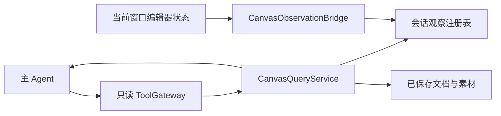

# 画布 Agent 只读查询工具设计

状态：待确认的补充设计。最终主方案为[画布 Agent 详细设计](./技术方案-画布Agent详细设计-v1.0.md)。本方案为模型增加画布元素、选中状态和可见区域的查询能力；查询不授予生成引用或文档写入权限。

## 1 查询的数据来源

模型需要同时了解文档内容与当前编辑状态，两者分别提供。

| 来源           | 内容                                                     | 使用边界                                         |
| -------------- | -------------------------------------------------------- | ------------------------------------------------ |
| 已保存文档     | 对象、素材绑定、层级、关系、属性、documentRevision       | 服务端核验的文档事实，用于确定输入和写入前置条件 |
| 当前窗口状态   | 选中对象、视口、相机、当前工具、工作副本版本、未保存标记 | 由前端状态桥提供，描述当前窗口；不作为授权依据   |
| 未保存工作副本 | 当前对象的待保存属性和结构                               | 只用于理解和比较，不能冒充已保存文档             |

当前画布在[CanvasShell](../apps/web/canvas-next/app.tsx)中通过 useCanvasViewSnapshot 读取 selection、camera 和 viewport，并通过 view.getDocument 获取对象。这些是状态桥的接入点，不表示后端已经能够查询实时选中状态。

## 2 工具目录

首期向模型提供四个主要只读工具。现有 read_scene 可以保留为兼容入口，内部复用同一查询服务，避免形成不同的对象解释规则。

| 工具                 | 输入                                          | 返回                                                                    | 主要用途                       |
| -------------------- | --------------------------------------------- | ----------------------------------------------------------------------- | ------------------------------ |
| get_canvas_state     | 当前 Run 绑定的文档与窗口会话、freshness 要求 | 文档版本、窗口快照 ID、选中集合、视口、相机、当前工具、未保存与连接状态 | 理解“选中的”“当前页面里”的指代 |
| list_canvas_elements | snapshotId、过滤条件、字段投影、分页游标      | 元素摘要、总量或可用计数、下一页游标、截断说明                          | 查询全部、选中、可见或某类元素 |
| get_canvas_elements  | snapshotId、明确对象 ID 集合、字段投影        | 对象详细属性、素材身份、层级关系、坐标与版本                            | 在具体操作前核对目标           |
| inspect_artifact     | 对象解析出的有效 artifactId、视图或裁切要求   | 媒体附件、素材身份、尺寸和坐标映射                                      | 查看图片实际内容；复用已有工具 |

过滤条件支持对象类型、选中集合、视口相交、父对象、名称与明确区域。名称匹配返回候选，不能保证唯一对象。首期采用规则查询，不要求引入向量数据库。

后续可增加 get_element_relations 查询分组、引用、连接及上下游关系，增加 inspect_canvas_region 查看指定区域的渲染图。必须按实际文档 Schema 返回受支持关系，不能由模型猜测不存在的关联。

所有工具都不改变选中集合、不移动视口、不加入引用、不修改对象、不触发生成。聚焦和定位界面属于独立 UI 动作，不混入只读工具。

## 3 返回协议

get_canvas_state 返回当前会话观察与已保存文档版本。documentRevision 由后端提供；前端上报的版本仅用于匹配，不能作为可信版本来源。

```ts
type CanvasStateObservation = {
  documentId: string
  documentRevision: number
  editorSessionId: string
  windowId: string
  sessionEpoch: string
  viewStateId: string
  viewSequence: number
  capturedAt: string
  receivedAt: string
  connection: 'connected' | 'disconnected'
  freshness: 'fresh' | 'stale' | 'unavailable'
  dirty: boolean
  workingCopyVersion: number
  selectedObjectIds: string[]
  viewport: {
    width: number
    height: number
    canvasBounds: { x: number; y: number; width: number; height: number }
  }
  camera: { x: number; y: number; scale: number }
  activeTool: string
}
```

activeTool 使用当前工具注册表校验。viewStateId 表示一份不可变查询快照，viewSequence 表示当前会话的递增观察序号，documentRevision 表示已保存文档版本，三者不能互相替代。刷新后创建新的 sessionEpoch，不能恢复旧窗口的选中集合。

元素摘要至少包含 objectId、类型、名称、父对象、可见和锁定状态、素材身份、局部变换、画布包围盒、来源快照与数据来源标记。详细字段根据已有对象类型使用判别联合建模，不用任意 JSON 或 any 接受属性。

文本内容、图片 OCR 和元素名称属于数据，不能变成模型指令。默认不返回完整图片字节、大量路径顶点或隐藏的编辑草稿；模型通过明确的详情请求读取必要信息。

## 4 前端状态桥

新增 CanvasObservationBridge，读取现有编辑器状态，并与创建 Run 的 editorSessionId 和 windowId 绑定。Runtime 不随意选择最后活跃窗口，也不合并不同标签页的选中集合。



状态桥在选择、视口、工具或工作副本变化时上报类型化观察，服务端维护有期限的会话快照。普通变化可以合并发送；模型要求新鲜观察时，通过绑定会话请求即时快照。后端不能只从文档 JSON 推断当前选择。

可采用已有事件通道下发带 requestId 的快照请求，前端通过受限 HTTP 接口回复；也可使用经过验证的双向连接。回复必须匹配会话、requestId、sessionEpoch 和序号，迟到回复不能覆盖新状态。请求等待有上限，不为等候前端持续调用模型。

浏览器关闭、超时或快照过期时返回 stale 或 unavailable，并提供原因。无法取得新鲜状态时，模型不能声称知道当前选择，也不能自行把上一次选中对象当成当前目标。需要用户指认的任务进入等待输入。

注册表中的选择、视口和未保存工作副本使用会话级临时存储，不写回文档，不恢复编辑会话。临时蒙版、识别结果和未提交笔画不通过通用观察接口上传或持久化。已确认任务的独立素材引用仍按主方案保存。

## 5 一致性与指代解析

先调用 get_canvas_state，再用返回的 viewStateId 查询对象列表和详情。这一轮查询使用同一份快照，不能把新选择与旧对象属性拼成一个结果。

分页游标绑定 snapshotId、字段投影和过滤条件。快照变化或过期后游标失效，重新查询。选择过滤只能使用工具返回的确定 ID 集合，不能在各页之间改成最新选择。

用户仅切换选择，不改变 ReferenceBinding。用户明确说“把选中的标题改成……”时，可以将该次指令发送时捕获的选择作为明确指代；Runtime 将其解析为具名目标并显示。后续切换选择不能将任务目标静默替换成另一个对象。

发起媒体生成时，仍需明确引用角色。元素被选中不代表它是 editTarget、subject 或 composition。用户要求不清、多个对象符合指代、需要的角色未确定时，先补充输入。

工作副本 dirty 时，查询返回未保存标记和差异来源。需要确定生成输入或准备写入申请时，先由用户编辑器完成保存或处理冲突，再根据服务端版本冻结 InputSnapshot、计算 Patch 并申请权限。模型不能自动保存未确认的用户草稿，也不能将查询时的工作副本当作服务端事实。

写入前重新核验当前文档版本、对象身份、确定 Patch 和 DocumentWriteGrant。查询快照、选中状态及截图都不能替代写入授权。

## 6 上下文与成本

每轮消息初始上下文包含文档概况、发送时的选择快照引用、对象数量、未保存标记和少量显式引用摘要。对象详情与媒体按工具请求加载，不把整份文档和所有图片塞入每轮提示。

列表限制返回数量和字段，分页查询。输出记录 truncated、omittedFields 和 nextCursor，不能静默截断成看似完整的画布。先读取结构化属性，再按需读取图片或区域视图。

读取权限沿用文档与素材访问检查，作用域由 Run 和会话解析，模型不能更换 documentId 或 windowId 跨范围读取。查询不需要文档写入批准。模型调用和收费媒体检查仍计入各自预算。

## 7 实施接口与验收

建议新增三个模块：前端 CanvasObservationBridge、服务端 CanvasObservationRegistry，以及统一 CanvasQueryService。ToolGateway 只暴露类型化读取工具，CanvasQueryService 同时负责快照一致性、访问范围、分页和字段投影。

| ID      | 场景                       | 必须观察到的结果                             |
| ------- | -------------------------- | -------------------------------------------- |
| QUERY01 | 仅改变选择                 | 查询能返回新选择，生成引用不变化，文档未修改 |
| QUERY02 | 两个窗口选择不同对象       | 只返回当前 Run 绑定窗口的状态                |
| QUERY03 | 浏览器关闭或快照过期       | 明确返回不可用或过期，不推断当前选择         |
| QUERY04 | 查询期间选择或对象发生变化 | 同一 snapshotId 结果一致，新状态单独取得     |
| QUERY05 | 工作副本未保存             | 来源明确，不作为已保存输入或有效写入版本     |
| QUERY06 | 名称重复或多选指代含糊     | 返回候选，必要时等待用户指认                 |
| QUERY07 | 明确指令提交后切换选择     | 已冻结目标不被替换                           |
| QUERY08 | 大画布分页与字段裁剪       | 截断明确，游标不混用不同快照                 |
| QUERY09 | 元素文本包含指令           | 只作为数据处理，不改变权限                   |
| QUERY10 | 查询请求尝试跨文档或会话   | 访问检查拒绝                                 |
| QUERY11 | 查询临时蒙版或笔画         | 通用接口不返回，不进入日志和持久上下文       |
| QUERY12 | 只读查询后立即调用修改工具 | 仍需确定变更与有效写入批准                   |

## 8 待合并范围

确认后更新主方案第 4、8、9、15、20 和 23 节：增加状态桥与查询服务、场景上下文、只读工具 Schema、会话观察接口、模块目录及 QUERY 验收。主方案第 3 节保留显式引用规则，并补充明确指代选中对象时的解析方式。原文在确认前保持不变。
