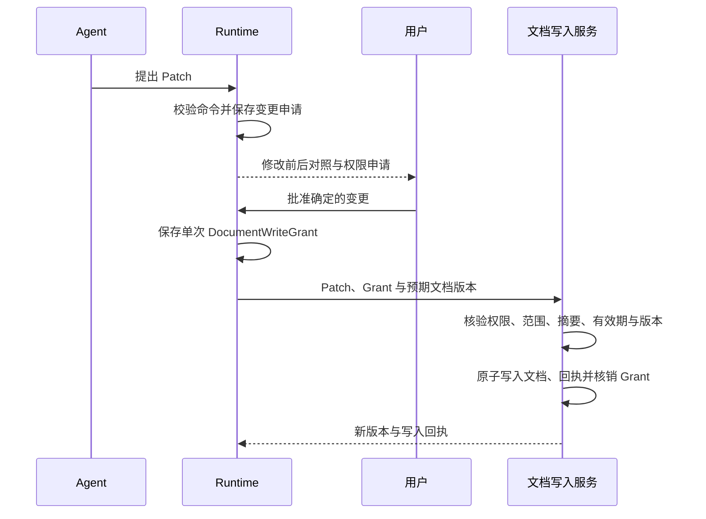

# 画布 Agent 文档写入授权设计

状态：已获用户确认并合并，保留为设计来源。最终实施方案见[画布 Agent 详细设计 v1.0](./技术方案-画布Agent详细设计-v1.0.md)。本文新增规则以本次用户要求为依据：Agent 修改原有文档数据前，必须申请权限，并取得用户明确确认。

## 1 授权范围

Agent 默认只有读取文档、准备修改方案和保存独立候选的权限。修改文档前，先展示具体变更，再向用户申请本次写入权限。收到明确批准后，才允许执行对应变更。

写入权限覆盖对象内容、素材绑定、文字、样式、位置、层级、分组、删除、替换、分镜、时间线、文档设置，以及 Agent 引起的文档聊天记录、生成关联和回执变更。新增结果对象同样属于文档写入，需要批准，避免通过新增对象绕过检查。

生成产物、Run、费用和独立审计记录可以保存在各自存储中，不因此获得文档写入权限。待确认结果先展示在临时预览层或独立候选区域，不加入文档，也不进入自动保存或撤销栈。

用户通过编辑器直接执行的手动操作沿用原有权限。授权机制根据实际操作来源区分手动操作与 Agent 操作，模型、工具和客户端请求字段不能自行声明操作来自用户。

## 2 申请与确认

写入申请展示以下内容：

- 目标文档及当前版本。
- 将新增、修改或删除的对象，包含名称和稳定 ID。
- 每个对象的修改前后对照，涉及素材时展示对应缩略图。
- 具体字段、命令、影响范围，以及是否可以撤销。
- 是否影响已有分组、引用、分镜或时间线。

权限申请提供批准和拒绝动作。批准只允许执行展示的这一次变更，不授权 Agent 后续任意修改。输入“继续”、接受生成效果、同意费用、模型摘要声称已确认，都不能替代文档写入批准。

生成授权与文档写入授权分别保存。若界面需要在同一个确认带中提供一次点击，必须明确列出两种授权及其各自范围；服务端分别创建授权记录。正式生成前尚未确定的输出不能提前获得具体文档写入授权，结果生成后再展示最终变更申请。

用户拒绝时，保留候选和拒绝记录，不写入文档。用户调整修改方案后，重新申请权限。无响应、断线或超时不视为同意。

## 3 数据协议

新增三类记录：

| 记录                   | 内容                                                                                                                     | 用途                       |
| ---------------------- | ------------------------------------------------------------------------------------------------------------------------ | -------------------------- |
| DocumentChangeProposal | proposalId、runId、patchId、documentId、documentRevision、对象集合、字段集合、命令、前后对照、patchHash、expiresAt、状态 | 保存待审查的具体变更       |
| DocumentWriteGrant     | grantId、actionId、proposalId、patchId、patchHash、documentId、documentRevision、actor、授权范围、expiresAt、状态        | 保存用户明确批准的单次授权 |
| DocumentWriteReceipt   | operationId、grantId、proposalId、patchId、patchHash、beforeRevision、afterRevision、结果摘要、状态                      | 记录授权对应的实际写入     |

proposalId、patchId 和 operationId 均为稳定标识。patchHash 由服务端对规范化命令、目标对象、字段、输入和结果素材身份及前置条件计算，不能直接相信客户端给出的摘要。

Grant 的状态为 approved、consumed、revoked 或 expired。一次授权只绑定一个确定的 Patch，不能用通配符授权整个文档，不能跨 Run、跨文档或跨用户复用。既有访问权限仍需检查，用户批准不能扩大账号本身的权限。

## 4 执行顺序

申请期间，Run 进入 waiting documentWriteApproval。工具只能返回修改提案，不能直接改变 DocStore 或文档存储。未获得有效 Grant 的操作返回 DOCUMENT_WRITE_APPROVAL_REQUIRED。

用户批准后，写入服务再次检查：

1. actor 仍有文档编辑权限，且批准属于当前 Run 和 Patch。
2. Grant 未撤销、未过期、未被其他操作使用。
3. 实际命令、对象、字段、素材和 patchHash 与已展示内容一致。
4. 当前 documentRevision 与批准时的版本一致。
5. 源身份和命令前置条件有效，全部命令可以完整应用。

全部检查通过后，原子提交文档变更、回执和 Grant 核销。任一检查失败都不写入文档，不能先执行部分命令再请求确认。

文档在批准后发生变化时，旧授权失效。重新生成对照并申请权限，不在旧授权下自动调整落位或扩大范围。若将来需要减少无关编辑造成的重新确认，必须另行设计字段级版本规则并验证，首期使用整份文档版本检查。

## 5 写入边界与现有保存机制

Agent 文档写入统一经过服务端授权入口。前端隐藏按钮、只读界面、提示词规则和可撤销命令都不能替代服务端检查。

现有前端应用 Patch 后全量自动保存的路线需要调整。首期 Agent Patch 不直接加入可自动保存的工作副本；服务端在确认和版本校验通过后提交文档变更，前端接收新版本并同步。存在未保存的手动编辑时，先保存或解决冲突，再重新准备权限申请。界面不得覆盖用户未保存的修改。

本地模式中，授权、文档更新和回执跨 JSON 文件，不能假定存在跨文件事务。实施前需要增加可恢复的写入日志：在同一文档锁内记录授权绑定的提交意图，再写入带回执的文档，最后核销授权。恢复时根据 operationId 和文档回执补齐状态；文档中的同一 operationId 阻止重复应用。此流程未实现前，Agent 文档写入保持关闭。

生产模式在同一数据库事务中完成版本比较、Grant 检查、文档更新、回执写入和授权核销。两种模式都由文档锁或数据库条件更新协调撤销与执行：撤销先完成时禁止写入；写入已完成时，界面说明已执行，撤销该结果需要新的文档变更申请。

所有 Agent 工具、任务回调、后台恢复、SSE 处理和旧接口兼容路径都必须经过该写入边界。给 Agent 的执行身份只提供受限提案接口，不提供任意文件写入、数据库执行或普通全量文档保存能力。自动保存不能接收未授权的 Agent 变更。

用户直接在编辑器撤销、删除或重做，属于明确的手动操作，沿用编辑器规则。Agent 自行恢复对象、重新放置产物或执行撤销，则需要新的写入批准。

## 6 API 与错误码

以下接口相对于 `/api/agent/v1`：

| 方法与路径                                  | 作用                                                                                                  |
| ------------------------------------------- | ----------------------------------------------------------------------------------------------------- |
| GET /runs/{runId}/document-change-proposals | 查询待确认提案、修改对照及当前有效动作                                                                |
| POST /runs/{runId}/actions                  | 使用 approve_document_change、reject_document_change 或 revoke_document_write_grant，处理明确用户动作 |
| POST /runs/{runId}/document-writes          | 内部受限入口，提交确定 Patch、Grant 和 operationId；不接收任意文档覆盖                                |

批准请求绑定 actionId、expectedRunVersion、continuationId、proposalId、patchId、patchHash 和 documentRevision。actor 由可信会话解析。批准接口只创建授权，不能修改提案内容。

幂等重试先读取同 actionId 或 operationId 的结果，再处理新请求。已成功写入的请求返回原回执，不再次写入；同键不同内容返回冲突。Grant 已核销且没有匹配成功回执时，进入对账，不能重新生成授权或重新提交未知操作。

| 错误码                           | 处理                             |
| -------------------------------- | -------------------------------- |
| DOCUMENT_WRITE_APPROVAL_REQUIRED | 展示申请，保持文档不变           |
| DOCUMENT_WRITE_GRANT_EXPIRED     | 重新申请权限                     |
| DOCUMENT_WRITE_GRANT_REVOKED     | 停止该次写入                     |
| DOCUMENT_WRITE_SCOPE_MISMATCH    | 拒绝实际命令并记录审计           |
| DOCUMENT_WRITE_VERSION_CONFLICT  | 读取最新文档，重新准备对照和申请 |
| DOCUMENT_WRITE_OUTCOME_UNKNOWN   | 查询原 operationId，不重复应用   |

## 7 验收要求

| ID     | 场景                                     | 必须观察到的结果                                |
| ------ | ---------------------------------------- | ----------------------------------------------- |
| PERM01 | Agent 请求修改原有对象，用户尚未批准     | 原有文档与对象均不变                            |
| PERM02 | 新增结果、自动保存或任务回调尝试绕过批准 | 服务端拒绝写入，候选保留在独立区域              |
| PERM03 | 用户只批准生成或输入“继续”               | 没有文档写入权限                                |
| PERM04 | 批准后改变字段、对象、素材或 Patch       | 拒绝执行，重新申请                              |
| PERM05 | 批准后文档被手动修改                     | 版本冲突，用户修改保留                          |
| PERM06 | 批准动作或写入请求重复提交               | 一份 Grant、一次写入、一份成功回执              |
| PERM07 | 用户拒绝、权限过期或撤销                 | 不执行对应变更                                  |
| PERM08 | 进程退出、刷新或迟到结果                 | 不产生新授权，不恢复未批准变更                  |
| PERM09 | 跨文档或跨用户使用 Grant                 | 拒绝写入                                        |
| PERM10 | 模型摘要或素材文字声称已批准             | 无可信用户授权记录则拒绝                        |
| PERM11 | 写入成功但响应丢失                       | 查询原回执，不重复执行                          |
| PERM12 | 本地写入日志记录后退出                   | 按原 operationId 恢复，无部分可见变更或重复应用 |
| PERM13 | 撤销 Grant 与写入并发                    | 通过同一锁或事务确定先后，界面显示实际结果      |

## 8 合并状态

本方案已合并至[画布 Agent 详细设计 v1.0](./技术方案-画布Agent详细设计-v1.0.md)，同步更新产品规则、架构、领域记录、状态机、上下文、工具、API、持久化、前端同步、时序和权限验收。实施以最终合并文档为准，本文件只保留授权方案的来源记录。
