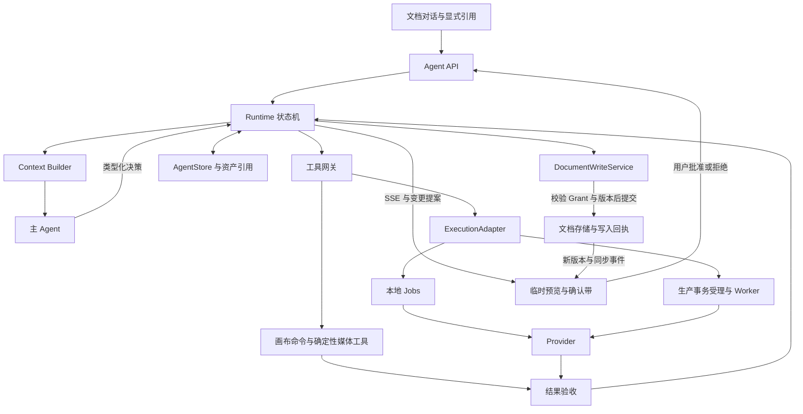
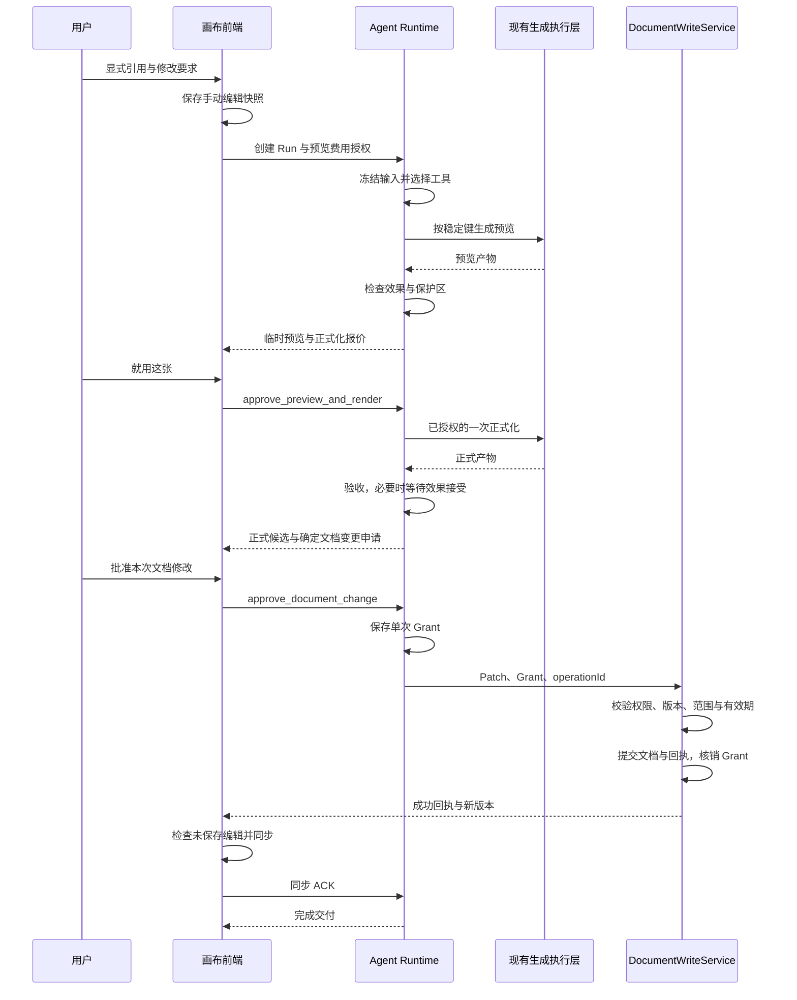
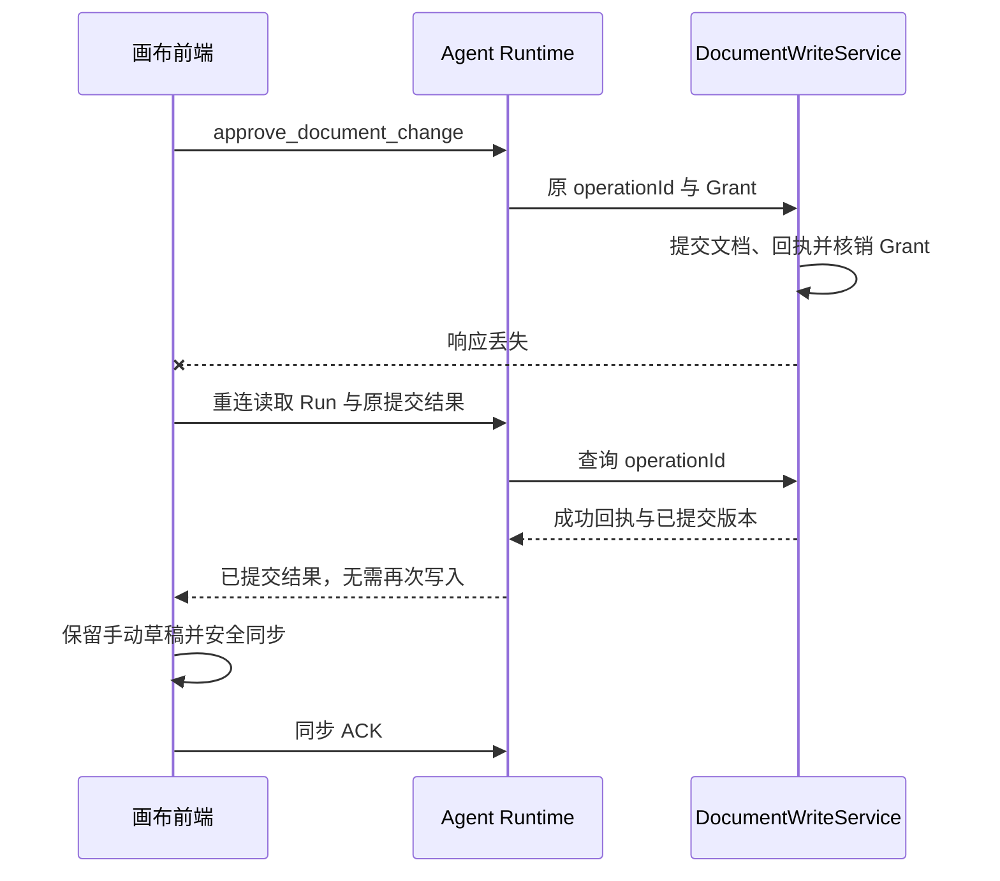

# 画布 Agent 详细设计

设计版本：v1.0（文档写入授权合并版）。基线日期：2026-10-03。适用仓库：aiVideo。读者：前端、后端、模型接入与测试工程师。

画布 Agent 根据用户的文字、素材引用和局部标记完成创作，在用户批准具体文档变更后，将结果放回画布。这份文档说明它如何理解需求、选择工具、生成预览、检查效果，以及如何处理确认、费用和任务恢复。

设计采用一个主 Agent，按任务需要组合 Plan、ReAct 和 Reflection：Plan 拆分步骤和依赖，ReAct 根据工具结果推进当前步骤，Reflection 检查结果与要求的差异。Runtime 是负责推进任务的运行层，执行确认、版本、预算和恢复规则，并保存执行状态。Provider 是图片和视频生成后端的统一接口。画布命令、生成执行层和 Provider 沿用仓库已有能力。Agent 默认只读；所有文档写入先申请权限，再由服务端核验明确批准并提交。

状态：最终合并设计，待实施。新增类型、接口、目录和验收目标描述的是实施要求，尚未实现，也未通过真实模型验证。代码现状根据包含未提交修改的当前工作区核对；实施前需要再次确认相关接口。

阅读导航：[产品契约](#3-产品交互契约) · [架构](#4-架构与执行边界) · [数据与状态](#5-领域数据与版本规则) · [上下文工程](#8-上下文工程) · [工具与能力](#9-工具协议与执行网关) · [视频](#12-连续视频设计) · [API](#15-api-详细协议) · [持久化](#16-存储与持久化执行) · [写入授权](#17-画布-patch-与文档写入授权) · [验收矩阵](#23-实施阶段与完成条件)。

## 1 设计范围与优先关系

本设计沿用一份文档一条主对话、显式引用、画布预览和版本确认的产品形态。最新交互依据为[草稿与确认交互 v4](./designs/canvas-agent-2026-10-02/v4-draft-confirmation/design-notes.md)。仓库开发与识别会话约束以 [AGENTS.md](../AGENTS.md) 为准。

本次新增的写入权限要求优先于历史交互中的自动落位规则。候选可以直接供用户查看，但新增或修改文档数据必须先展示具体变更、申请权限并取得明确批准。全文采用同一写入流程。

本次设计更新了历史 [v0.4 技术方案](./技术方案-创作平台与画布Agent-v0.4.md)中的默认四图生成、旧 JS 目录、固定抠图 Agent 和持久化蒙版会话方案。实施画布 Agent 时，以本文对应要求为准。任务基础设施仍遵守现有[任务执行选型](./architecture/decisions/0002-task-stack.md)，保留既有生产执行路线。

### 1.1 本次确定的设计决策

Run 表示一次创作任务，Step 表示其中的执行步骤，Artifact 表示一份不可变的媒体产物。Patch 是一组待应用的画布命令及其前置条件。

| 编号 | 决策                                                     | 原因                                   |
| ---- | -------------------------------------------------------- | -------------------------------------- |
| D01  | 一个主 Agent，按任务复杂度组合 Plan、ReAct、Reflection   | 控制调用成本，保持单一创作状态         |
| D02  | Runtime 是执行与确认的唯一裁决者                         | 模型输出只能提出动作，不能自行产生授权 |
| D03  | 文档、Run、Artifact 分别保存画布事实、执行事实、媒体事实 | 防止聊天摘要覆盖真实状态               |
| D04  | Agent 生成由后端统一提交，前端绑定已有任务               | 避免同一操作提交两次                   |
| D05  | 一次先生成一个候选，确认后才正式化                       | 减少无效生成与大批量试错               |
| D06  | 确认绑定产物内容、具体动作、方案与报价                   | 防止旧按钮、改价或方案变化继续执行     |
| D07  | Agent Patch 经用户批准后由服务端提交，前端同步新版本     | 防止未授权修改进入文档与自动保存       |
| D08  | 识别蒙版与未提交笔画不进入持久记忆                       | 遵守当前识别会话生命周期               |
| D09  | 本地和生产各实现 Store 与 ExecutionAdapter               | 保留当前两条执行路径，禁止双调度和双写 |
| D10  | 硬约束由程序保证，生成语义靠证据检查，审美由用户决定     | 使效果承诺可验证                       |

新增决策 D11：生成授权与文档写入授权分别记录；D12：写入授权只绑定一次确定变更，文档版本或变更内容变化后重新申请。

### 1.2 首期交付范围

首期完成单图局部修改流程：用户显式引用图片，使用已有局部标记能力指定修改范围；Agent 生成一份预览，将需要保留的区域合成回结果。用户确认后，按模型支持的方式生成正式结果，再展示具体文档变更并申请写入权限。用户批准后，才将对应版本放入画布。流程同时支持继续修改、停止和刷新恢复。

本文将预览转换为正式结果的过程称为正式化，包括模型原生升级、放大增强和重新生成。将结果对象放入画布并保存回执的过程称为落位。

主体加构图的多参考生成、铅笔和钢笔、可编辑矢量元素、多步骤创作及连续视频属于后续阶段。协议预留这些能力，但界面只开放已经端到端验证的工具。模型选择、正式化路线和效果阈值通过真实评测确定。

## 2 当前代码基础与差距

下表区分已有能力和本次需要新增的内容。文中的 CAS 指带预期版本的条件写入：只有当前版本与请求一致时才保存，用于防止并发修改相互覆盖。SSE 是服务端向前端持续推送任务事件的机制。

| 现状依据                                                                                                         | 可复用内容                               | 本设计需要补充的内容                                                     |
| ---------------------------------------------------------------------------------------------------------------- | ---------------------------------------- | ------------------------------------------------------------------------ |
| [当前画布入口](../apps/web/canvas-next/app.tsx)                                                                  | React 编辑器、右栏、手动生成、局部编辑   | 接入 Agent 请求、引用与任务视图；Agent 对话先独立保存，写回文档需授权    |
| [旧 Agent 流程](../apps/web/canvas/flows/agent.ts)与[规划器](../apps/api/backend/planning.py)                    | 受限工具校验的思路                       | 当前为固定抠图方案，不承担新 Runtime                                     |
| [GenerationCoordinator](../apps/web/canvas/state/generation-coordinator.ts)                                      | 生成实体、对象关联、运行态               | 增加绑定后端已有任务的入口，不能复用 submit 再提交一次                   |
| [DocStore](../apps/web/canvas/state/doc-store.ts)与[commands](../apps/web/canvas/state/commands.ts)              | 命令、撤销、生成事件归属                 | 受限服务端命令提交、授权回执、版本同步与手动撤销；不直接保存未批准 Patch |
| [Reference 类型](../apps/web/canvas/state/node-model.ts)                                                         | 素材与来源对象引用                       | 角色、内容版本、指纹及来源身份                                           |
| [文档存储](../apps/api/backend/storage.py)与[自动保存](../apps/web/canvas/state/autosave.ts)                     | 文档 revision、baseRevision 冲突处理     | 授权写入服务、强制 CAS、恢复日志与保存白名单；防止全量保存覆盖新版本     |
| [Provider](../apps/api/backend/providers/base.py)与[Jobs](../apps/api/backend/jobs.py)                           | 生成、排队、进度、取消、历史产物         | 模型级能力表、正式化路线、多角色输入适配                                 |
| [生产入口](../apps/api/backend/production.py)与[事务受理](../apps/api/backend/services/acceptance.py)            | 数据库受理、现有生产执行体系             | Agent 路由和持久化适配，复用既有受理边界                                 |
| [能力声明](../apps/api/backend/capabilities.py)与[评测注册](../apps/api/backend/evaluation/registry.py)          | 能力与测试入口                           | 统一不同模块的能力来源与版本                                             |
| [识别操作](../apps/web/canvas/flows/recognition-operation.ts)与[抠图执行](../apps/api/backend/cutout.py)         | operationId、源身份、取消、原生线程占槽  | 在新 Run 中沿用，不跨会话恢复旧选区                                      |
| [视觉裁判](../apps/api/backend/evaluation/graders/judge.py)与[评测门禁](../apps/api/backend/evaluation/gates.py) | 结构化回答、规则判定、人工校准与质量门禁 | 原图、主体参考、预览、正式版的成对或多图检查                             |

当前云端视频适配器限制图生视频的参考输入。开放连续视频前，需要增加并验证首帧或片段延续能力。图片模型支持单张参考图，也不足以证明主体参考和构图草图能够同时生效；这种组合需要单独验证。

## 3 产品交互契约

### 3.1 页面职责

一份文档绑定一条主对话。用户在右侧对话中提交需求、添加带名称的引用并查看任务状态，在画布中指认对象、比较结果和继续编辑。底部手动生成区域默认折叠为入口，展开后使用独立参数表单。对话和手动生成表单分别保留未发送的输入。分镜和时间线用于编辑结果，只有用户明确要求时才将结果写入时间线。

候选或已放入画布的结果下方只有一组当前阶段的确认动作。未批准写入的候选显示在临时预览层，不加入文档。聊天关联卡显示缩略图、状态和定位入口，不复制第二组批准按钮。窄屏应保留结果与动作的关联，并支持键盘聚焦、状态播报和返回对话。

### 3.2 引用与输入规则

1. 用户通过引用操作将对象加入输入框，显示名称、缩略图、角色和移除按钮。
2. 当前选中对象只影响画布操作，不隐式成为生成参考。
3. 已确认并完成的正式结果可成为下一轮默认引用；若用户已修改输入或引用，不覆盖其未发送内容。
4. 主体参考和构图参考分开传递。风格、台词、时长属于结构化文字要求。
5. 引用对象或整图与局部范围不清楚时，进入补充输入状态；不猜测并提交生成。
6. 输入“继续”不产生 Approval，只定位到对应等待点。
7. 已提交完成的构图草图可以作为独立素材保存。未提交的蒙版、识别结果和笔画草稿遵守临时会话规则。

### 3.3 三个动作

| 动作     | 状态变化                                             | 是否发起生成                                             |
| -------- | ---------------------------------------------------- | -------------------------------------------------------- |
| 就用这张 | 图像场景接受该预览，并授权界面已展示方案的一次正式化 | 仅通过服务端确认校验后执行；视频按第 12 节的阶段语义处理 |
| 这里要改 | 进入修改状态，等待补充文字、引用或标记               | 点击本身不生成，不提交已有草稿                           |
| 停       | 停止当前 Run 的自动推进，并请求取消在途任务          | 不创建新生成，保留已有产物                               |

预览确认带展示正式尺寸、正式化方式和预计费用。需要重新生成时，同时说明细节可能变化。报价或方案变化后，旧确认动作失效；界面展示更新后的内容，等待用户重新点击。正常流程无需额外的计划确认弹窗。

若正式结果与预览发生需人工判断的差异，展示“接受当前正式结果”动作。此动作只接受已有产物，不触发另一次正式生成，也不直接修改文档。结果准备完成后，当前确认带切换为具体文档变更的权限申请，不另设长期重复按钮。

### 3.4 新消息如何影响 Run

| 当前情形                   | 处理规则                                                                   |
| -------------------------- | -------------------------------------------------------------------------- |
| 无活动 Run                 | 创建新 Run                                                                 |
| 等待修改或补充输入         | 新消息进入当前 Run，增加 iteration 与请求版本                              |
| 等待预览确认，用户提出修改 | 原待批准方案失效，保存修改请求后重新准备                                   |
| 生成中，用户修改当前目标   | 记录新请求，当前步骤标记结果不可自动应用；请求取消，实际结束后按新要求继续 |
| 用户明确提出独立新任务     | 保存为新 Run；MVP 同文档只推进一个 Agent Run                               |
| 用户要求的对象归属不清     | 询问对象与任务归属，不修改现有执行意图                                     |

系统建议不能覆盖用户的新要求。旧步骤失效后，已经发生的费用仍需记录。迟到结果保留来源记录，但不作为新任务的基准。

### 3.5 文档修改前申请权限

Agent 默认只能读取文档、准备修改方案和保存独立候选。修改文档前，先展示具体变更，再申请本次写入权限。只有用户明确批准后才能执行。

写入权限覆盖对象内容、素材绑定、文字、样式、位置、层级、分组、删除、替换、分镜、时间线、文档设置，以及 Agent 引起的文档聊天记录、生成关联和回执变更。新增结果对象同样需要批准。Run、产物、费用和独立审计记录保存在各自存储中，不因此获得文档写入权限。

申请展示目标文档与版本、对象名称和稳定 ID、修改前后对照、具体字段与命令、影响范围，以及撤销方式。涉及素材时展示缩略图；涉及分组、引用、分镜或时间线时说明影响。未批准结果保留在临时预览层或独立候选区域，不进入自动保存或撤销栈。

用户可以批准或拒绝。批准只对应展示的一次变更，不授权后续任意修改。输入“继续”、接受效果、同意费用和模型声称已确认，都不能替代文档写入批准。拒绝、超时、断线或无响应时不写入文档。修改方案后重新申请。

生成授权与文档写入授权分别保存。同一确认带需要一次点击处理两种授权时，必须分别展示范围，并分别创建记录。尚未生成的正式结果无法绑定确定 Patch，不能预先获得写入批准；结果生成后再次展示最终变更申请。

用户直接通过编辑器执行的手动操作沿用现有权限。操作来源通过可信执行通道区分，模型、工具和请求字段不能自行声明操作来自用户。用户直接撤销或删除属于手动操作；Agent 自行撤销、恢复对象或重新放置仍需新的写入批准。

## 4 架构与执行边界



服务启动时选择本地 Jobs 或生产执行路径。每个 Run 固定使用一个 `executionProfile`，运行期间不能切换，也不能同时向两条路径提交任务。Agent 的媒体生成统一交给选定的现有执行层。

主 Agent 使用多模态语言模型理解需求并选择动作，图片和视频 Provider 生成媒体结果。视觉验收器可以复用主模型适配器，也可以配置独立模型。对话中的图片和视频模型菜单只选择生成模型，不控制主 Agent 或视觉验收器。

### 4.1 模块接口

| 模块                 | 输入                                     | 输出与责任                            |
| -------------------- | ---------------------------------------- | ------------------------------------- |
| ContextBuilder       | runId、stage、预算                       | ContextPackage、ContextManifest       |
| AgentModelClient     | 消息、媒体附件、工具 Schema              | Decision、Usage、供应商响应 ID        |
| Runtime              | 用户命令、工具完成事件、检查结果         | 状态转换、执行意图、等待点            |
| ToolGateway          | 类型化工具调用、执行上下文               | 经过验证的工具结果或拒绝原因          |
| ExecutionAdapter     | 稳定 Step 与提交意图                     | Job 标识、状态、取消与对账结果        |
| Validator            | 要求、输入与输出产物、程序证据           | pass、fail 或 inconclusive 的逐项报告 |
| AgentStore           | 预期 Run 版本与变更                      | 原子检查点、事件、执行意图和回执      |
| DocumentWriteService | 确定 Patch、Grant、operationId、预期版本 | 校验权限、提交文档、回执与授权核销    |
| CanvasPatchBridge    | 写入结果、当前工作副本与版本             | 冲突处理、版本同步与同步 ACK          |

## 5 领域数据与版本规则

### 5.1 基础原则

媒体产物不能原地修改。生成、裁切或合成会创建新的 Artifact，并记录来源素材和生成步骤。画布对象是素材在文档中的一个实例：移动对象不改变媒体内容，替换图片则会改变内容指纹。

聊天保存交互内容，预算、确认和完成状态以执行记录为准。新消息通过稳定的 messageId 关联 Run。当前 `doc.chat` 可以继续展示旧文档内容，实际执行读取 Run 中的用户命令。Agent 新增消息默认保存在独立对话记录中，写回 `doc.chat` 需要对应写入授权；不能为了展示聊天自动改变文档。

### 5.2 核心记录

| 记录              | 必要字段                                                                                                                                                   |
| ----------------- | ---------------------------------------------------------------------------------------------------------------------------------------------------------- |
| Run               | id、documentId、requestVersion、iteration、state、refs、constraints、planVersion、currentStepId、budgetId、executionProfile、version、createdAt、updatedAt |
| UserCommand       | id、runId、messageId、原文、显式引用、intentMode、actor、createdAt                                                                                         |
| Step              | id、runId、iteration、kind、dependsOn、inputDigest、recipeHash、status、version、idempotencyKey、attemptIds、jobId、outputArtifactIds                      |
| Attempt           | id、stepId、attemptNo、submissionState、providerRequestId、externalTaskId、reservedCost、usage、errorCode                                                  |
| Artifact          | id、assetId、contentHash、kind、width、height、durationMs、parentIds、producerStepId、stage、createdAt                                                     |
| ReferenceBinding  | id、role、artifactId、objectId、documentId、sourceDigest、origin                                                                                           |
| InputSnapshot     | id、documentId、documentRevision、refBindings、所依赖对象字段、constraintsVersion、digest、createdAt                                                       |
| Constraint        | id、targetRefIds、property、mode、expected、strength、checkMethod、sourceMessageId、version                                                                |
| Approval          | id、actionId、runId、stepId、artifactId、artifactHash、recipeHash、constraintsHash、quoteId、purpose、actor、createdAt                                     |
| BaselineSelection | runId、artifactId、source、basedOnApprovalId、createdAt                                                                                                    |
| ContextManifest   | id、runVersion、stage、templateVersion、capabilityVersion、refIds、includedFacts、omissions、usage、responseId                                             |
| CanvasPatch       | id、runId、stepId、artifactIds、commands、preconditions、status、documentRevision、receiptId                                                               |
| RunEvent          | id、runId、seq、runVersion、type、stepId、payload、createdAt                                                                                               |

`Artifact.stage` 为 source、preview 或 final，不等于用户接受状态。`Approval.purpose` 区分正式化授权和接受已有结果。`BaselineSelection.source` 为用户选择或已确认预览的正式化派生；后者不能在对话中表述为用户亲自确认过该正式图。

文档写入另设 DocumentChangeProposal、DocumentWriteGrant 和 DocumentWriteReceipt，不能复用生成 Approval 代替写入授权。CanvasPatch 增加 patchHash、proposalId、expectedDocumentRevision 和 writeGrantId，并与确定命令及其回执关联。

### 5.3 引用与约束协议示意

下列 TypeScript 是拟议协议示意。实际实现由 Pydantic Schema 与前端类型生成或契约校验保持一致，全部新增前端代码纳入 typecheck 和 lint。

```ts
type ReferenceRole = 'editTarget' | 'subject' | 'composition' | 'firstFrame' | 'previousTail'

type ReferenceBinding = {
  id: string
  role: ReferenceRole
  artifactId: string
  contentHash: string
  objectId?: string
  documentId: string
  sourceDigest: string
  origin: 'userExplicit' | 'confirmedResult' | 'validatedDependency'
}

type Constraint = {
  id: string
  targetRefIds: string[]
  property: string
  mode: 'preserve' | 'change'
  expected: string | number | boolean
  strength: 'hard' | 'semantic'
  checkMethod: 'geometry' | 'pixel' | 'metadata' | 'vision' | 'human'
  sourceMessageId: string
  version: number
}
```

`validatedDependency` 只用于已明确展示和授权的任务内依赖，例如上一段尾帧。它不能把任意画布选择或检索结果变成参考图。检索可以定位候选对象；使用新的创作输入仍需明确的引用绑定。

旧 Reference 缺少角色时保留 legacy 语义，不自动猜成主体或构图。新任务通过显式选择或明确用户要求完成角色解析。

### 5.4 指纹与版本

| 标识             | 含义                                               | 使用位置               |
| ---------------- | -------------------------------------------------- | ---------------------- |
| documentRevision | 一次已保存文档的版本                               | 保存 CAS、落位 ACK     |
| contentHash      | 实际媒体字节的不可变哈希                           | 素材身份、确认、缓存   |
| sourceDigest     | 当前步骤依赖的对象内容、素材与编辑属性的规范化摘要 | 输入有效性、冲突判定   |
| layoutDigest     | 位置、父子变换、画幅关系的摘要                     | 布局工具、草图构图任务 |
| runVersion       | Run 每次事务提交的递增版本                         | 动作 CAS、SSE 状态归并 |
| planVersion      | 计划修订版本                                       | 计划依赖与失效记录     |
| recipeHash       | 工具、模型版本、输入、尺寸与正式化路线的摘要       | 幂等请求、确认匹配     |

后端按照带版本的规范化规则计算摘要，客户端提供的哈希只用于比对。JSON 键排序、数值格式和参与计算的字段需要契约测试。普通图片编辑的 sourceDigest 不包含对象在画布上的平移；布局生成需要位置关系，因此将相应的 layoutDigest 纳入依赖。

报价和密钥不混入 recipeHash 的媒体语义部分：报价通过 quoteId 单独绑定；密钥仅由服务端配置引用解析，不进入上下文、日志或文档。

### 5.5 文档变更与单次授权

| 记录                   | 必要字段                                                                                                                          | 用途               |
| ---------------------- | --------------------------------------------------------------------------------------------------------------------------------- | ------------------ |
| DocumentChangeProposal | proposalId、runId、patchId、documentId、documentRevision、对象集合、字段集合、commands、beforeAfter、patchHash、expiresAt、status | 保存待审查变更     |
| DocumentWriteGrant     | grantId、actionId、proposalId、patchId、patchHash、runId、documentId、documentRevision、actorId、scope、expiresAt、status         | 用户批准的一次写入 |
| DocumentWriteReceipt   | operationId、grantId、proposalId、patchId、patchHash、beforeRevision、afterRevision、结果摘要、status                             | 记录实际提交结果   |

Grant 状态为 approved、consumed、revoked 或 expired。提案状态为 pending、approved、rejected、stale 或 applied。写入回执与界面同步状态分别保存，浏览器未同步不等于服务端未提交。

proposalId、patchId 和 operationId 均为稳定标识。patchHash 由服务端对规范化命令、对象、字段、输入和结果素材身份及前置条件计算。生成 recipeHash 和文档 patchHash 分别表达媒体操作与文档变更，不能互相替代。

一次 Grant 只绑定一个确定 Patch，不接受整个文档的通配授权。不能跨 Run、文档或用户复用，也不能扩大账号已有权限。当前 documentRevision 与批准版本不同，或实际命令与 patchHash 不一致时，重新展示对照并申请权限。首期采用整份文档版本检查，不在旧授权下自动调整位置。

```ts
type DocumentWriteGrant = {
  grantId: string
  actionId: string
  proposalId: string
  patchId: string
  patchHash: string
  runId: string
  documentId: string
  documentRevision: number
  actorId: string
  scope: {
    operationKinds: ('insert' | 'update' | 'delete' | 'reorder')[]
    objectIds: string[]
    fieldIds: string[]
  }
  expiresAt: string
  status: 'approved' | 'consumed' | 'revoked' | 'expired'
}
```

scope 描述确定命令中的操作、对象和字段，只能使用注册 Schema 允许的标识。它用于复核影响范围，不能替代 patchHash，也不能接受任意属性路径或脚本。Actor、状态和摘要由服务端写入，客户端不能自行构造有效 Grant。

## 6 状态机与停止语义

### 6.1 Run 状态

采用判别联合表达状态，避免 `status=completed` 同时 `waiting=true` 的矛盾组合。

```ts
type RunState =
  | { kind: 'active'; phase: 'interpret' | 'plan' | 'act' | 'review' | 'finalize' | 'deliver' }
  | {
      kind: 'waiting'
      reason:
        | 'input'
        | 'region'
        | 'previewApproval'
        | 'finalAcceptance'
        | 'budget'
        | 'conflict'
        | 'externalUnknown'
        | 'placement'
        | 'documentWriteApproval'
        | 'documentSync'
        | 'documentWriteUnknown'
      continuationId: string
    }
  | { kind: 'stopping'; requestedAt: string }
  | { kind: 'terminal'; outcome: 'completed' | 'failed' | 'stopped' }
```

### 6.2 主要状态转换

| 事件                   | 前置状态                                                          | 后置状态                                   | 关键条件                                             |
| ---------------------- | ----------------------------------------------------------------- | ------------------------------------------ | ---------------------------------------------------- |
| 创建任务               | 无                                                                | active interpret                           | 请求幂等、文档与引用有效                             |
| 解析后发现输入缺失     | active interpret                                                  | waiting input 或 region                    | 不创建生成 Step                                      |
| 工具提交               | active act 或 finalize                                            | 同阶段等待 Job                             | Step 意图已持久化、预算已预留                        |
| Job 完成               | active act 或 finalize                                            | active review                              | 归属匹配，输入未被新要求废弃                         |
| 预览准备完成           | active review                                                     | active deliver                             | 产物独立保存，只准备候选展示，不写入文档             |
| 预览可以检查           | active deliver                                                    | waiting previewApproval                    | 候选独立保存并通过必要硬检查，无需先写入文档         |
| 确定文档变更           | active deliver                                                    | waiting documentWriteApproval              | 保存前后对照、Patch 与当前文档版本                   |
| 批准文档变更           | waiting documentWriteApproval                                     | active deliver                             | 有效单次 Grant，服务端再次校验后提交                 |
| 服务端写入完成         | active deliver                                                    | waiting documentSync 或 terminal completed | 成功回执已保存；当前前端无法安全同步时等待           |
| 拒绝文档变更           | waiting documentWriteApproval                                     | waiting placement                          | 保留候选，不写入；用户可调整方案或停止               |
| 文档写入结果未知       | active deliver                                                    | waiting documentWriteUnknown               | 查询原 operationId，不重复写入或创建授权             |
| 请求修改               | waiting previewApproval、finalAcceptance 或 documentWriteApproval | waiting input 或 region                    | 旧 continuation 和未提交写入授权失效，保留输入草稿   |
| 发送修改               | waiting input 或 region                                           | active interpret                           | 新 UserCommand，iteration 递增                       |
| 图像批准并正式化       | waiting previewApproval                                           | active finalize                            | 确认、预算、Step 意图同次提交                        |
| 确认非末段视频预览     | waiting previewApproval                                           | active act 或 waiting budget               | 只接受本段；下一段预览须在授权范围内，不创建正式 Job |
| 确认整组视频并正式化   | waiting previewApproval                                           | active finalize                            | 全部预览已接受，整组确认、报价与总预算预留原子提交   |
| 正式结果疑似偏移       | active review                                                     | active deliver 后 waiting finalAcceptance  | 展示差异，尚未自动成为基准                           |
| 接受现有正式结果       | waiting finalAcceptance                                           | active deliver                             | 不产生付费 Step；仍需具体文档变更授权                |
| 正式结果验收与落位完成 | active review 或 deliver                                          | terminal completed 或继续下一已授权步骤    | 必须有已授权写入的成功回执；当前界面未同步时明确区分 |
| 源内容发生冲突         | active 或 waiting                                                 | waiting conflict                           | 已派发任务仅停止应用与推进；停止标记存在时只记事实   |
| 上游提交结果未知       | active act 或 finalize                                            | waiting externalUnknown                    | 保留预留，查询原尝试                                 |
| 点击停                 | 任意非终态                                                        | stopping                                   | 停止创建后续步骤                                     |
| 停止请求已记录         | stopping                                                          | terminal stopped                           | Job 的实际停止状态独立跟踪                           |

硬检查失败的产物可以作为失败候选展示，不能提供普通预览的正式化按钮。语义验收无法判断时，由用户复核；文件损坏、尺寸错误或协议错误仍需通过程序检查，用户接受不能替代这些检查。

### 6.3 Step 与 Job 的独立状态

Step 状态为 pending、ready、dispatching、running、unknown、completed、failed、cancelled、obsolete。Job 延续现有执行协议。Run stopped 表示创作不再推进，并不证明上游已经停止收费或原生线程已经结束。

任务已停止或步骤已失效后收到成功结果时，系统仍需保存产物和费用，并将结果标记为未采用。该结果不能恢复旧选择、重建已撤销对象或自动触发下一步。原生识别线程结束前继续占用并发槽位。外部任务是否释放容量，由执行适配器根据对账和租约规则判断；界面停止本身不是释放依据。

停止标记一旦写入，模型回复、Job 结果和源变化事件都不能清除它。状态转换依次检查停止与终态保护、事件归属和版本，最后处理正常推进。处于 stopping 或 stopped 的 Run 收到 SOURCE_CHANGED、模型回复或完成事件时，只更新审计、产物和费用记录。恢复创作需要新的明确任务或恢复命令，旧事件不能重新启动任务。

## 7 Agent 策略与模型协议

### 7.1 策略选择

| 任务                         | 路线                                               |
| ---------------------------- | -------------------------------------------------- |
| 已明确的文字、位置、颜色修改 | 生成类型化变更提案，必要时一次意图解析，批准后提交 |
| 单图局部编辑                 | 短 ReAct 循环，加程序检查与必要视觉检查            |
| 多素材生成或依赖多个工具     | Plan 生成步骤，再逐步 ReAct                        |
| 连续视频与多镜头             | 有依赖的 Plan，按检查点推进                        |

Plan 记录内部步骤及其依赖，计划建立后仍需逐步检查执行条件。每个节点必须引用已注册工具和有效输入。计划不能包含循环依赖、不存在的产物、尚未支持的能力，或绕过确认点的付费步骤。

### 7.2 主模型输出

Decision 使用 Pydantic 判别联合，至少包含 `propose_plan`、`call_tool`、`ask_input`、`report_issue`。生成确认、文档写入批准、预算增加和完成交付由 Runtime 根据真实事件决定，不作为模型可直接写入的字段。

模型客户端适配多模态附件、结构化输出、工具调用 ID、usage、超时及取消。每个适配器必须声明其工具调用和结构化输出能力；不支持时明确报错或进入已验证的 JSON 协议适配，禁止执行任意自然语言输出。

输出格式不合法时，可以重新请求结构化输出，但不能执行上一次无效的工具调用。格式修复产生的模型费用仍需入账。系统保存模型给出的决策、简短依据和证据引用，不依赖其内部推理文本。

### 7.3 Reflection 输出

```json
{
  "verdict": "needs_revision",
  "issues": [
    {
      "constraintId": "preserve-face",
      "status": "inconclusive",
      "evidenceRefs": ["source-face-crop", "preview-face-crop"],
      "description": "预览中的面部细节不足以确认一致性"
    }
  ],
  "suggestedAction": "request_detail_view"
}
```

Reflection 对照原始要求、源素材、候选结果和程序检查证据，判断修改是否完成、保护内容是否受损。生成阶段的自述不能作为效果证据。Reflection 可以建议重新合成或重新生成，实际执行仍由 Runtime 检查能力、授权和预算。

### 7.4 循环边界

首期建议采用可配置的保守初值：每个 iteration 最多 8 次模型调用、12 次工具调用、2 次计划修订、1 次格式修复；自动付费重新生成上限为 0。以上是待压测和评测调整的设计初值，不是模型能力或响应时延承诺。

达到步数或预算上限后，任务进入等待状态，并说明已完成的内容和剩余问题。相同输入反复产生相同错误时，停止循环。查询已提交任务只读取原任务状态，不创建新的生成尝试；轮询仍受请求频率和模型调用预算约束。

## 8 上下文工程

### 8.1 七类上下文

| 层     | 内容                                             | 构建方式                        | 持久化规则                     |
| ------ | ------------------------------------------------ | ------------------------------- | ------------------------------ |
| 规则层 | 工具边界、引用、确认、停止规则                   | 版本化模板加当前策略            | 保存模板版本                   |
| 场景层 | 文档、素材、对象关系与版本                       | 读取已保存文档和不可变 Artifact | 原始状态归对应存储             |
| 意图层 | 当前原文、修改与保留要求                         | 类型化解析，记录来源            | UserCommand 与 Constraint      |
| 工作层 | 计划、步骤、预算、写入申请与授权状态、未解决问题 | Run 的阶段投影                  | 检查点                         |
| 记忆层 | 相关创作决定、拒绝原因和偏好                     | 按作用域、来源与有效期检索      | 带来源的 MemoryFact            |
| 观察层 | 工具输出、错误和验收证据                         | 结构化短结果，按需读取细节      | 结果和证据引用                 |
| 附件层 | 原图、主体图、草图、局部裁切、关键帧             | 根据当前任务按需加载            | 已提交素材可引用，临时蒙版排除 |

### 8.2 Context Builder 流程

```text
loadRunCheckpoint
 → loadFrozenTaskInputs
 → checkCurrentDependencies
 → resolveExplicitReferences
 → selectStageFactsAndTools
 → retrieveRelevantMemory
 → selectMediaAndCrops
 → calculateModelInputBudget
 → trimOptionalContext
 → validateRequiredContext
 → saveSanitizedManifest
 → invokeModel
```

创建任务时，系统保存本次输入快照，后续步骤始终能够追溯到这份输入。同时，每次执行前检查当前文档，确认用户是否修改了相关依赖。发现变化后按冲突规则处理，不能在循环中直接将输入替换成最新图片。

解析引用时，先通过 documentId、objectId 和 artifactId 定位具体对象与素材，再根据明确关系补充依赖。首期不需要向量检索。后续引入素材或历史检索时，检索结果只作为候选资料；加入生成输入仍需明确的引用绑定。

### 8.3 阶段上下文投影

| 阶段       | 必需内容                                         | 默认排除                     | 可用工具                     |
| ---------- | ------------------------------------------------ | ---------------------------- | ---------------------------- |
| Plan       | 最新要求、约束、引用清单、能力、预算、依赖       | 无关历史、完整媒体日志       | 读取、能力查询、必要素材查看 |
| ReAct      | 当前步骤、输入素材、前置结果、最近错误、剩余预算 | 已完成且无关步骤、过时方案   | 当前步骤允许的读取和操作工具 |
| Reflection | 原始要求、检查清单、原图与结果、程序证据         | 生成模型的自我评价、无关聊天 | 对照、局部查看、证据读取     |
| 等待用户   | continuation、候选、报价、变更对照与权限申请     | 持续调用模型的完整循环       | 默认不调用模型               |

### 8.4 媒体与坐标

先提供对象语义和几何元数据，再加载有关图片。检查细节时增加局部裁切，裁切必须记录 `artifactId`、原图尺寸、裁切范围和缩放映射。图像数量、分辨率和视频帧数受模型适配器的能力与预算约束。

模型按照工具约定的画幅局部坐标描述位置，每个工具都声明 `coordinateSpace`。局部坐标与画布坐标的转换集中处理一次。子对象使用父级变换，不另外保存一套可能与父级不一致的页面坐标。截图用于判断视觉关系，位置和尺寸数值从文档读取。

### 8.5 预算与裁剪

计算可用输入预算时，从模型上下文上限中扣除预留输出、工具 Schema、图片或视频开销和安全余量。token 数量使用模型适配器提供的估算，无法准确估算时采用保守上界。字符串长度不能作为精确计费依据。

上下文超限时，依次删除重复观察、缩短旧工具日志、压缩已结束步骤、减少无关历史，最后降低可选附件的细节。稳定规则、最新用户要求、有效约束、当前输入版本、等待状态和费用条件必须保留。如果必需内容仍然超限，需要拆分读取或缩小步骤，不能省略保护约束。

ContextManifest 记录选择的素材版本、记忆来源、模板与工具能力版本、裁剪项、模型和 usage。禁止记录密钥、可恢复蒙版、笔画或临时区域下载地址。

### 8.6 历史记忆与信任

MemoryFact 包含 fact、sourceIds、scope、validForDigest、status、supersededBy、createdAt。scope 为 run、document 或用户明确要求的跨文档偏好。单次修改意见不自动升级为长期偏好。

摘要保留有效决定、未解决问题和已拒绝方案的原因，并关联原始消息。判断生成是否已确认时重新读取 Approval，判断文档能否写入时读取真实 DocumentWriteGrant、提案和当前版本。模型摘要不能提供权限。图片 OCR、网页、素材文字和工具返回的自由文本只作为输入数据处理，不能改变系统规则或产生授权。

蒙版会话保存在内存或当前会话的临时空间中，退出、刷新或源身份变化后失效。已提交 Job 所需的临时输入，按现有执行生命周期清理，不能用于恢复编辑选区。涉及临时区域的上下文可能无法完整回放，需要记录这个限制，不能为回放额外持久化选区。

## 9 工具协议与执行网关

### 9.1 工具目录

| 工具                   | 必需输入                         | 主要输出               | 副作用与边界                             |
| ---------------------- | -------------------------------- | ---------------------- | ---------------------------------------- |
| read_scene             | documentId、对象 ID 范围         | 对象与版本快照         | 只读；不能擅自升级引用                   |
| inspect_artifact       | artifactId、视图或裁切要求       | 图像附件和坐标映射     | 只读派生视图，记录源身份                 |
| query_capabilities     | mediaKind、所需角色              | 版本化能力与成本档位   | 只返回真实配置与验证状态                 |
| update_elements        | 对象与预期指纹、类型化属性       | DocumentChangeProposal | 只提出变更，不能直接更新 DocStore 或存储 |
| composite_assets       | 素材引用、区域句柄、合成规则     | 新 Artifact            | 原图像素保护与边缘规则显式               |
| generate_image_preview | 任务配方、角色引用、临时区域句柄 | Job 和候选 Artifact    | 通过 ExecutionAdapter 提交               |
| generate_video_preview | 首帧引用、动作、时长与模型       | Job 和视频候选         | 能力检查、每次一段                       |
| extract_video_frame    | 视频 ID、时间或尾帧策略          | 帧 Artifact            | 记录源片段、时间与解码策略               |
| validate_artifact      | 输入、结果、约束与检查方案       | ValidationReport       | 程序检查优先，视觉调用入账               |
| finalize_artifact      | 已确认预览、正式化配方、批准 ID  | Job 或正式 Artifact    | 必须通过相应 Approval                    |
| propose_canvas_patch   | 产物、目标文档、明确落位策略     | DocumentChangeProposal | 新增和修改都先申请写入权限               |

工具名称、参数和返回值使用带版本的 Schema 定义。执行器拒绝未知字段、非法枚举、越界坐标、超出当前文档授权范围的素材和过期区域句柄。每个阶段只向模型提供当前可用的工具，底层 Provider SDK 由执行层调用。

Agent 的工具与执行身份不具有任意文件写入、数据库执行或普通全量文档保存能力。写入服务不作为模型可直接调用的工具；只由 Runtime 在可信用户授权通过后调用。后台任务、旧接口和恢复路径同样不能绕过这一边界。

### 9.2 统一结果

```json
{
  "toolCallId": "tc_01",
  "stepId": "step_preview_01",
  "status": "completed",
  "artifactIds": ["artifact_preview_01"],
  "observations": [{ "code": "PROTECTED_REGION_MATCH", "evidenceRef": "check_01" }],
  "issues": [],
  "usageRef": "usage_01"
}
```

异步提交返回 `status=accepted` 和稳定的 jobId。Runtime 随后等待事件，或通过执行适配器查询进度，无需持续调用语言模型。错误结果包含机器可读的 code、能否安全重试、是否已产生外部副作用，以及对应的证据引用。

### 9.3 类型化图形操作

图形工具使用 text、rect、ellipse、path、group 等受限元素模型。位置、填充、描边与文字属性先形成确定命令和前后对照，获得写入批准后再更新文档。渲染器负责生成 SVG 或画布结果。外部 SVG 导入另走净化和格式验证，Agent 不通过生成任意 SVG 字符串注入脚本、外链或事件处理器。

已确认矢量结果需要参与生成时，先确定画幅，再由确定性栅格化工具产生 composition Artifact。主体参考继续保持独立输入。位图转 SVG 属于另一项有损转换能力，不承担主体或构图锁定。

## 10 Provider 能力与任务配方

### 10.1 能力注册表

新增统一 ModelCapability，至少包含：providerId、modelId、pinnedVersion、operationKinds、referenceRoles、referenceLimit、支持的角色组合、maskMode、controlKinds、sizes、durations、previewProfiles、finalizationModes、cancelMode、queryMode、价格版本、验证记录。

能力声明与验证分开：模型已配置、服务可访问和引用组合达到质量要求，需要分别验证。验证记录绑定模型或工作流版本、适配器版本、测试集合和日期；变更后相关验证失效。

服务端校验具体任务的角色组合。例如支持两张一般参考图，不必然表示主体身份和草图结构能够分别受控；需要已验证的角色编译方案。能力不足时返回明确缺口，不把两张图拼成一张再宣称保留了角色语义。

### 10.2 配方选择

配方描述有限的工具组合和适用条件，例如：

| 配方                                | 适用任务                           | 保护机制                     |
| ----------------------------------- | ---------------------------------- | ---------------------------- |
| edit_attributes                     | 文字、形状、位置和纯属性修改       | 精确画布命令                 |
| preserve_subject_replace_background | 主体已有独立有效合成产物，替换背景 | 复用主体像素，生成背景后合成 |
| edit_region_composite               | 修改已有图的指定区域               | 区域生成，保护区回贴         |
| generate_subject_composition        | 新图同时遵循主体与草图             | 独立角色输入和已验证模型控制 |
| continue_video_segment              | 从确认帧或前段尾帧接下一段         | 帧依赖、主体参考和段间验收   |

选择配方时，先检查是否满足必要能力和质量条件，再比较生成范围与总成本，优先选择修改范围较小、成本较低的路线。用户指定模型时，保持该选择，不自动替换为其他模型。

配方编译器将语义输入转换为 Provider 请求或受控 ComfyUI 工作流。Agent 不能任意创建未验证的工作流节点或网络出口。原有 `/api/generate` 兼容契约保留，新增能力通过版本化输入适配，不静默改变旧字段语义。

## 11 预览与正式化

### 11.1 预览原则

每次只产生一份候选。预览使用该模型实际支持、对任务仍有判断价值且成本确实更低的档位。低分辨率显示不等于低成本生成；生成大图再缩小不能计作节省。

预览尺寸必须能支持本次关键判断。例如需要判断小字或商品标志时，应增加局部细节视图，或者说明当前预览不足以确认。不能因分辨率过低看不出漂移就判断通过。

模型没有更便宜的预览档位，或尚未验证正式化路线时，能力表需要明确标记。首期可以限制这类任务，并提示用户切换到支持的模型。同价生成后再缩小展示，不能标为低成本预览；新增一轮生成费用也必须提前展示。一次生成后直接采用属于后续产品扩展，需要单独确定交互规则。

### 11.2 正式化模式

| 模式            | 实现                                   | 确认前说明                   | 正式后验收                       |
| --------------- | -------------------------------------- | ---------------------------- | -------------------------------- |
| native_finalize | 调用模型真实支持的预览升级能力         | 尺寸、价格与已验证限制       | 内容、尺寸、关键细节             |
| enhance         | 对已确认内容进行放大或增强             | 增强可能改变细节，按能力说明 | 身份、文字、标志和边缘           |
| regenerate      | 用冻结配方、预览参考和保护约束重新生成 | 明确“细节可能变化”           | 与确认预览及稳定主体参考重新对比 |

固定 seed 只记录为配方参数，不作为跨尺寸、跨模型或跨环境内容一致的承诺。

正式结果通过所需检查后可以成为默认后续基准，标注其来源为已确认预览的正式化派生。若存在明显差异或无法确定，先在独立候选区域展示并等待 `accept_existing_final`。该动作只更新 Run 中的选择与后续基准，不调用 finalize 工具，也不修改文档。无论是否存在差异，正式结果放入画布前都需要确定 Patch 的写入批准。

### 11.3 临时范围与正式化输入

每个正式化配方声明 `requiresLiveRegion` 和用于保护区合成的基底。native_finalize 与对已合成预览的 enhance 通常可以只依赖独立产物，但以实际 Provider 契约为准；重新生成并在原图上局部合成可能仍需当前区域输入。

确认前，先检查区域句柄、源身份和操作会话。区域仍然有效时，新正式 Job 单独受理所需的临时输入。会话已退出、刷新或区域已失效时，返回 REGION_REQUIRED，不将 Approval 标记为已使用，也不扣除正式化预留。界面停用旧正式化按钮，等待用户重新标记。

重新标记后，系统按新的编辑输入计算配方和报价。如果无法证明新范围与已确认候选对应，需要生成新预览并重新确认。切换到不依赖区域的已验证正式化方案时，也要展示新方案和报价，等待用户点击确认。

严格像素约束需要明确目标画幅和合成基底。整图增强或改变尺寸后，结果通常无法继续与原图逐像素比较。需要像素保持的路线，必须使用目标尺寸对应的基底完成合成和验收。工具无法满足时，拒绝该路线，不能将硬约束改成视觉相似检查。

## 12 连续视频设计

视频是后续阶段，需要先验证首帧、延续和帧提取能力。没有相关能力时，对应工具和入口禁用。

### 12.1 预览阶段

1. 起始帧必须是用户确认过的图像或其验收通过的正式化派生，且在输入框中具名显示。
2. Plan 生成有序片段目标，每段规定动作和预计结束状态；总段数与总预算有界。
3. 一次生成一段最短且可判断的低成本视频预览。
4. 第一段确认后，提取其尾帧作为第二段的输入；后续同理。
5. 每段分别确认，全部预览段都确认后才进入正式化阶段。

视频使用专用批准动作：前面的片段执行 `approve_video_preview`，只接受该片段并在已展示的本轮预算内允许下一段预览，不能提交正式视频。全部片段中最后一个待确认片段使用 `approve_video_sequence_and_render`；同一确认带明确说明将完成全部预览确认，并按顺序正式化整组片段，显示正式总预算与各段明细。

最后一次确认绑定按顺序排列的预览 ID、内容哈希、输入依赖、整组正式化配方和 quoteId。服务端在同一次原子提交中确认最后片段、创建整组执行授权并预留总预算。各段从这份预留中分配额度，不能重复预留同一费用。执行时，每次只派发依赖已经满足的一段；`allPreviewsApproved` 检查必须阻止提前派发正式片段。

前面片段的预览接受记录不附带过期后仍有效的正式化报价。整组报价在最后一次批准前取得；后续某段正式化价格或输入变化超出该授权范围时暂停相关步骤，更新报价或预览后再接受授权。停止或依赖失效时释放已确认未提交的剩余额度，未决尝试继续保留预留。

### 12.2 正式阶段

正式片段按顺序生成。若模型支持对同一预览内容增强，则按能力处理；若必须重新生成，正式第 N 段使用正式第 N−1 段的有效尾帧，不能继续使用旧预览尾帧冒充相同输入。

上游正式尾帧改变后，重新计算下游依赖摘要。只有变更位于已明确批准且经过验证的正式化转换范围内，相关批准才可以继续使用；动作、主体、构图或衔接发生实质变化时，使受影响下游批准失效，先重新展示相关预览并等待确认。预算与报价改变也必须更新授权。

片段验收包括身份、动作完成情况、构图、关键中间帧、闪烁和段间衔接。只比较首尾帧不足以证明整段视频质量。抽帧检查能降低成本，但不是全帧无缺陷保证。

只有用户明确要求接入时间线才产生时间线变更提案；展示片段顺序、时长和现有轨道影响，取得单次写入批准后才提交。音频、自动配音和烧录字幕不在本设计的默认执行范围。

## 13 效果验收

### 13.1 验收等级

| 等级     | 内容                                         | 判定方式               | 失败处理                                 |
| -------- | -------------------------------------------- | ---------------------- | ---------------------------------------- |
| 硬约束   | 文件、尺寸、有效引用、保护区、几何及执行协议 | 程序确定性检查         | 阻止普通接受与正式化，修复或报告失败     |
| 语义约束 | 人物外观、商品特征、构图、修改目标           | 视觉模型和专项检测辅助 | 提供证据，等待修订或用户明确接受当前效果 |
| 审美选择 | 氛围、质感、偏好                             | 用户对照确认           | 保留候选并继续修改                       |

像素保持检查适用于尺寸一致、色彩处理约定一致的无损合成输出。编辑区需要明确包含过渡带，保护区位于该范围之外。羽化处理不能修改保护区像素。程序检查读取已保存产物，不能只检查界面缩略图。

用户可以接受语义上的创作差异，但这种接受不能写成“原约束自动检查通过”。记录用户选择和相应约束修订；未来生成若方案或报价改变，需要新的对应授权。

### 13.2 报告结构

ValidationReport 包含 id、artifactIds、inputArtifactIds、constraintVersion、checkerVersion、checks、overallVerdict、reviewRequired、usageRef。单项包含 constraintId、method、status、observed、evidenceRefs 和 limitation。

缺少必需证据时，报告返回 inconclusive。检查器分别判断修改要求是否实现、保护内容是否受损。整图相似度较高，也可能只是没有完成修改，因此不能单独作为通过依据。视觉判断需要先用人工标注样本校准，模型自评高分不足以放行。

### 13.3 效果评测与发布条件

先构建 30–50 个固定真实案例作为起步样本，覆盖局部改色、换背景、人物和商品细节、边缘遮挡、文字、多轮修改以及预览正式化。每个场景重复尝试并保留全部结果。此规模用于发现问题和建立基线，不足以宣称普遍可靠性。

开发集、保留测试集和裁判校准集分别维护。更换模型、工作流、角色编译方案、提示模板或关键参数后，重新评测。质量指标包括修改完成率、主体破坏率、保护区破坏率、预览与正式版的偏移率、首次接受率、多轮累积偏移，以及每个接受结果的总成本。同时记录任务支持率，避免仅根据支持任务的结果判断整体质量。

首期必须通过以下检查：定义明确的保护区不得出现像素变化；不得重复计费提交；失效确认不得执行；已撤销对象不得被迟到事件恢复。语义通过率阈值由真实基线与产品容忍度确定，未测量前不写已达标百分比。Mock 和 Stub 只验证流程，不支持模型质量结论。

## 14 预算与费用协议

### 14.1 费用记录

BudgetLedger 分别记录用户授权范围、预算上限、已预留、已结算、未决费用和估算误差。金额使用带单位的整数最小计费单位，不使用浮点累加，不混合积分和货币。

费用记录覆盖主模型输入输出、视觉检查、图片或视频生成、增强，以及实际收费的媒体处理或导出。失败、取消和结果未知的尝试仍可能收费，需要根据供应商记录结算。本地计算可以记录资源估算，并与供应商实际账单分开。

Quote 至少包含 id、scope、recipeHash、priceVersion、estimatedAmount、reserveAmount、unit、validUntil、billingMode。billingMode 区分已知上限和仅估算。没有可靠计费上限时，不声称硬预算可保证；用户设定硬上限的自动执行只能选择可界定成本的路线。

### 14.2 授权与结算

发送任务时，界面展示本次预览及必要检查的预计费用或已配置的授权预算；提交表示授权该范围。正式化由确认带另行授权。模型调用不能隐式扩展预算。

每一步通过稳定的 reservationId 预留费用，完成后根据真实 usage 结算。确认请求尚未提交的失败可以释放预留；结果未知时继续保留，待对账后结算或释放。重复提交同一幂等动作不能重复预留费用。

新预览、输入内容、正式化路线、模型版本、必要约束或报价发生实质变化时，旧正式化动作失效。单纯移动画布节点不使媒体内容批准失效。

## 15 API 详细协议

### 15.1 通用约定

新接口使用 `/api/agent/v1`，保留旧 `/api/agent/sessions` 的兼容行为。读取、引用解析、动作和 SSE 都遵守当前部署模式的文档访问权限。actor 从可信会话中解析，不接受请求体自行声明的身份。

写操作使用 `Idempotency-Key` 或协议规定的稳定 actionId。幂等用于识别重复请求，其作用域至少包含部署或工作区、文档、Run 和操作类别。服务端先查询同键的历史结果：请求内容一致时返回原结果，内容不一致时返回 409。只有新操作才继续检查当前版本和报价，避免已成功的请求在重试时被后续版本变化误判为失败。

### 15.2 接口表

| 方法与路径                                               | 请求重点                                                                                  | 响应与语义                                             |
| -------------------------------------------------------- | ----------------------------------------------------------------------------------------- | ------------------------------------------------------ |
| POST /quotes                                             | purpose、文档与引用、operationHint 或正式化目标、模型选择、已有授权范围                   | 不调用模型或生成，返回保守预览预算报价或精确正式化报价 |
| POST /documents/{documentId}/edit-sessions               | 源对象、源身份、operationId、当前临时区域输入                                             | 当前进程会话句柄和过期条件，不进入持久上下文           |
| DELETE /documents/{documentId}/edit-sessions/{sessionId} | 源会话身份                                                                                | 失效区域句柄并请求取消对应识别                         |
| POST /runs                                               | documentId、documentRevision、messageId、文本、references、modelSelection、previewQuoteId | 202，runId、runVersion、snapshotCursor                 |
| GET /runs/{runId}                                        | 文档访问权限                                                                              | 完整可展示快照、cursor、有效 actions                   |
| GET /documents/{documentId}/runs                         | 分页参数                                                                                  | 文档任务历史与活动 Run                                 |
| POST /runs/{runId}/messages                              | messageId、expectedRunVersion、文本、引用、intentMode、previewQuoteId 或有效授权范围 ID   | 保存新要求；新付费 iteration 必须有本轮授权            |
| POST /runs/{runId}/actions                               | actionId、action、expectedRunVersion、continuationId、目标和报价                          | 同步接受动作，异步继续执行                             |
| GET /runs/{runId}/events?after={seq}                     | 游标                                                                                      | SSE 增量事件或 reset_required                          |
| GET /runs/{runId}/patches                                | 游标或待处理过滤                                                                          | 确定 Patch 及提案、授权、写入回执状态                  |
| GET /runs/{runId}/document-change-proposals              | 文档访问权限、分页或状态                                                                  | 前后对照、当前有效权限申请                             |
| POST /runs/{runId}/document-writes                       | 内部受限身份、确定 Patch、Grant、operationId、预期版本                                    | 服务端提交；不接收任意文档覆盖                         |
| POST /runs/{runId}/patches/{patchId}/ack                 | operationId、documentRevision、receiptId                                                  | 核验服务端写入回执后更新前端同步状态                   |

表中路径均相对于 `/api/agent/v1`。新增类型和错误码必须进入 OpenAPI、前端 TypeScript 契约和兼容测试。

### 15.3 报价与临时输入准备

`POST /quotes` 的 preview_budget 用途只根据已配置模型价格、角色组合、尺寸范围和调用上限计算可执行范围，不请求语言模型，也不创建媒体任务。此时尚未规划出精确配方，可以给出有限集合的保守预览预算；配方确定后，只有实际费用和操作都落在该范围内才允许执行，否则返回新的报价等待授权。报价本身不授权支出。

正式化报价的输入包含当前 Run、具体候选、finalizationSpecHash 和 constraintsHash；视频整组报价额外绑定有序片段与依赖摘要。报价到期通过相同接口重新获取，不改写已批准报价记录。供应商没有可靠价格或可界定成本时，不能返回虚假的硬上限。

发送修改和点击批准下一段视频预览都需要绑定对应 quoteId，或使用仍有效且明确包含该步骤的预留授权。首次创建 Run 时的授权范围不能无限延伸到后续 iteration。原文保存、进入修改状态和读取已有产物本身不创建新的付费生成。

EditSessionRegistry 临时保存区域、operationId 和源内容身份，并绑定浏览器编辑会话。退出、刷新、切换源对象或取消后，区域句柄失效；断线后通过短 TTL 清理。生产环境存在多个实例时，有效临时请求需要路由到保存该会话的实例。无法路由时要求用户重新标记，不能为跨实例恢复将蒙版写入数据库、持久 Redis、日志或 Run。首期沿用现有识别生命周期，增加区域句柄的传递与校验。

### 15.4 创建任务示例

```json
{
  "documentId": "doc_01",
  "documentRevision": 42,
  "messageId": "msg_101",
  "text": "把门口灯光调柔和，人物和构图保持不变",
  "references": [{ "objectId": "obj_07", "artifactId": "art_12", "role": "editTarget" }],
  "regionHandle": "ephemeral_region_03",
  "modelSelection": { "image": { "mode": "auto" } },
  "previewQuoteId": "quote_preview_05"
}
```

regionHandle 只引用当前有效编辑会话，解析后不得原样进入持久 Run、通用请求日志或 ContextManifest。持久记录保留“本步骤需要区域”及源身份。HTTP 日志、错误报告和追踪中需对临时输入脱敏。已受理 Job 必需的临时输入由执行适配器按生命周期管理。

创建任务前，前端保存当前捕获的文档快照，并提交对应的 revision。当前 Documents 只保留最新文档，无法按历史 revision 读取旧快照。因此，服务端受理时需要在文档一致性锁或事务内检查当前 revision；匹配后读取相关对象和素材，保存不可变的 InputSnapshot，再创建 Run。后续上下文读取这份输入快照，同时检查当前依赖。

revision 不匹配时，服务端返回 SOURCE_CHANGED 或文档版本冲突，不调用模型或生成服务。客户端刷新文档并重新解析引用，确认不存在已受理的 Run 后，才能使用新的受理键重试。messageId 在文档范围内保持唯一，避免响应丢失后更换幂等键创建两个任务。保存 ACK 只对应已保存快照，不能将之后的手动编辑标记为已保存。

### 15.5 批准预览并正式化

```json
{
  "actionId": "action_approve_01",
  "action": "approve_preview_and_render",
  "expectedRunVersion": 12,
  "continuationId": "continue_preview_02",
  "targetArtifactId": "preview_02",
  "targetArtifactHash": "sha256:example-preview",
  "planVersion": 3,
  "finalizationSpecHash": "sha256:example-recipe",
  "constraintsHash": "sha256:example-constraints",
  "quoteId": "quote_final_02"
}
```

服务端在同一次原子提交中校验 continuation 并将其标记为已使用，写入 Approval、创建正式化 Step 的执行意图、预留预算，并更新 Run 和事件。这份授权记录只能由通过校验的用户动作创建，模型摘要和工具输出不能替代它。

图像使用 `approve_preview_and_render`。视频使用第 12 节的 `approve_video_preview` 或 `approve_video_sequence_and_render`，不得落入图像的立即正式化分支。

`accept_existing_final` 同样绑定当前候选和 continuation，但只接受已有结果，不要求新的生成 Quote，不创建付费 Step。`request_refinement` 只改变等待状态；`stop` 为单调停止请求，对已停止 Run 重复调用返回当前结果，不因纯进度版本变化阻止停止。

所有生成审批要求精确版本匹配。continuation 不提供秘密权限，服务端仍验证会话、Run、版本和动作条件。禁止跨 Run 或跨文档重用。

### 15.6 错误码

| 错误码                   | HTTP | 客户端行为                       |
| ------------------------ | ---- | -------------------------------- |
| IDEMPOTENCY_CONFLICT     | 409  | 显示冲突，不换新键静默重试       |
| RUN_VERSION_CONFLICT     | 409  | 刷新快照，重新展示有效动作       |
| SOURCE_CHANGED           | 409  | 保留结果，定位冲突源对象         |
| APPROVAL_STALE           | 409  | 停用旧按钮，展示新候选或方案     |
| QUOTE_EXPIRED            | 409  | 更新报价并等待新的点击           |
| REGION_REQUIRED          | 422  | 请求重新标记，不降级整图生成     |
| CAPABILITY_UNSUPPORTED   | 422  | 说明缺少的模型能力               |
| BUDGET_EXCEEDED          | 409  | 等待预算或任务范围调整           |
| UPSTREAM_OUTCOME_UNKNOWN | 202  | 进入对账状态，不创建新尝试       |
| ARTIFACT_UNAVAILABLE     | 409  | 说明输入或结果缺失，停止依赖步骤 |

访问拒绝、认证失败和服务故障复用现有统一错误协议。每个错误附 traceId 和适合用户阅读的说明，不暴露密钥、原始供应商敏感请求或临时媒体地址。

### 15.7 文档写入授权接口

用户通过 actions 提交 approve_document_change、reject_document_change 或 revoke_document_write_grant。批准绑定 actionId、expectedRunVersion、continuationId、proposalId、patchId、patchHash 和 documentRevision。actor 从可信会话读取；批准接口不能顺便修改提案内容。

撤销请求使用稳定 actionId 和具体 grantId，由服务端检查当前用户与授权归属，并在写入共用的锁或事务内更新状态。纯进度版本变化不能阻止撤销。若已完成写入，返回实际提交回执；不能把事后撤销 Grant 表述为已撤销文档变更。拒绝提案同样绑定具体 proposalId，不能通过拒绝一个提案取消无关任务。

```json
{
  "actionId": "action_write_01",
  "action": "approve_document_change",
  "expectedRunVersion": 18,
  "continuationId": "continue_write_01",
  "proposalId": "proposal_01",
  "patchId": "patch_01",
  "patchHash": "sha256:example-document-change",
  "documentRevision": 42
}
```

批准记录提交后，Runtime 通过内部写入入口申请执行。DocumentWriteService 检查 actor 编辑权限、Run 与文档归属、Grant 状态与有效期、对象与字段范围、patchHash、documentRevision 和全部命令前置条件。任一条件不满足都不写入。批准后版本变化也需重新申请，不自动扩大范围或调整命令。

同 actionId 或 operationId 重试先返回历史结果；同键不同内容返回冲突。已成功写入返回原回执，不重复应用。Grant 已核销但没有匹配成功回执时进入对账，不重新产生授权或重提未知操作。

| 错误码                           | 客户端与执行器行为                       |
| -------------------------------- | ---------------------------------------- |
| DOCUMENT_WRITE_APPROVAL_REQUIRED | 展示具体申请，保持文档不变               |
| DOCUMENT_WRITE_GRANT_EXPIRED     | 重新申请权限                             |
| DOCUMENT_WRITE_GRANT_REVOKED     | 停止该次写入                             |
| DOCUMENT_WRITE_SCOPE_MISMATCH    | 拒绝实际命令并记录审计                   |
| DOCUMENT_WRITE_VERSION_CONFLICT  | 保留手动修改，读取最新文档并重新准备申请 |
| DOCUMENT_WRITE_OUTCOME_UNKNOWN   | 查询原 operationId，不重复应用           |

错误码纳入统一错误协议。无授权、过期、撤销、范围或版本冲突返回 409；结果未知返回 202 并持续对账。文档访问拒绝沿用现有 403 行为。

## 16 存储与持久化执行

### 16.1 双模式适配

| 运行模式       | AgentStore                                       | ExecutionAdapter                   |
| -------------- | ------------------------------------------------ | ---------------------------------- |
| 当前本地单实例 | 独立 Agent JSON 记录，沿用单进程锁与原子文件替换 | 复用 Jobs 及其稳定请求归属         |
| 现有生产模式   | PostgreSQL Repository，沿用既有事务和迁移机制    | 调用生产受理服务、Outbox 和 Worker |

本地 Run 状态建议保存在运行时数据目录的 `agent/runs/<runId>.json` 中，不提交到 Git。每个 Run 的检查点、有限事件、动作去重记录、预算记录和待提交执行意图可以保存在同一文件内，通过单写入者锁和版本 CAS 更新。同一文档创建活动 Run 时，也需要串行检查重复请求。索引可以从 Run 记录重建，不作为另一份独立状态依据。

JSON Run、现有 Jobs 和资产文件之间没有跨文件事务。ExecutionAdapter 需要通过可查询的稳定提交键，识别已经提交但尚未写回 Run 的任务。底层无法持久识别同一提交时，恢复过程将结果标记为 unknown，并停止自动重提。这种情况下无法保证恰好执行一次。

生产模式在同一数据库事务中写入确认、预算预留和任务意图，再由既有 Outbox 执行。部署只启用一个 writer 和一种适配模式，运行中不在 JSON 与数据库之间永久双写。

### 16.2 Runtime 的单执行者

Runtime 根据已保存的执行意图逐步推进任务。等待模型、媒体 Job 或用户输入时，状态已经保存，恢复不依赖持续驻留的进程内对话。API 受理逻辑和事件消费者只提交领域事件或唤醒信号，模型决策统一由 runner 调用。

本地模式对每个 Run 保留唯一推进锁，写状态的短临界区不跨网络等待。生产模式为 Run 或当前 effect 保存 owner、leaseUntil、epoch 和 activeEffectId，由既有生产基础设施唤醒 runner；领取、续租与状态提交使用数据库 CAS。媒体 Worker 的租约不能替代 Agent runner 的租约。

语言模型、视觉检查和生成调用都先登记稳定 effectId、输入摘要和提交状态。过期 runner 不能使用旧 epoch 提交新状态；返回结果以原 effectId 保存收据，再由当前有效 runner 判断是否仍可应用。失去租约时在途调用结果未知，不能由新 runner 直接重新调用收费模型。供应商无幂等或查询能力时进入 externalUnknown，等待对账或明确的新尝试授权。

模型 SDK 默认关闭未显式记录的付费重试，由 Runtime 统一计数和记账。只有能够证明请求尚未受理的错误，才可以按照已授权策略重试。租约和 fencing 用于阻止过期执行者提交状态；已经到达供应商的调用仍需查询或对账，无法靠本地租约撤回。

### 16.3 提交与恢复顺序

```text
1. 持久化 Step、Attempt、幂等键、预算预留与 submission intent
2. ExecutionAdapter 受理或查询同键任务
3. 保存 jobId、providerRequestId、externalTaskId 与提交状态
4. 接收完成信息，持久化 Artifact 与归属收据
5. 保存 ValidationReport，更新 Run
6. 生成确定 CanvasPatch 与变更对照，等待文档写入批准
7. 经 DocumentWriteService 提交，保存写入回执并同步前端
```

恢复策略：

| 故障位置                         | 恢复动作                                             |
| -------------------------------- | ---------------------------------------------------- |
| 步骤意图已保存，尚未提交         | 查稳定键；确认未提交后执行                           |
| 提交响应丢失                     | 查同键任务或上游请求；无证据时 unknown               |
| 已知 externalTaskId              | 查询原任务，不重新 submit                            |
| Artifact 已写入，Run 尚未更新    | 由 producerStepId 和产物收据恢复状态                 |
| 预览在等待确认                   | 恢复等待点，不自动生成                               |
| 已批准且正式化意图存在           | 恢复同一 Step 和 Job，不重复创建批准记录或正式化意图 |
| 原任务需要临时范围，但范围已失效 | 等待重新标记；已提交 Job 按其输入生命周期处理        |
| Run 已停止，Job 迟到完成         | 记录结果和费用，禁止自动应用或继续                   |

### 16.4 素材保留与清理

清理素材时，需要保留文档引用、活动或待确认 Run、未落位 Patch、有效 Approval 和保留历史所引用的产物。这些引用构成垃圾回收的保留依据。只扫描画布对象会遗漏尚未放入画布的预览，因此不能作为唯一清理依据。

长期存储使用 assetId 和 storageKey，临时下载 URL 在读取时生成。历史裁剪不能清除仍被 Run 引用的素材。取消后临时请求输入按执行生命周期清理；用户明确保留的独立合成结果继续作为 Artifact。

### 16.5 文档写入的事务与恢复

生产模式在同一数据库事务中检查 Grant、比较文档版本、提交文档与回执，并将 Grant 标记为 consumed。并发的批准、撤销、停止和执行使用同一文档与授权锁定顺序；只有一条有效提交可以完成。

本地 JSON 模式没有跨文件事务。需要新增可恢复写入日志，并让手动保存与 Agent 写入共用文档锁。在锁内先验证授权与版本，持久化绑定 operationId、Grant、Patch 与预期版本的提交意图，再原子替换包含 `agentPatchReceipts[patchId]` 的完整文档，最后补齐 Run 回执和授权核销。提交意图不保存临时蒙版或笔画。锁顺序固定，不能跨网络持锁。

回执与对象在同一个文档文件内提交，失败时不暴露部分命令。文档提交前退出时，根据原意图重新检查授权、撤销、停止、有效期与版本；已失效则不执行。文档提交后退出时，通过 operationId 和服务端核验的回执补齐授权核销，不重复应用。这个恢复流程验证通过前，本地 Agent 文档写入保持关闭。

写入与撤销通过同一锁或事务决定先后。撤销先完成则禁止写入；写入已完成则返回实际成功回执，不能宣称已阻止该变更。用户手动撤销沿用编辑器规则；Agent 撤销需新的变更申请。

停止时撤销尚未提交的写入授权。已经提交的文档变更保留真实结果，不自动执行逆向修改。恢复任务、SSE 重放或重复 Job 事件都不能创建新 Grant。

| 故障位置                       | 恢复动作                                        |
| ------------------------------ | ----------------------------------------------- |
| 提案保存，未批准               | 恢复权限申请，不写入                            |
| Grant 保存，尚未提交           | 重新检查当前有效性与版本，失效则重新申请        |
| 本地提交意图已保存，文档未写入 | 按原 operationId 校验后提交或取消，不产生新授权 |
| 文档与回执已写入，Grant 未核销 | 核验回执，补齐 consumed 状态，不重复修改        |
| 服务端提交成功，前端未同步     | 返回已提交版本和回执，不重复生成或写入          |
| 提交结果无法确定               | 查询原 operationId，进入对账，不盲目重提        |

## 17 画布 Patch 与文档写入授权

### 17.1 确定变更与申请

CanvasPatch 记录 patchId、runId、stepId、稳定目标对象 ID、artifactId、确定命令、源前置条件、目标位置、expectedDocumentRevision 和 patchHash。默认提议将新结果放在原图右侧，保留原图，但不会自动写入。

申请前确定具体位置和字段，并展示修改前后对照。源对象移动或文档发生任何保存变更后，旧申请或授权失效，重新计算对照并申请；不能在旧 Grant 下按最新位置自动落位。多个对象的变更组成一次完整 Patch，不能将未经批准的附加命令混入批次。

后端已有媒体 Job 通过 `attachExistingJob` 或等价入口关联独立任务视图，不调用 `GenerationCoordinator.submit` 再发送 `/api/generate`。如果关联需要修改文档生成实体或对象，同样包含在确定 Patch 中。

### 17.2 服务端提交与前端同步

1. 检查前端是否存在未保存手动编辑。先按用户原有手动保存流程保存或解决冲突，再请求当前文档版本上的提案。未保存内容不能被远端版本覆盖。
2. Runtime 保存确定 Patch 与前后对照，进入 waiting documentWriteApproval。前端只显示临时预览，不将命令加入 DocStore、自动保存工作副本或撤销栈。
3. 用户明确批准后保存 DocumentWriteGrant。写入服务再次检查编辑权限、授权范围、有效期、撤销与停止、命令摘要、文档版本及全部前置条件。
4. 服务端通过第 16.5 节的数据库事务或本地恢复日志提交文档、`agentPatchReceipts[patchId]` 和授权核销。失败不应用部分命令。
5. 前端接收服务端版本。工作副本仍基于批准版本且没有未保存编辑时，可以同步新版本；存在新手动编辑时，保留工作副本并进入 waiting documentSync，展示冲突处理。合并涉及的新 Agent 变更必须重新申请，不能静默重基。
6. 前端 ACK 只报告对已提交 operationId、receiptId 和 documentRevision 的同步结果，不创建写入授权，也不证明新的文档写入。后端读取真实回执，验证提交与当前手动撤销状态。

回执字段纳入前后端 Schema、保存白名单、生产投影和导入导出协议。服务端生成的提交身份和授权字段不能由普通全量保存伪造。手动保存继续强制 baseRevision，保留已有写入回执，防止旧快照覆盖服务端提交。

### 17.3 去重、撤销与重放

operationId、patchId 和成功写入回执共同阻止重复应用。重复 SSE、双击批准、两个标签页或丢失响应都读取同一提交结果。浏览器未同步不触发重新写入或重新生成。

成功写入并同步后，前端可以根据已核验回执中的逆向信息注册手动撤销条目。撤销前校验受影响对象与版本，存在后续修改时先处理冲突，不能覆盖新编辑。服务端接受来自可信手动操作通道的撤销或重做，原 Grant 保持 consumed，不重新用于 Agent 写入。

receipt 保存授权和写入身份、对象集合、前后版本及 applied 状态。用户手动撤销或删除后，在对应手动保存中更新为 reverted 或 deleted，保留原授权关联和去重记录。服务端核验手动操作后记录实际状态，不能因为对象不存在就再次应用旧 Patch。

用户在同步 ACK 前手动撤销时，后端读取已保存的 reverted 或 deleted 回执，停止重发。Run 可以等待 placement，说明结果保留但放置已撤销；重新放置由新的提案、批准和 operationId 完成，不重新生成。已经完成的 Run 不因普通画布编辑重新启动。

候选被隐藏或移除不产生文档修改，也不自动取消已提交的生成。停止仍通过“停”处理。用户手动撤销、删除和重做沿用编辑器规则；Agent 执行同类操作必须重新申请权限。手动重做使用原产物，并使用可信手动操作通道记录，不能让 Agent 伪装成用户。

### 17.4 浏览器关闭与唯一写入边界

浏览器关闭时，后端可以保存独立产物，但没有 Grant 就不能修改文档。有效授权已提交给 Runtime 时，可以按原确定 Patch 在校验通过后完成服务端写入；前端重连后读取实际结果。授权过期、版本变化或已撤销时等待重新申请。

首期必须实现受限 DocumentWriteService 和版本同步。Agent 工具、生成回调、后台恢复、SSE 处理、旧 Agent 接口和全量自动保存都不能绕过该服务。提示词、前端按钮和可撤销命令只辅助交互，不能替代服务端权限检查。

## 18 SSE 与任务视图

SSE 采用至少一次投递。事件包含 eventId、runId、seq、runVersion、stepId、stepVersion 和 type。纯进度事件只更新对应 Step 进度版本，不让等待确认状态随频繁进度变化产生不必要的审批冲突。

GET Run 返回状态快照及其对应的 cursor。客户端先读取快照，再通过 after=cursor 接收后续事件；服务端需要保留读取快照与建立事件连接期间产生的事件。游标超出保留范围时，返回 reset_required，客户端重新读取快照。重复事件按 ID 去重，旧版本不能覆盖新状态。

建议事件类型：run.updated、step.accepted、step.progress、artifact.created、validation.completed、approval.required、quote.updated、patch.available、document.proposal.created、document.grant.updated、document.write.committed、document.sync.required、patch.applied、run.stopped。事件只用于通知与投影，真实状态始终通过对应存储查询。

前端组件建议拆为 AgentComposer、ReferenceChips、AgentTranscript、RunStatusCard、ArtifactConfirmationBar、RefinementOverlay、DocumentChangeApproval 和 CanvasPatchBridge。确认带读取服务端返回的有效 actions；本地隐藏按钮不能替代服务端校验。模型输出流可以展示文字进度，但工具请求必须在完整 Schema 验证后才执行。

## 19 关键链路时序

### 19.1 单图局部编辑与写入批准



预览和正式结果在批准文档写入前只保存在独立区域。直接修改文字、位置或颜色时，省略生成步骤，仍需要具体变更申请与写入批准。源内容、授权范围或文档版本发生变化后，不按旧 Grant 执行。

### 19.2 服务端提交成功但前端响应丢失



恢复不重复生成、不重复写入、不创建新授权。发现手动撤销或删除时，保持该状态；发现未保存编辑时等待冲突处理。

## 20 模块目录与实施接口

下列目录为建议新增结构，不表示文件已经存在。

```text
apps/api/backend/agent/
  contracts.py          Pydantic 请求 响应 状态和工具协议
  api.py                Run 消息动作 查询 SSE 和 ACK
  runtime.py            单步推进 状态转换 预算与等待点
  model_client.py       多模态模型与结构化输出适配
  policy.py             规则 工具能力 确认和副作用检查
  context.py            输入解析 阶段投影 附件选择与裁剪
  memory.py             有来源的事实 摘要与失效处理
  tools.py              工具注册和类型化分发
  recipes.py            有限配方与 Provider 请求编译
  review.py             程序与视觉检查的组合
  budgets.py            Quote 预留 结算与未决费用
  patches.py            确定画布命令与变更对照
  document_writes.py    单次授权校验 服务端写入与核销
  write_journal.py      本地写入日志 对账与恢复
  store.py              AgentStore 接口与本地适配
  execution.py          ExecutionAdapter 接口与本地适配
  production.py         现有生产存储和执行体系适配

apps/web/canvas-next/agent/
  contracts.ts          服务端协议对应类型
  client.ts             请求 幂等 游标与事件归并
  store.ts              Run 只读投影与界面状态
  composer.tsx          文本草稿与显式引用
  transcript.tsx        文档对话与任务卡
  confirmation-bar.tsx  版本绑定的确认动作
  refinement.ts         临时修改会话桥接
  document-approval.tsx 修改前后对照与单次写入申请
  patch-bridge.ts       服务端版本同步 手动草稿保护与 ACK
```

复杂状态转换尽量实现为纯 reducer：它根据当前状态和领域事件计算新状态，并输出待执行动作，即 effect intents。effect runner 负责执行外部调用。reducer 内不能请求模型、读写网络或生成随机标识；稳定 ID 在受理时创建并保存。

接口能力建议至少包括：

| 接口                 | 方法语义                                                                    |
| -------------------- | --------------------------------------------------------------------------- |
| AgentStore           | createOrReplay、load、commitExpectedVersion、listEvents、findPendingIntents |
| ExecutionAdapter     | acceptOrFind、getStatus、requestCancel、reconcile、resolveArtifacts         |
| ContextBuilder       | build、validateRequired、recordManifest                                     |
| AgentModelClient     | decide、estimateInput、normalizeUsage                                       |
| ToolRegistry         | listAllowed、validateCall、execute                                          |
| DocumentWriteService | propose、grant、commitAuthorized、revoke、reconcile                         |
| CanvasPatchBridge    | preflightSync、syncCommittedVersion、ackOrReconcile                         |

前后端协议通过 JSON Schema 或 OpenAPI 生成类型，并用 roundtrip fixture 测试字段一致性。不得以 `any`、任意 JSON Patch 路径或宽松字符串执行绕过业务建模。

## 21 配置、可观测性与数据边界

### 21.1 配置

配置项至少包括 agentEnabled、executionProfile、主模型配置引用、视觉检查模型引用、能力注册版本、允许配方、模型与工具调用上限、默认预览预算、写入授权有效期、文档写入开关、自动付费重试上限、事件保留策略和未落位产物保留策略。

默认自动付费重新生成为 0。生产启用前检查 Store、ExecutionAdapter、资产引用与文档访问范围是否匹配当前部署。Agent 配置不改变用户手动生成的模型配置；指定模型与自动选择的语义必须清楚。

### 21.2 追踪与指标

每个链路关联 traceId、documentId、runId、stepId、attemptId、jobId、artifactId、contextManifestId、patchId、proposalId、grantId 和 documentWriteOperationId。日志保存机器状态、错误类别、外显决策摘要与证据引用。

运行指标包括模型调用次数、上下文裁剪量、缺引用率、能力拒绝率、重复提交拦截数、上游结果未知次数、版本冲突数和 Patch 等待落位的时长。效果与成本指标包括首个可检查预览的耗时、用户首次接受率和每个接受结果的总成本。时延需要在真实模型和部署环境中测量，设计阶段不设定未经验证的固定秒数。

禁入日志和持久上下文的内容：密钥、会话凭据、临时蒙版、笔画草稿、可恢复区域地址。原始媒体保存在已有受控资产存储中，访问和导出沿用对应部署的权限检查。来自素材的文本不能改变工具权限。

### 21.3 回放能力

可回放类型化状态转换、输入素材引用、结构化决策、工具结果、费用事件和 Patch 回执。对外部生成使用已记录结果回放验证 Runtime，不在默认回放中调用真实 Provider。

涉及已失效临时区域、不可重取上游结果或模型服务不可复现的记录，标明回放缺口。重新调用真实模型属于新的付费评测任务，必须使用独立配置和明确预算。

## 22 兼容与迁移

1. 新 API 与旧 Agent sessions 并存；旧单图抠图接口不在此次迁移中静默改变语义。
2. 前端新增 Agent 入口只连接当前 canvas-next 编辑器，不恢复已废弃入口。
3. 旧文档缺少 Agent 字段时按空状态读取。不能把旧确认或旧 Patch 回执迁移为新的写入授权。新增 Patch receipt 等字段必须明确加入文档保存、生产投影和导入导出协议。
4. 旧引用保留原始数据，不推断主体和构图角色；新任务重新解析必要语义。
5. GenerationEntity 保留既有 operationId 与版本门禁。Agent 新增关联方式不能改变现有手动生成结果归属。
6. API、SSE 与数据格式变更必须覆盖旧数据读取、新数据往返、旧客户端保存和冲突处理。对于不支持新字段的客户端，需要拒绝破坏性旧格式写入或提供明确兼容策略，不能让旧保存丢失回执。
7. 本地模式继续单进程；生产模式沿用既有任务基础设施和迁移机制。切换部署按已有 runbook 进行，不由 Agent 自动转换。
8. Agent feature flag 关闭后仍应允许读取历史结果与对账已提交任务；不能通过关闭入口丢掉未决费用、产物或取消状态。

兼容入口不得给予 Agent 普通用户的全量保存能力。旧 Agent、生成回调和恢复逻辑没有有效 Grant 时，默认拒绝文档写入。手动保存与受限写入共用版本控制，并保护服务端回执。

## 23 实施阶段与完成条件

| 阶段                | 工作项                                                                         | 完成条件                                           |
| ------------------- | ------------------------------------------------------------------------------ | -------------------------------------------------- |
| P0 契约与能力基线   | 核对现有接口、冻结 Schema、确定可用局部编辑与正式化 Provider、准备隔离案例     | 能力缺口清楚，Mock 流程与真实质量证据分开          |
| P1 Runtime 基础     | Run、Step、幂等、预算、SSE、生成确认、Store 与执行适配；提案、Grant 与写入服务 | 生成与写入的故障恢复、去重、授权和版本冲突契约通过 |
| P2 单图编辑流程     | 显式引用、局部预览、保护区合成、验收、正式化、授权写入、版本同步与手动撤销     | 权限验收通过；真实案例集给出质量与成本结果         |
| P3 上下文与复杂创作 | 阶段投影、记忆压缩、多角色引用、受控草图与矢量、Plan                           | 多轮修改和依赖失效回归通过                         |
| P4 连续视频         | 首帧和尾帧适配、逐段预览确认、顺序正式化、时间线 Patch                         | 衔接、偏移、下游批准失效与预算行为通过             |

P1 与 P2 构成首期交付，P0 是真实能力前置验证。部署目标为生产模式时，生产 Store、ExecutionAdapter 和文档授权写入事务的集成测试也是首期门槛，不能以本地 Mock 通过替代。

### 23.1 首期验收矩阵

| ID        | 场景                                  | 必须观察到的结果                                        |
| --------- | ------------------------------------- | ------------------------------------------------------- |
| REF01     | 仅切换选择但未加入引用                | 生成参考不变化                                          |
| REF02     | 源图、主体、草图混合输入              | 角色明确，能力不足时不提交                              |
| REF03     | 任务执行中替换源图                    | 旧结果不覆盖新内容，不自动成为基准                      |
| REF04     | 任务执行中只移动源图                  | 不因平移重新生成；写入提案按当前版本准备，旧 Grant 失效 |
| CTX01     | 长对话触发裁剪                        | 当前要求、约束、源版本与等待点完整                      |
| CTX02     | 摘要声称用户已确认                    | 无真实 Approval 时不得正式化                            |
| CTX03     | 素材文字要求跳过规则                  | 只作为被处理内容，不执行指令                            |
| CTX04     | 临时区域失效后刷新                    | 等待重新标记，日志与检查点没有可恢复蒙版                |
| ACT01     | 双击就用这张                          | 一份 Approval、一份预算预留、一个正式化意图             |
| ACT02     | 同键请求内容改变                      | 返回幂等冲突，不创建新任务                              |
| ACT03     | 旧预览、旧报价或旧方案按钮            | 不执行，返回有效新动作                                  |
| ACT04     | 接受已有正式结果                      | 没有新付费 Job                                          |
| ACT05     | 点击这里要改                          | 保留输入草稿，未发送前没有生成                          |
| JOB01     | 上游提交成功但响应丢失                | 查询原请求或进入 unknown，不盲目重提                    |
| JOB02     | Artifact 落盘后进程退出               | 恢复收据与状态，不重新生成                              |
| JOB03     | 停止后上游迟到成功                    | 保存产物与费用，不继续计划或恢复对象                    |
| JOB04     | 取消原生识别                          | 线程结束前不释放并发槽，旧结果不污染新会话              |
| JOB05     | Agent runner 失去租约时模型调用在途   | 新 runner 不自动重复付费调用，旧 epoch 不推进 Run       |
| JOB06     | STOP 与 SOURCE_CHANGED 或完成事件并发 | 停止标记保持，不恢复可推进状态                          |
| PATCH01   | 服务端提交成功但同步 ACK 丢失         | 查询原回执并同步，不重复写入                            |
| PATCH02   | 两个标签同时请求提交                  | 同一 operationId 一次提交，其他版本冲突，不重复对象     |
| PATCH03   | 撤销或删除后刷新                      | receipt 阻止对象被旧事件复活                            |
| PATCH04   | 未批准写入时关闭浏览器                | 产物保留，文档不变，重开恢复申请                        |
| PATCH05   | 服务端提交后同步 ACK 前手动撤销并保存 | 接受真实 reverted 状态，不恢复旧对象                    |
| SSE01     | 重复、乱序或缺失事件                  | 状态不倒退，游标补洞或重取快照                          |
| COST01    | 失败、取消和未知尝试                  | 费用不记为零，预留与结算可追溯                          |
| COST02    | 相同动作重放                          | 不重复预留或结算                                        |
| COST03    | 新修改 iteration 未携带有效报价       | 保存要求或等待授权，不创建付费预览                      |
| QUALITY01 | 局部修改的保护区                      | 在约定无损产物上像素保持                                |
| QUALITY02 | 只保持相似但未完成修改                | 修改完成检查失败，不能只靠相似度通过                    |
| QUALITY03 | 正式版主体疑似偏移                    | 展示差异，等待接受已有正式版或新修改                    |
| QUALITY04 | 正式化需要的区域在确认前失效          | 先等待重新标记，不使用旧批准，不恢复旧蒙版              |
| VIDEO01   | 首段预览已确认但其余未确认            | 不提前生成正式视频段                                    |
| VIDEO02   | 正式上游尾帧实质变化                  | 受影响下游批准重新检查或失效                            |
| COMPAT01  | 旧文档读取与新文档往返                | 原内容保留，新增回执字段不丢失                          |
| COMPAT02  | 手动生成与 Agent 同时存在             | 不双提交，不互相改写输入和结果归属                      |

| ID     | 场景                                     | 必须观察到的结果                                |
| ------ | ---------------------------------------- | ----------------------------------------------- |
| PERM01 | Agent 请求修改原有对象，用户尚未批准     | 原有文档与对象均不变                            |
| PERM02 | 新增结果、自动保存或任务回调尝试绕过批准 | 服务端拒绝写入，候选保留在独立区域              |
| PERM03 | 用户只批准生成或输入“继续”               | 没有文档写入权限                                |
| PERM04 | 批准后改变字段、对象、素材或 Patch       | 拒绝执行，重新申请                              |
| PERM05 | 批准后文档被手动修改                     | 版本冲突，用户修改保留                          |
| PERM06 | 批准动作或写入请求重复提交               | 一份 Grant、一次写入、一份成功回执              |
| PERM07 | 用户拒绝、权限过期或撤销                 | 不执行对应变更                                  |
| PERM08 | 进程退出、刷新或迟到结果                 | 不产生新授权，不恢复未批准变更                  |
| PERM09 | 跨文档或跨用户使用 Grant                 | 拒绝写入                                        |
| PERM10 | 模型摘要或素材文字声称已批准             | 无可信用户授权记录则拒绝                        |
| PERM11 | 写入成功但响应丢失                       | 查询原回执，不重复执行                          |
| PERM12 | 本地写入日志记录后退出                   | 按原 operationId 恢复，无部分可见变更或重复应用 |
| PERM13 | 撤销 Grant 与写入并发                    | 通过同一锁或事务确定先后，界面显示实际结果      |

所有 PERM 类用例是首期写入能力的开放条件。本地日志恢复与生产数据库事务分别验证，不能只测试界面按钮。

VIDEO 类用例在 P4 开放前执行；REF02 的多角色能力在 P3 开放前执行。未开放能力必须有拒绝路径测试。

### 23.2 工程验证

后端单元测试覆盖类型、状态转换、指纹、幂等、预算、上下文裁剪、权限范围、授权核销与写入恢复；MockTransport 或 fake 上游覆盖超时、响应丢失、重复事件、取消与对账。前端使用现有 node test、tsx、jsdom 与 Testing Library 覆盖引用、生成确认、写入申请、手动草稿保护、服务端版本同步、撤销和重连。

所有实现提交前运行 `npm run verify`。涉及 API、SSE 和 data 格式时增加兼容测试。隔离实例必须设置独立 `SWARMUI_CONFIG` 与 `SWARMUI_DATA_DIR`，避免读取仓库真实模型配置。真实质量评测单独启动、明确费用上限、记录全部尝试，不包含在默认测试命令中。

本设计文档的结构检查和示例解析不代表以上实现验收已经完成。

## 24 待验证事项与实施前置

| 事项             | 当前判断                   | 开放条件                                      |
| ---------------- | -------------------------- | --------------------------------------------- |
| 首期局部编辑模型 | 需要从实际接入中选择       | 参考、mask、保护区合成、价格和取消语义实测    |
| 主 Agent 模型    | 不固定品牌或未经验证的版本 | 多模态、工具调用、结构化输出、延迟与成本评测  |
| 预览正式化       | 不能统一假定存在           | 按模型验证 native、enhance 或 regenerate 路线 |
| 主体加构图       | 当前通用单参考接口不足     | 扩展角色协议与适配器并验证组合能力            |
| 云端连续视频     | 当前接入不满足首帧延续要求 | i2v 或 continuation 接入、尾帧与段间质量验证  |
| 视觉验收阈值     | 不能凭空指定一个通用相似度 | 人工标注、裁判校准、保留集评估                |
| 部署入口         | 工作区存在本地与生产路径   | 实施时选择对应适配与上线测试，不同时写入      |

类型契约、Mock Runtime、引用界面、幂等和恢复测试可以先行实施。对应真实生成能力只有在上述条件验证通过后，才能标记为可用。

文档写入上线前置：受限写入服务、所有 Agent 写入路径的权限校验、本地日志或生产事务、手动保存版本同步及 PERM 验收全部通过；任一缺失时保持 Agent 文档写入关闭。

## 25 设计依据

产品与代码依据：

- [仓库开发约定](../AGENTS.md)。
- [草稿与确认交互 v4](./designs/canvas-agent-2026-10-02/v4-draft-confirmation/design-notes.md)。
- [现有生产执行状态](./architecture/durable-execution-status.md)与[任务执行选型](./architecture/decisions/0002-task-stack.md)。
- [完整评测体系技术方案](./技术方案-完整评测体系-v1.0.md)。

本文已合并用户确认的[文档写入授权补充设计](./技术方案-画布Agent文档写入授权-v1.0.md)。该补充文件保留为来源，实施以本文合并后的接口、状态和写入流程为准。

外部资料仅支持机制说明，不证明本项目的模型效果或实现已经通过：

- ReAct 的交替决策、行动与观察机制见[作者项目页](https://react-lm.github.io/)。本文将其限制在类型化工具和 Runtime 条件内。
- Reflection 泛指基于反馈修正；论文 Reflexion 进一步将反馈保存为记忆，见[原论文](https://arxiv.org/abs/2303.11366)。本文只保存可追溯决定与证据。
- 规划与执行的分离见[Plan and Execute Agents](https://www.langchain.com/blog/planning-agents)。本文增加按产物版本确认的等待点。
- 按需检索、精简上下文和历史压缩参考[上下文工程说明](https://www.anthropic.com/engineering/effective-context-engineering-for-ai-agents)。
- 检查点与长期存储的区分参考[LangGraph 持久化](https://docs.langchain.com/oss/python/langgraph/persistence)；中断恢复可能重跑节点及副作用幂等要求见[中断说明](https://docs.langchain.com/oss/python/langgraph/interrupts)。本设计不要求首期必须引入该框架。
- 局部生成也可能改变未编辑区域，以及原图覆盖合成方法见[Diffusers Inpainting](https://huggingface.co/docs/diffusers/en/using-diffusers/inpaint)。本文的严格保护区由确定性合成与程序检查实现。
